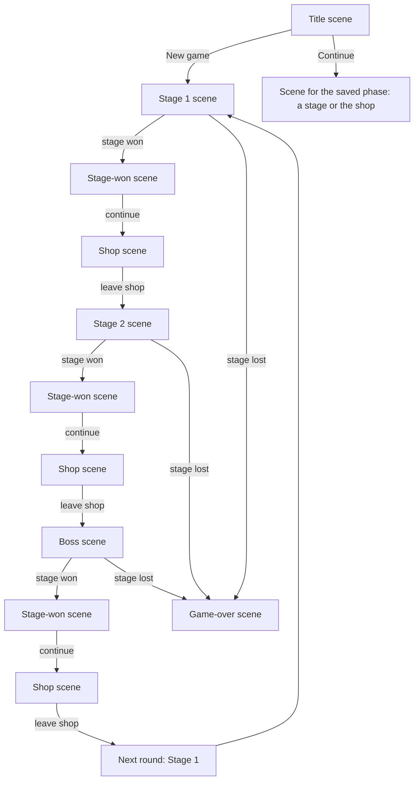

# Game architecture notes

Status: core principles agreed; the current drag-and-attach demo implements the initial spatial rules and the trait container. The general trait event/effect design is still open.

## Game concept

Poker Blocks will be a puzzle game in the style of poker solitaire. Its main source of interest should be the unexpected ways players can combine reusable game features.

A basic block represents one of the 52 cards in a standard deck. An `identifiable` trait holds its rank and suit and answers shared identity queries. Every geometric face of its cube shows that same identity; geometric faces are distinct from behavior traits. The identity model should later admit special cards unique to this game.

The deck is the collection of cards currently possessed. At the start of this game's demo, one card is drawn for the large center block and five other cards are drawn into the hand. The hand is a list of five cards. All six draws are distinct, leaving 46 cards in the deck. The five hand blocks are one-third the size of the center block and appear in a row at the bottom of the screen. Reloading deals a new set.

The five-card starting hand is a rule for Poker Blocks.

## Agreed principles

- Composability takes priority when designing game mechanics.
- A block is defined by data and configured trait instances. Block types do not own behavior code.
- Behavior code lives in reusable traits. Each trait instance carries configuration for its block.
- The game engine should run traits through shared rules and events. It should not branch on specific block types or implement one-off block behavior.
- The same holds at every level, not only blocks: no code branches on a phase, scene, room, mode, screen, material, kind or id, and no code reads a trait as a flag (`if (traits.x)`). A trait brings its behaviour with it. This is enforced by `src/guardrails.test.ts` and by review; see AGENTS.md, "No special cases".
- The same trait can be attached to multiple block definitions with different configurations, and multiple traits can be attached to one block.

## Examples

- `additiveScore` has a numeric amount configured per block, such as `+5`.
- `scorable` supplies a block's base numeric score as trait configuration. Standard cards use 2–10 as printed, J = 11, Q = 12, K = 13 and A = 14. Hand recognition reads card identity; line scoring reads the scorable value of each contributing block. Future blocks can configure a different value without adding a scoring branch for their type.
- `identifiable` supplies rank and suit and reusable queries such as `isFaceCard()`, `isNumberCard()`, and `hasSuit(suit)`. Standard cards derive these answers from one identity configuration rather than storing duplicate flags: J/Q/K are face cards, 2–10 are number cards, and Ace is neither category. Special card identities can extend the same query vocabulary.
- `explosive` destroys its block and adjacent blocks; its configured scalar controls the strength or reach. The exact meaning of that scalar is undecided.

These names and payloads are examples, not a frozen API.

## Core runtime

Four small modules under `src/core/` carry the trait pattern. They are independent of cards and of rendering, and none of them knows about a specific trait.

`registry.ts` is a named collection of definitions with unique names. `register` throws on a duplicate name and `get` throws on an unknown one, so a double import or a misspelled reference fails loudly rather than silently overwriting or returning nothing. It holds no gameplay meaning of its own; it is the lookup that lets definitions stay plain data while behavior lives elsewhere.

`emitter.ts` is a minimal named-event channel with `on`, `emit`, `listens`, and `clear`. Every dispatch iterates a snapshot of the listener set, so a listener may subscribe or unsubscribe during a dispatch without disturbing it.

`trait.ts` defines what a trait is. `defineTrait` takes a name, default settings, an optional `setup`, and an optional per-frame `update`, and returns the definition. `trait(def, settings)` builds a type-checked settings override for one attachment.

`block.ts` is the container. A block holds an id, a map of attached traits, and an event channel. It has no gameplay code of its own: `add` merges the override over the trait's defaults and runs `setup`, `remove` runs the attachment's cleanup, and `update` ticks every attached trait each frame.

## Trait configuration pattern

A trait is a reusable behavior plus the configuration that makes it concrete. A block is a list of configured trait entries, and no block type carries behavior code.

The configuration has three properties that the container enforces:

1. Settings are merged over `structuredClone(defaults)`, so every attachment owns its settings object and mutating one block's configuration cannot affect another block using the same trait.
2. `setup` may return a cleanup function, or a `TraitInstance` with its own `update` and `dispose`. Per-attachment runtime state closes over the trait's own locals, so it needs no `WeakMap` and no field reserved on the block.
3. Settings must stay plain, serializable data. This is what lets a block's configuration be inspected, compared, and eventually saved. Behavior belongs in the trait definition, not in a function stored in settings.

Traits are referenced by their definition object, not by a name string, so `add`, `has`, and `settingsOf` are fully typed and a missing trait is a compile error rather than a runtime lookup. Named data that definitions refer to each other by, such as an effect id, goes through `Registry` instead. Keeping the two mechanisms separate is deliberate: direct references get type checking, and string ids get data that can be authored and serialized.

Traits are detached in reverse order of attachment when a block is disposed, so a trait may rely on anything it was attached after.

The demo's pure helpers separate behavior from container wiring. `toggleBlockSelection`, `attachmentCell`, `faceFromNormal`, and `inspectBlock` are plain functions over plain state, and the trait wrapping one calls it rather than reimplementing it. This keeps a trait's rules testable without constructing a block, a scene, or a renderer.

### Traits whose settings hold a function

`inspectable` currently stores a closure, `inspectable(description)` returning `{ inspect }`. That fits the present struct-shaped block type but conflicts with the rule that settings stay serializable. When the trait is ported, the description becomes the trait's `defaults`, and the invocation belongs to the trait definition or to a trait-level function, not to per-block settings. Future traits should not store closures in `defaults`.

## Selectable trait

A block with the `selectable` trait can respond to a player click or tap. The trait toggles that block's selected state; selecting one block does not clear other selections. Clicking the same block again unselects it. Hand blocks carry this trait. Playing a block removes `selectable` from its field instance and clears its selection, while leaving `inspectable` intact. A block drawn into a later hand regains `selectable`. Selection is separate from identity: the card remains the same rank and suit. The toggle behavior belongs to the trait, not to a particular card or block type.

The current visual cue is face illumination only. Selection does not change a block's size or position, so connected cubes remain aligned. True bloom remains an option if a softer glow is wanted later.

What an operation does to the selected cards is still to be decided.

## Inspectable trait

An inspectable trait instance implements `inspect(): string`. The hover UI calls that method and displays its result beside the pointer for a block in the hand or in play. Standard cards configure the trait with their rank and suit name. Future block types can provide their own description through the same trait, with no tooltip behavior on the block itself.

## Attachable trait and dealer

The `attachable` trait lists the faces of a block that may accept another block: `north`, `south`, `east`, `west`, `up`, and `down`. Standard cards allow all six. A face can accept a dragged hand block only when its neighboring grid cell is empty. The block snaps face-to-face into that cell, leaves the hand, and becomes part of the structure. Any exposed face of any placed block can be used; dragging the structure reveals its other sides.

The dealer is a rule system, rather than a block. After a successful attachment it draws from the remaining deck until the hand contains five cards, or the deck is empty. The six starting cards and all subsequent draws remain unique.

When dragging a hand block starts, the structure's wobble slows to one-tenth of normal over half a second. On drop or cancel it eases back over half a second. Small numeric easing helpers live in `src/easing.ts` for later animations.

The hand is rendered as a fixed overlay with its own camera. Only the structure uses the perspective board camera. After a block attaches, the board camera waits one second, then eases over two seconds to a distance calculated from the grid's bounding box, so the growing structure stays visible. The hand's size and position do not follow that camera move.

All standard cubes currently have equal mass. The structure keeps a running sum of block grid positions and divides by the block count to find its true center of gravity after each attachment. The rotation pivot moves to that center while preserving the existing block positions. The structure gently oscillates on two axes around the pivot instead of spinning continuously. Dragging any placed block rotates the structure on horizontal and vertical axes; the oscillation continues around the new orientation. A click without dragging still toggles selection.

## Stage overlay and discard area

Each stage starts at score 0 with the target, plays and discards from the session configuration. A successful attachment consumes one play and scores the field. Dropping a hand card into the fixed two-dimensional discard area, marked by a pixel art bin, adds it to the discard pile and consumes one discard. The dealer refills the hand after either action. Invalid drops consume nothing.

The deck count appears at the lower right. The counters and discard area stay fixed on screen while the board camera moves.

## Game state and dealer

`GameState` is the single source of truth for the field, hand, deck, discard pile, and round counters. Each zone holds the actual card blocks, not a count of them. The field pairs each block with its grid cell. The UI's Three.js objects, animations, and selection highlights remain presentation state outside `GameState`.

The canonical domain terms are in [terms.md](terms.md): a **stage** is one score-target game and a **round** contains three stages, each followed by a shop. Within a round, the deck and discard pile persist across stages and shops, while the dealer resets the field and sets fresh play and discard allowances for each stage. Cards discarded in an earlier stage stay unavailable in later stages of that round.

The stage opens with an empty field and a dealer-filled hand. The player may discard before placing anything. The first play is a drag from the hand into the empty field, creating the centre block and consuming one play.

`GameRun` owns progression through stage one, shop, stage two, shop, boss stage, shop, and the next round. It selects the active dealer and target score for each stage, asks that dealer to set the stage's field and allowances, and carries the deck and discard pile across the three stages. Its snapshot includes the current round, phase, and stage that opened a shop for save/Continue.

A registered dealer reads `GameState` to decide whether a move is legal and returns the next state after a play or discard. The base dealer owns the current five-card hand, six plays, four discards, provisional target score of 100, opening deal, face attachment rules, and hand refill. `GameRun` holds the active dealer and current state; switching to another registered dealer preserves the exact state value. A future boss dealer can change rule methods without moving cards between zones or adding boss checks to the scene.

## Placement and card appearance

After a hand cube is dropped on an attachable face, its screen position is mapped through the board camera into the play scene. The same cube becomes a child of the rotating assembly and moves, turns, and grows toward the target cell in assembly-local coordinates over one second using the shared easing helper. Because the cube and target share a parent, the destination follows the board's wobble throughout the flight. Its hand slot remains empty during that second. The dealer refills that slot when the placement finishes, and the new cube materializes with a Perlin noise shader adapted from `../shrew_farmer/src/hud/materialise.ts`.

A discarded hand cube dissolves with the same shader over one second before its slot refills. The discard effect runs backwards from the appearance effect. Other hand cubes stay in their slots during either animation. Reduced-motion settings shorten the effect and use a fade.

## Field visual effects (proposal)

Field visual effects are presentation behaviors, separate from gameplay effects such as adding score or destroying blocks. The current `tintRow` effect temporarily colors a scoring line gold. A future field effect registry could resolve named requests with target block IDs and visual parameters such as color, intensity, duration, and easing. The same mechanism could later draw glows, bursts, or explosions for unrelated game events.

Gameplay resolves first. A presentation coordinator may turn the resulting events into field visual effect requests, but the visuals never determine score or mutate `GameState`. An explosive trait, for example, would use gameplay effects to remove blocks and a separate field effect request to show an explosion. Multiple temporary effects and persistent selection illumination need a defined visual composition policy so one highlight does not erase another; that policy is still open.

After each play, scoring calculates all line scores first, filters out zero-point lines, and orders the remainder from lowest to highest. Presentation then steps through that ordered result, tinting each row gold and playing a `score.magnitude.*` sound chosen for its points. The scorer does not call shaders or audio directly.

## Passive registry and triggers (design)

The proposed event order, reaction contract, and effect boundaries are specified in [game-events.md](game-events.md). The current game has only a general event emitter; it does not implement that gameplay contract yet.

Passive definitions live in a named registry with a stable id, display name, visual design or icon, and a trait reference. The passive itself is a block instance in the ordered `GameState.passiveRack`. Behavior code belongs to reusable traits, not the block instance or an ad hoc function attached to one registry entry. A trait may listen for gameplay events such as block placement, apply a condition, produce a gameplay effect such as coins proportional to the placed card's rank, and request separate presentation effects.

The passive trait declares its event subscriptions; it need not respond to every event. A reaction may also request a further named gameplay event. The run's passive event queue delivers that event after the current one and applies a loop guard, preserving deterministic ordering and preventing recursive callbacks. The `?mode=dev2` sandbox draws two distinct active passives at each fresh start. Do Nothing remains a retired registry definition solely so older saves can load and replace it without losing the card run.

Passives may react throughout the stage or session, not only during scoring. The engine should expose named lifecycle events with explicit timing and context: for example, before the first play in a stage, before/after a block is placed, before/after one line is scored, after all lines are scored, and when a stage is won or lost. These are examples, not an exhaustive event list. A passive's trait checks its configured condition against the event and returns gameplay effects; an event may also lead to separate sound or visual requests. This gives designers callback-like trigger points without storing arbitrary callback code on individual blocks.

Timing matters: a trait that changes a block's base value or a line's points must run at a defined pre-score point, while a reaction to a finalized `lineScored` event sees the completed result. An `allLinesScored` reaction sees the aggregate after the line pass. Victory and loss reactions need an explicit place relative to the dealer's outcome check. The pure line scorer remains free of lifecycle dispatch; a coordinator invokes it within the larger event/effect sequence. The exact event vocabulary and resolution rules are still to be specified.

Trigger usage is configurable per passive: unlimited, a fixed count, or one-shot. Remaining uses are instance state; exhausting them can destroy the passive. Passives are not discardable. A separate sell interaction can remove an installed passive at any time and award coins without using a stage discard. The rack size, sale values, and installation flow remain open.

The proposed hand and passive rack are ordered zones in `GameState`. A generic reorder action would change item order when a block is dragged between slots in its own zone; it would not consume a play or discard. For passives responding to the same trigger, the default resolver would use a snapshot of rack order and apply their gameplay effects left to right. An explicitly defined timing rule could override that default. The renderer would reflect the new order but would not decide effect order itself.

## Line scoring

`src/scoring.ts` holds pure scoring primitives with no UI, sound or state changes. `findScoringLines` returns every maximal gap-free run of two or more placed blocks along X, then Y, then Z, with its cells and blocks in cell order. `scoreLine` returns one line's numeric score, and `evaluateLine` adds the hand type and the ids of the cards that counted. Card points come from the configured `scorable` trait (`src/traits/scorable.ts`), never from the block type. `scoreField` scores every line, and `presentationOrder` drops zero-point lines and sorts the rest lowest first.

After each successful play the base dealer adds the points of every line on the field to the running total. `roundOutcome` reports the stage as won once the total reaches the target and lost when plays run out short of it; the dealer then refuses further plays and discards. The formula and its provisional edge rules are in `doc/game.md`.

When the placed card lands, the scene presents each scoring line from lowest to highest: the reusable `tintRow` effect flashes its blocks gold, the `score.magnitude.*` sound for its points plays (`src/score-presentation.ts`), and its points are added to the displayed score. The stage result and its sound follow the last line.

## Session controller

`GameRun` (`src/game-run.ts`) controls one run: stage 1 → shop → stage 2 → shop → boss stage → shop → next round. It holds the round number, the phase (a stage, `shop` or `over`), the stage that opened the current shop, the active dealer and the current `GameState`. `advance()` opens a shop after any won stage and sets the phase to `over` on a loss. `leaveShop()` starts the next stage, or stage 1 of the next round after a boss. The shop can be skipped without spending coins. `snapshot()` preserves the completed stage so Continue leaves a restored shop for the right destination; older boss-only shop saves still lead to the next round.

Each stage's dealer, target, plays and discards come from a `RunRules` (`src/run-rules.ts`), not from the scene. The config also names the open rules as explicit options: what happens to the hand at a stage boundary, and whether the discard pile returns to the deck after the boss-stage shop. Earlier shops do not recycle discards. `demoRunRules` holds the documented placeholders.

A dealer's `startStage` returns the field to the deck, sets the stage's counters and fills the hand. The field starts empty, and the first play needs no target: `placementFor` returns the centre cell when the field is empty. In the scene, dropping a hand block anywhere above the hand on an empty field plays it at the centre. When a stage is decided, a button in the round panel offers the next step (next stage, shop, next round or a new game), and taking it clears the table and deals the new hand.

## Ordered zones and hand reordering

`GameState.hand` is the source of truth for hand order; the scene's hand slots always follow it (`syncHandSlots`). `src/zones.ts` provides `moveItem` and `insertAt` for any ordered zone, so the future passive rack can reuse them. `GameRun.reorderHand(from, to)` moves a card without changing counters, score or any other zone, and `refillHand(slot)` puts a drawn card in the gap left by the card just played or discarded.

In the scene, a dragged hand card that is over the hand area (the bottom of the screen, where neither a field face nor the discard area applies) previews its new position: the other cards glide aside. Dropping there reorders the hand, plays `hand.reorder` and autosaves; dropping on a field face or the discard area still plays or discards. The passive rack itself, and resolving passives in rack order, wait for the passive implementation (issue #4).

## Card room and shadows

`src/visual/card-room.ts` sets the board scene in a dim card room: a procedurally drawn backdrop (warm panelled walls, lamp glow, vignette) and a round green baize table with a wooden rim. No image assets are used. The table is fixed in the world rather than in the rotating pivot; each frame it eases to sit just below the structure's bounding sphere and grows with it, so the structure can still turn freely above it. An overhead lamp (a directional light above and slightly in front) casts soft PCF shadows onto the baize and between cubes. Its shadow camera is re-fitted around the structure as it grows. The hand keeps its own neutral light in a separate scene and stays a fixed overlay.

The **Shadows** setting chooses high (2048 px shadow map), low (1024 px) or off; automatic picks low on touch-first devices and high elsewhere. Changing it rebuilds materials, since shadow support is compiled into them.

## Title, settings and saving

The page opens on a title screen (`src/menus.ts`) over the empty table. **Continue** appears only when a valid saved run exists and resumes it exactly; **New game** asks for confirmation first if it would replace a save; **Settings** opens the settings screen. A settings button at the top of the game screen (or Escape) opens the same screen during play, and Back returns to wherever it was opened from. When a run is lost, the HUD's "New game" returns to the title screen. The screens are DOM overlays that cover the scene, so the board takes no input while one is open.

Settings (`src/settings.ts`) are sound volume, mute, sound effects on/off, music on/off (both under the master mute, which silences everything and greys out the two toggles), motion (follow system, reduced or full) and shadows (automatic, high, low or off). They apply immediately and persist in `localStorage` under `poker-blocks.settings`; invalid stored values fall back to defaults field by field.

The run is saved automatically (`src/save.ts`) at safe points only: when a placement or discard has finished resolving, after a stage transition, and when a run starts or resumes. The record is versioned and stores card ids rather than `CardBlock` objects, because some traits hold functions and the deck definition is the source of truth:

```json
{
  "version": 1,
  "round": 1,
  "phase": "stage-2",
  "dealer": "base",
  "state": {
    "field": [{ "cardId": "7-hearts", "cell": { "x": 0, "y": 0, "z": 0 } }],
    "hand": ["K-spades"],
    "deck": ["..."],
    "discardPile": ["..."],
    "round": { "score": 0, "targetScore": 150, "movesLeft": 6, "discardsLeft": 4 }
  }
}
```

Loading rebuilds the blocks from the standard deck and `GameRun.fromSnapshot` restores the session. A record with another version, an unknown phase or dealer, unknown or duplicate card ids, a missing card or malformed numbers is ignored, which hides Continue. A lost run (phase `over`) clears the save. All storage access is wrapped so the game still works, without Continue or remembered settings, when storage is unavailable.

## Modes, scenes and traits

### Concepts

- **Game mode** (`GameMode`): a named playable configuration. It lists scenes and a start scene, supplies mode-wide configuration such as save identity and optional game features, and declares its **run setup** as ordered steps in `runSetup`. Music is a behaved configuration (`traits.music`), not a bare property. The scene list is a catalogue of definitions, not a scene graph.
- **Scene** (`Scene`): a presentation context such as title, stage, shop, settings, stage-won or game-over. Scene data composes traits. `SceneManager` calls trait lifecycle hooks when scenes enter and exit.
- **Scene stack**: the runtime layers currently active. Settings and stage-won are pushed over gameplay and popped to resume it. Title and game-over replace the stack.
- **Game flow**: decisions about which scene follows an action or run outcome. Today `run-controller.ts` coordinates this using `GameRun.phase` and outcomes. The mode's `startScene` is not yet the authoritative transition graph.
- **GameRun**: live mutable state for one playthrough: cards, field, scoring, coins, passives and phase. It remains the same run while the scene stack changes. Its `snapshot()` method produces data that the run controller persists through `save.ts`.
- **RunRules**: progression and economy rules used to create a run. Mode traits may further configure its save key, starting deck and optional features.
- **Trait**: reusable behavior plus plain data, attached at a declared scope. A mode trait is not automatically copied onto each scene; composition between scopes must be explicit.
- **Services**: camera, input, hand, field, HUD, audio, overlays and console, exposed through narrow interfaces to behaviors.

- **Dev trait**: a trait that exists only for testing. Its name begins with `dev` (`devManualBlockDestroyer`), and only dev modes compose it.

### How they fit together

```text
main.ts ── builds ──> services + SceneManager + selected GameMode
GameMode ── catalogs ──> Scene definitions and start scene
run-controller ── coordinates ──> GameRun state and game flow
SceneManager ── owns ──> active scene stack; calls scene trait lifecycle hooks
RunRules + the mode's run setup ── create ──> GameRun
```

The Escape/settings menu is a scene pushed over gameplay. Popping it resumes the underlying scene. Stage-won is pushed while rewards are presented; the shop is a scene between stages while the same run persists. Title and game-over currently replace the stack. A future victory ending should be represented by a scene as well.

### Example: game progression is a flow

Flow answers **what happens next?** The run controller currently follows game events and run outcomes to choose the next scene, and the scene manager applies the stack change; the `GameRun` remains the same object as the player advances through stages and shops.



Here `stage-won` is a success presentation for one stage, not the end of a complete run. The current game repeats rounds, so it has no terminal run-victory screen. If a mode later has a finite objective, its flow can route the final successful outcome to a distinct **run-won scene**, just as a failed outcome routes to **game-over**. Both are flow destinations; the result scene itself is presentation.

### Example: title, game and Escape menu use a scene stack

The stack answers **what is currently layered on top of what?** Starting a new game replaces the title scene with the active stage scene. Opening Settings from gameplay pushes it above that stage. Closing Settings pops only the top item, revealing the same stage and run state underneath.

```mermaid
sequenceDiagram
  participant Player
  participant Flow as Run controller / flow
  participant Stack as SceneManager
  participant Stage as Stage scene
  participant Settings as Settings scene
  Player->>Flow: New game
  Flow->>Stack: replace(Stage)
  Stack->>Stage: enter traits
  Player->>Flow: Escape
  Flow->>Stack: push(Settings)
  Stack->>Settings: enter traits
  Note over Stack,Stage: Stage remains on the stack; scene-managed input and updates pause
  Player->>Flow: Close settings
  Flow->>Stack: pop()
  Stack->>Settings: exit traits
  Note over Stack,Stage: Stage is visible again; it is not re-entered
```

For each stack operation, the manager invokes `enter` on the newly active scene's composed traits and `exit` on traits of scenes removed from the stack. A push does not exit the scene underneath; a pop does not re-enter it. A replace exits the old stack and enters the replacement. Trait hooks can start or stop scene-owned behavior such as music, input handling or animation. In this code these hooks are named `enter` and `exit` (often called `onEnter` and `onExit` in engine APIs), and they belong to each trait attached to the scene rather than to a special callback on the stack item.

### Where the code is today

`src/scenes.ts` defines the scene-trait behavior registry and scene-stack manager. A switch exits the stack top-to-bottom and enters the replacement; push enters only the new top; pop exits only the top and resumes what is underneath. Updates run bottom-to-top unless blocked, and input dispatch runs top-to-bottom. DOM input routing is scaffolding: no current scene trait handles real input, so `pausesBelow.input` does not yet pause legacy DOM listeners.

`src/game-modes.ts` defines each mode's scene catalogue, start scene, run setup and mode traits. A mode's `startScene` is authoritative for the scene a fresh page opens on: `title` shows the title screen, and any other scene starts play straight away, resuming that mode's saved run. `?mode=` is canonical; `?room=` remains accepted as a legacy URL alias. Developer-console mode changes update the URL and switch in memory without reloading. The scene manager tracks screen transitions, while `run-controller.ts` still coordinates stage/shop progression from run phase and outcomes. This is an interim arrangement, not a mode-owned flow graph.

### Run setup

Run setup is what a game mode does to a **new** game run, and nothing else. It is ordered data on the mode (`runSetup: RunSetupStep[]`), not flags: a step is `{ step: "sandbox" }` or `{ step: "materialDeck", reshuffle: "new-game" }`. `src/run-setup.ts` holds the typed `RunSetupRegistry`, which pairs each step name with its own config type the same way `SceneTraitRegistry` pairs scene traits, and `src/run-setup-behaviours.ts` holds the behaviour. The steps compose in declared order in two passes:

- `prepare`, before the run is dealt: the `RunRules` it will be judged by, and the deck it is dealt from. `sandbox` widens the rules; `materialDeck` replaces the deck and records the seed it used.
- `start`, once the opening snapshot exists: what the run begins holding. `materialSample` puts a block of every material on the field, `passiveRack` fills the rack, and `shopPreview` opens the run in a stocked shop.

Continue never applies a step. A saved run is restored exactly as saved, and the deck it was dealt from is rebuilt from the `seed` recorded in its snapshot, so a mix kept until a new game matches after a reload. Saves written before run setup have no seed; they still load, against the mode's plain deck. Save-format changes go through explicit migration in `src/save.ts`.

The controller therefore calls the registry instead of branching on the mode. `modeTraits` keeps only mode-wide configuration: the save key, the console and restartable traits, the rack and shop configuration, the music style, and the testing-only destructible mix.

The extracted services own presentation and interaction. `main.ts` constructs and connects them; it does not decide what the player may do or which scene follows an outcome.

| Service                                 | Responsibility and current caller                                                                                                                                                                                                 |
| --------------------------------------- | --------------------------------------------------------------------------------------------------------------------------------------------------------------------------------------------------------------------------------- |
| `camera-view.ts`                        | Owns cameras, board pivot, framing, zoom, rotation and resize. `table-input.ts` uses it for gestures and picking; the run controller and presenter request camera transitions.                                                    |
| `audio-service.ts`                      | Owns music, player settings, gesture unlock and view sounds. The run controller reports game events; the mode's `music` trait selects ordinary or quiet music through `src/mode-music.ts`. Action sounds play at the action site. |
| `hud-panels.ts`                         | Builds round, deck, shop coin and exit panels, then renders a `HudView`. The run controller assembles the numbers; a scene shows or hides each panel through the `show`/`hide` API its own panel trait calls.                     |
| `console-host.ts`                       | Adapts the run controller's `ConsoleApp` and the audio service to developer-console commands. Mode switching updates the URL and opens the mode in memory.                                                                        |
| `overlays.ts`                           | Owns title, settings, game-over and stage-won menus, inspection tooltip and refused flash. The run controller supplies menu actions and scene-stack operations.                                                                   |
| `hand-view.ts` and `rendered-blocks.ts` | Own hand layout, motion, refills and cube rendering. The run controller chooses hand contents; the presenter animates accepted actions.                                                                                           |
| `field-view.ts`                         | Owns placed cubes, centre of mass, drop preview, first-play prompt, picking and row tints. Input obtains legal candidates through run rules and shows them through this service.                                                  |
| `table-input.ts`                        | Turns pointer gestures into plays, discards, reorders, selection, board rotation and zoom. Its `TableRules` comes from the run controller.                                                                                        |
| `table-renderer.ts`                     | Owns the WebGL scenes, lights, reflection environment, drag layer and frame drawing. The card room is its physical backdrop.                                                                                                      |
| `play-presenter.ts`                     | Animates accepted plays and discards, presents scoring lines and announces outcomes to the run controller.                                                                                                                        |

`src/run-controller.ts` completes the split. It owns the run and its mode: the `GameRun`, the mode configuration (run rules, deck and save key), starting, resuming and saving runs, moving between stages and the shop, following an announced outcome with the stage-won pop-up or game over, applying settings, and opening the start screen. It answers the other services through `rules` (input), `menus` and `screenScenes` (overlays) and `consoleApp` (the console). `src/scene-behaviours.ts` holds the behaviour each scene trait installs.

### Scene trait catalogue

`src/scene-behaviours.ts` registers each scene trait against its own config type, and a scene composes whichever subset it needs. Behaviour therefore comes from the scene in front, and a scene that gains or loses a trait leaves the others alone.

| Scene trait               | What it does while its scene is in front                                       | Composed by             |
| ------------------------- | ------------------------------------------------------------------------------ | ----------------------- |
| `screen`                  | Marks the host with the scene, for styling and tests.                          | Every scene.            |
| `roundPanel`              | Shows the round panel through the HUD service.                                 | Stage 1, stage 2, boss. |
| `deckPanel`               | Shows the deck counter through the HUD service.                                | Stage 1, stage 2, boss. |
| `coinsPanel`              | Shows the coin counter through the HUD service.                                | Shop.                   |
| `shopExit`                | Shows the shop's exit button through the HUD service.                          | Shop.                   |
| `fieldPlacement`          | Lets the input service play blocks onto the field.                             | Stage 1, stage 2, boss. |
| `shopStock`               | Shows the shop's stock, and lets its offers be bought, through the shop view.  | Shop.                   |
| `pausesBelow`             | Stops lower scenes taking input or updates while a pop-up or menu is open.     | Settings, stage-won.    |
| `devManualBlockDestroyer` | Testing only: destroys a double-clicked table block with the configured cause. | dev4's play scenes.     |

The numbers a panel shows are not the scene's: the run controller keeps handing the HUD service a `HudView` snapshot, and the traits only decide which panels exist. Likewise what a shop stocks is game-run state, chosen by run setup and held by `GameRun`; `shopStock` owns only its display and buying.

`src/main.ts` is the composition root. It may create the DOM host, construct services and the scene manager, connect their narrow interfaces, open the selected mode, run the frame loop and dispose resources. Rules and progression belong in the run controller; gestures in `table-input.ts`; presentation in services and scene traits. The comment at the top of `main.ts` records this boundary, and the architecture test guards it. The legacy branches moved into `src/run-controller.ts` remain in the guardrail baseline; removing them is #36's job.

The migration order is set out in epic #30: scene manager, trait lifecycle, services split, run-config/scene-trait split, scene rollout (Esc menu as pilot), removal of phase branches, and moving sequencing out of `GameRun`. A `console: { name }` trait lists a mode in the developer console, and a `restartable: { param }` trait makes it honour `&restart=true` (#38).

## Architecture to discuss

Settled: the data-only block definition, the trait container, the named registry, and the event channel described above. The demo's existing traits are still plain fields on a `CardBlock` struct and have not been ported onto the container yet; that port is what makes new traits like `additiveScore` and `explosive` a file each with no engine change.

Still open: the effect engine. A trait receives an event and a limited view of game state, then returns effects such as `addScore` or `destroyBlock`. The engine applies those effects in a defined order and emits any resulting events. Rendering reads game state separately.

This keeps behavior reusable, but the event and effect rules need deliberate design. Before implementing them, decide:

1. Which events traits can react to, and whether a trait can react to effects it caused.
2. How to order multiple traits and resolve simultaneous effects.
3. How chain reactions terminate and how to prevent accidental infinite loops.
4. What `explosive` strength means: radius, damage, number of targets, or something else.
5. How poker-hand scoring and spatial rules fit into the same composition model.
6. Whether a trait's `update` may mutate block state that another trait reads in the same frame, or whether changes must go through the event channel.
7. How to migrate the demo's current data-only `identity` field to the agreed `identifiable` trait without duplicating rank and suit state.
