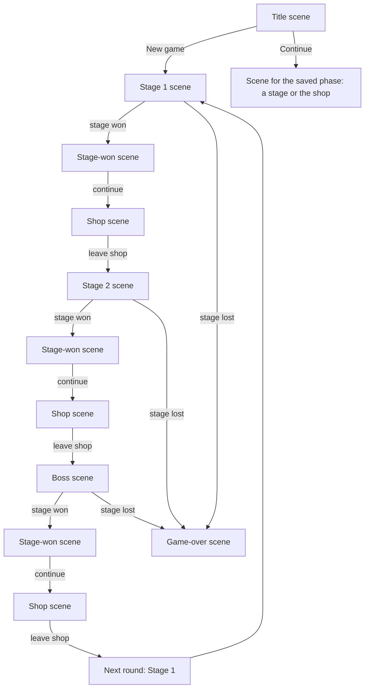

# Game architecture notes

Status: core principles agreed; the current drag-and-attach demo implements the initial spatial rules and the trait container. The general trait event/effect design is still open.

## Game concept

Poker Blocks will be a puzzle game in the style of poker solitaire. Its main source of interest should be the unexpected ways players can combine reusable game features.

A basic block represents one of the 52 cards in a standard deck. An `identifiable` trait holds its rank and suit and answers shared identity queries. Every geometric face of its cube shows that same identity; geometric faces are distinct from behavior traits. The identity model should later admit special cards unique to this game.

The deck is the collection of cards currently possessed. A new stage starts with an empty field. The base dealer draws six distinct blocks into the hand from a standard 52-card deck, leaving 46 in the deck at the start of a new run. The first play places the centre block on the field. The hand is rendered in a row at the bottom of the screen.

The base hand size is a tuning value in `src/balance.ts`; another dealer may set a different size.

## Agreed principles

- Composability takes priority when designing game mechanics.
- A block is defined by data and configured trait instances. Block types do not own behavior code.
- Behavior code lives in reusable traits. Each trait instance carries configuration for its block.
- The game engine should run traits through shared rules and events. It should not branch on specific block types or implement one-off block behavior.
- The same holds at every level, not only blocks: no code branches on a phase, scene, mode, screen, material, kind or id, and no code reads a trait as a flag (`if (traits.x)`). A trait brings its behaviour with it.
- **Identity is opaque.** A mode's or scene's id is a handle for lookup, save keys, URLs and display, never a key that selects behaviour: no `includes`/`has` on it, no table indexed by it, and no mode named outside `src/game-modes.ts`. A thing's data lives on its own definition, not in a side table keyed by its id or kind. Both rules are enforced by `src/guardrails.test.ts` and by review; see AGENTS.md, "No special cases".
- The same trait can be attached to multiple block definitions with different configurations, and multiple traits can be attached to one block.

## Examples

- `additiveScore` has a numeric amount configured per block, such as `+5`.
- `scorable` supplies a block's base numeric score as trait configuration. Standard cards use 2–10 as printed, J = 11, Q = 12, K = 13 and A = 14. Hand recognition reads card identity; line scoring reads the scorable value of each contributing block. Future blocks can configure a different value without adding a scoring branch for their type.
- `identifiable` supplies rank and suit and reusable queries such as `isFaceCard()`, `isNumberCard()`, and `hasSuit(suit)`. Standard cards derive these answers from one identity configuration rather than storing duplicate flags: J/Q/K are face cards, 2–10 are number cards, and Ace is neither category. Special card identities can extend the same query vocabulary.
- `explosive` destroys its block and adjacent blocks; its configured scalar controls the strength or reach. The exact meaning of that scalar is undecided.

These names and payloads are examples, not a frozen API.

## Core runtime

Four small modules under `src/core/` carry the trait pattern. They are independent of cards and of rendering, and none of them knows about a specific trait.

`registry.ts` is a named collection of definitions with unique names. `register` throws on a duplicate name and `get` throws on an unknown one, so a double import or a misspelled reference fails loudly rather than silently overwriting or returning nothing. It holds no gameplay meaning of its own; it is the lookup that lets definitions stay plain data while behavior lives elsewhere.

`emitter.ts` is a minimal named-event channel with `on`, `emit`, `listens`, and `clear`. Every dispatch iterates a snapshot of the listener set, so a listener may subscribe or unsubscribe during a dispatch without disturbing it.

`trait.ts` defines what a trait is. `defineTrait` takes a name, default settings, an optional `setup`, and an optional per-frame `update`, and returns the definition. `trait(def, settings)` builds a type-checked settings override for one attachment.

`block.ts` is the container. A block holds an id, a map of attached traits, and an event channel. It has no gameplay code of its own: `add` merges the override over the trait's defaults and runs `setup`, `remove` runs the attachment's cleanup, and `update` ticks every attached trait each frame.

## Trait configuration pattern

A trait is a reusable behavior plus the configuration that makes it concrete. A block is a list of configured trait entries, and no block type carries behavior code.

The configuration has three properties that the container enforces:

1. Settings are merged over `structuredClone(defaults)`, so every attachment owns its settings object and mutating one block's configuration cannot affect another block using the same trait.
2. `setup` may return a cleanup function, or a `TraitInstance` with its own `update` and `dispose`. Per-attachment runtime state closes over the trait's own locals, so it needs no `WeakMap` and no field reserved on the block.
3. Settings must stay plain, serializable data. This is what lets a block's configuration be inspected, compared, and eventually saved. Behavior belongs in the trait definition, not in a function stored in settings.

Traits are referenced by their definition object, not by a name string, so `add`, `has`, and `settingsOf` are fully typed and a missing trait is a compile error rather than a runtime lookup. Named data that definitions refer to each other by, such as an effect id, goes through `Registry` instead. Keeping the two mechanisms separate is deliberate: direct references get type checking, and string ids get data that can be authored and serialized.

Traits are detached in reverse order of attachment when a block is disposed, so a trait may rely on anything it was attached after.

The demo's pure helpers separate behavior from container wiring. `toggleBlockSelection`, `attachmentCell`, `faceFromNormal`, and `inspectBlock` are plain functions over plain state, and the trait wrapping one calls it rather than reimplementing it. This keeps a trait's rules testable without constructing a block, a scene, or a renderer.

### Traits whose settings hold a function

`inspectable` currently stores a closure, `inspectable(description)` returning `{ inspect }`. That fits the present struct-shaped block type but conflicts with the rule that settings stay serializable. When the trait is ported, the description becomes the trait's `defaults`, and the invocation belongs to the trait definition or to a trait-level function, not to per-block settings. Future traits should not store closures in `defaults`.

## Selectable trait

A block with the `selectable` trait can respond to a player click or tap. The trait toggles that block's selected state; selecting one block does not clear other selections. Clicking the same block again unselects it. Hand blocks carry this trait. Playing a block removes `selectable` from its field instance and clears its selection, while leaving `inspectable` intact. A block drawn into a later hand regains `selectable`. Selection is separate from identity: the card remains the same rank and suit. The toggle behavior belongs to the trait, not to a particular card or block type.

The current serialized block shape uses trait keys. `block-trait-behaviours.ts` resolves those keys through registered behavior objects owned by the trait modules. Selection, cursor, drag eligibility, attachable faces, destruction causes, and transparency handover call the resulting capabilities without inspecting which trait provided them. A new trait can register a capability without changing those consumers. This is a transition toward the definition-object model above; the trait key is only a registry lookup, never a branch in the caller.

The current visual cue is face illumination only. Selection does not change a block's size or position, so connected cubes remain aligned. True bloom remains an option if a softer glow is wanted later.

What an operation does to the selected cards is still to be decided.

## Inspectable trait

An inspectable trait instance implements `inspect(): string`. The hover UI calls that method and displays its result beside the pointer for a block in the hand or in play. Standard cards configure the trait with their rank and suit name. Future block types can provide their own description through the same trait, with no tooltip behavior on the block itself.

## Attachable trait and dealer

The `attachable` trait lists the faces of a block that may accept another block: `north`, `south`, `east`, `west`, `up`, and `down`. Standard cards allow all six. A face can accept a dragged hand block only when its neighboring grid cell is empty. The block snaps face-to-face into that cell, leaves the hand, and becomes part of the structure. Any exposed face of any placed block can be used; dragging the structure reveals its other sides.

The dealer is a rule system, rather than a block. After a successful attachment it draws from the remaining deck until the hand contains six cards, or the deck is empty. The six opening hand blocks and all subsequent draws remain unique.

When dragging a hand block starts, the structure's wobble slows to one-tenth of normal over half a second. On drop or cancel it eases back over half a second. Small numeric easing helpers live in `src/easing.ts` for later animations.

The hand is rendered as a fixed overlay with its own camera. Only the structure uses the perspective board camera. After a block attaches, the board camera waits one second, then eases over two seconds to a distance calculated from the grid's bounding box, so the growing structure stays visible. The hand's size and position do not follow that camera move.

All standard cubes currently have equal mass. The structure keeps a running sum of block grid positions and divides by the block count to find its true center of gravity after each attachment. The rotation pivot moves to that center while preserving the existing block positions. The structure gently oscillates on two axes around the pivot instead of spinning continuously. Dragging any placed block rotates the structure on horizontal and vertical axes; the oscillation continues around the new orientation. A click without dragging still toggles selection.

## Stage overlay and discard area

Each stage starts at score 0 with the target, plays and discards from the session configuration. A successful attachment consumes one play and scores the field. Dropping a hand card into the fixed two-dimensional discard area, marked by a pixel art bin, adds it to the discard pile and consumes one discard. The dealer refills the hand after either action. Invalid drops consume nothing.

The deck count appears at the lower right. The counters and discard area stay fixed on screen while the board camera moves.

## Game state and dealer

`GameState` is the single source of truth for the field, hand, deck, discard pile, and round counters. Each zone holds the actual card blocks, not a count of them. The field pairs each block with its grid cell. The UI's Three.js objects, animations, and selection highlights remain presentation state outside `GameState`.

The canonical domain terms are in [terms.md](terms.md): a **stage** is one score-target game and a **round** contains three stages, each followed by a shop. Within a round, the deck and discard pile persist across stages and shops, while the dealer resets the field and sets fresh play and discard allowances for each stage. Cards discarded in an earlier stage stay unavailable in later stages of that round.

The stage opens with an empty field and a dealer-filled hand. The player may discard before placing anything. The first play is a drag from the hand into the empty field, creating the centre block and consuming one play.

`GameRun` owns progression through stage one, shop, stage two, shop, boss stage, shop, and the next round. It selects the active dealer and target score for each stage, asks that dealer to set the stage's field and allowances, and carries the deck and discard pile across the three stages. Its snapshot includes the current round, phase, and stage that opened a shop for save/Continue.

A registered dealer reads `GameState` to decide whether a move is legal and returns the next state after a play or discard. The base dealer owns the current six-block hand, six plays, four discards, provisional target score of 100, opening deal, face attachment rules, and hand refill. `GameRun` holds the active dealer and current state; switching to another registered dealer preserves the exact state value. A future boss dealer can change rule methods without moving cards between zones or adding boss checks to the scene.

## Placement and card appearance

**Model first (owner rule, 2026-11-10).** User input commits to the model immediately, and animation catches up. An animation can take seconds, but the play has already happened: presentation never gates or delays a rule outcome. This applies to every input (plays, discards, purchases, sales). #272 implemented it for drops, discards and passive sales, replacing the #167 rule in which a drop waited for the last animation. The epic #271 restructures input so each thing handles its own input (a gesture router plus input owners registered by traits), following this rule.

**The drop contract (#167, #272).** A hand card, with any selected cards it carries, can be picked up at any time, including while earlier plays or discards are still animating. When it's dropped, each carried card ends up exactly once: played at the candidate, discarded, moved within the hand, or put back.

- **A drop commits at once (model first, #272).** It goes to the rules immediately, even while earlier plays are still being shown. Their animations and this one catch up with the model: the presenter keeps every play and discard in flight in a list. Each play's scoring lines are captured when it commits and queued behind any still being shown (`queueScoreSteps`), so plays that land close together score one after another. A stage outcome's pop-up waits until all of it has been shown.
- **The rules decide immediately.** A drop the current state refuses (the stage was just won by the play before it, say) goes back to the hand with the `action.denied` sound. Discards and passive sales commit at once too.
- **Nothing waits for an animation.** No drop is held, and no new drag is blocked, while something is being shown.

- **Hit-testing follows the game state, not the animation.** When a play is accepted, the field records each played block as an invisible stand-in at its final cell (`FieldView.expect`), which the real block replaces when it lands. A drop made while that block is still flying can attach to it, or finds the face it now covers taken. The empty-field check uses `occupiedCells()` for the same reason. `cells()` still means landed blocks, which is what the camera frames.

Before #167, a pointer down during an animation was silently ignored. A quick drag after a play did nothing, while the empty field's first-play prompt looked like a drop preview.

After a hand cube is dropped on an attachable face, its screen position is mapped through the board camera into the play scene. The same cube becomes a child of the rotating assembly and moves, turns, and grows toward the target cell in assembly-local coordinates over one second using the shared easing helper. Because the cube and target share a parent, the destination follows the board's wobble throughout the flight. Its hand slot remains empty during that second. The dealer refills that slot when the placement finishes, and the new cube materializes with a Perlin noise shader adapted from `../shrew_farmer/src/hud/materialise.ts`.

A discarded hand cube dissolves with the same shader over one second before its slot refills. The discard effect runs backwards from the appearance effect. Other hand cubes stay in their slots during either animation. Reduced-motion settings shorten the effect and use a fade.

Material appearance is defined on each material definition in `src/materials.ts`: printed ink, face pattern, relief, surface, geometry, edges, optical settings and the transparent trait attachment. `src/visual/block-appearance.ts` is a generic builder that dispatches named pattern, surface, relief, geometry and assembly handlers from that configuration. The same definition is used by blocks in hand, in the field and in the shop. A new material may combine existing handlers without changing the builder; a genuinely new visual technique gets one new registered handler. Material gameplay effects remain separate and are tracked in #8 and #63.

**Filled vessels and visual experiments (#227).** The `filledVessel` assembly (`src/visual/filled-vessel.ts`) draws a hollow, clear vessel part-filled with a viscous fluid, configured entirely by a material's `appearance.vessel` data. That data sets the fill and surface colours, the level, a settle time constant, a trace time constant and opacity, the shell's opacity and the wall thickness. No code names the material. Custard is the first such material.

- **How it works:** it is a lightweight approximation, not a fluid simulation. A copy of the block's shape is cut by a flat surface: fragments above it are discarded, and back faces seen through the cut are shaded flat, so the cut reads as the fluid's top. Each frame, the surface's normal eases toward "up" in the block's own space (the world's up, turned back by the block's rotation), using an exponential with the settle time constant. The fluid therefore levels slowly, without splashing or overshooting.
- **Wall trace:** a second normal follows the surface more slowly. Inner wall that lies below that old surface but above the current one is tinted faintly. As the old surface catches up, the band shrinks to nothing, so the trace fades. Exact volume is not preserved as the block tilts.
- **Where it can appear:** experimental materials live in `experimentalMaterials`, not `materialDefinitions`. No shop, reward, material sample or attract sequence ever deals them, and they carry no scoring, prices or rewards. A developer mode deals one only by asking: `materialDeck` with the `registered` pool (dev0 deals every registered material, so a new experiment appears there automatically), or the `uniformMaterialDeck` run setup step; the developer mode `dev6` (sandbox play, every card custard) is the only one that does. `src/visual/filled-vessel.test.ts` checks that no file in `src/visual` names an experimental material, and that experiments stay out of gameplay.
- **Shared simulations (#230):** blocks of one effect type show one simulation result. `src/visual/shared-simulation.ts` is a generic registry: `sharedSimulations.acquire(config, create)` returns the simulation for a configuration object (a material's appearance data), creating it on first use. It is released when the block's material is disposed, and dropped when no block uses it. A simulation advances at most once per frame, keyed on the frame's timestamp (`document.timeline.currentTime`), however many blocks render it. The vessel simulation keeps the fluid's surface and trace as world-space normals. It is driven by the rotation of the first block drawn each frame; blocks on the table all share the structure's rotation. Each block turns that result into its own space, so placement and orientation stay per block while the simulation runs once. `src/visual/shared-simulation.test.ts` checks one simulation and one step per frame for many blocks, separate configurations kept apart, identical results at one orientation, and the same world surface at another. It also guards that the per-block vessel factory gets its simulation from the registry. The flame core needs nothing more: it is a stateless shader of the shared clock, so every flame already looks identical. A future flame particle system should acquire its simulation the same way.
- **Performance:** each vessel adds three meshes (inner wall, fluid and trace) and two transparent layers (shell and trace), and the fluid is double-sided. That is more overdraw than an opaque block, and transparent sorting can occasionally flicker where vessels overlap. The shaders are cheap: one dot product and a discard, with no textures or extra render passes. A table full of vessels on a low-end phone is the case to watch. If it struggles, the first savings are to drop the trace mesh and use the outer shell alone.

**Random amounts in rules (#97).** A scoring effect's amount can be a registered **value source** (`fixed`, `roll`) instead of a number. Dice are just `add-line-score { amount: { valueSource: "roll", sides: N } }` on the `score.afterLineClamp` phase. The rules are resolved once per scoring resolution, before candidate hands are compared, using the run's seeded random source. No controller rolls dice or knows that a die exists; `src/dice.test.ts` checks that no die name or dice field appears in the run, the controller, the scorer or the rule runner. The token's polyhedral shape comes from #125's registered shapes and applies to passive tokens only.

**The beat signal (#255).** `src/audio/beat-signal.ts` tells presentation where the music is, so visuals can follow it.

- **Where the numbers come from:** each frame it reads `musicPlayer.position(performance.now())`. That comes from the shared beat clock, which is built from each loop's registered `tempo_bpm` and `first_beat_seconds`; nothing analyses audio.
- **Heard time:** the position is taken at the time actually being heard, through `AudioContext.getOutputTimestamp()`, falling back to `currentTime` less the output latency.
- **What it gives:** a continuous `beat`, `beatPhase` and `barPhase` (each 0–1), `bar`, `tempo`, and an `energy` from 0 to 1. Energy eases up while music plays and down when it stops, so movement settles instead of freezing. Muted music keeps its energy, because its clock still runs.
- **Events:** `beat` and `bar` fire once when a frame crosses a line, never as a burst after a long frame, and not when a track change re-anchors the clock.
- **Bar length:** the player now uses each loop's `beats_per_bar` (4 when absent) for bar alignment and crossfade length.
- **Scope:** presentation only; rules and scoring never read it. The `danceToBeat` trait (#256) is its first consumer.

**Dancing (#256).** Things move with the music by joining the **dance floor** (`src/dance/dance-floor.ts`).

- **Dancers:** a dancer names the cycle it follows (`halfBeat`, `beat`, `bar` or `twoBars`, a registry of cycle lengths) and an optional `offset` in beats. It implements `dance(move)`, which is called every frame with its `phase` through that cycle, the music's `energy` and the `tempo`.
- **What a dance may change:** the dancer decides. Usually that's its appearance, but not always. The floor never asks what a dancer is.
- **Shapes:** pure functions of phase, from 0 to 1, in a registry keyed by name (`src/dance/beat-shapes.ts`): `sine`, `pulse`, `bounce`, `gate` and `saw`.
- **Resting:** with no music, or with reduced motion, `energy` is 0, so dancers settle.
- **The first dancer is the ghost cube.** `firstPlayPrompt`'s `dance` data (cycle, shape, offset, swell) makes its prompt join the floor. For now a dance affects only the ghost's **size**: a sawtooth over the bar, growing steadily through each bar and dropping back to its base size on the downbeat (`{ cycle: "bar", shape: "saw", swell: 0.12 }`). Its glow keeps its own idle pulse. A prompt without `dance` never joins.

**Action history and the drop inspector (dev10).**

- **The action log** (`src/action-log.ts`) is a record of the last 30 seconds of interaction events and callbacks; anything older is thrown away, however many entries remain. Each entry has a `performance.now()` time and the main loop's frame number, and runs of pointer moves are folded into one entry. It records only while a scene composing the **`actionHistory`** trait is showing.
- **What `actionHistory` records:** raw pointer and window events, every change in the watched state (animating, presenting, dragging, a held drop, model blocks against drawn ones), and the input's decisions, which arrive through the input's optional `trace` hook. The game passes the hook nothing outside the log, and tracing never changes behaviour.
- **The copy button:** `actionHistory` adds a **Copy action history** button, which puts the log on the clipboard as plain text. A header carries the version, mode, screen, scene stack and current state. It's meant for pasting into a bug report after a drag-and-drop failure.
- **The drop inspector:** **`devDropInspector`** is a live panel of the same state and the newest entries.
- **Where they're composed:** both traits are composed only into dev10, a development-only sandbox room. Composing `actionHistory` into a main mode's scenes would record there too.

## Input (#284, epic #271)

**Each thing handles its own input.** Pointer, touch and wheel input is turned into intents by a generic layer, and every decision about what those intents _mean_ belongs to the thing they're aimed at, through traits composed into scenes. The vocabulary is the industry's: HTML5 drag and drop and React DnD for dragging, Flutter and UIKit for gestures.

- **Gesture arena and recognizers** (#282). When a pointer goes down, every **gesture recognizer** that could claim it joins the **gesture arena**: a tap (select), a drag from a drag source, a rotation of the grid, and a pinch with a second finger. Each **withdraws** when movement rules it out, or **declares victory** when its own rule is met (moved past its threshold, a second finger arrived, held long enough). The last one standing wins. Thresholds and priorities are recognizer data. The winner receives the **gesture lifecycle**: **began, changed, ended, cancelled**. Every owner must handle **cancelled** by putting its things back.
- **Library: dnd-kit** (`@dnd-kit/dom`, the framework-free core; owner decision on #286, 2026-11-10). dnd-kit's `DragDropManager` and **sensors** do the drag and drop:
  - the pointer sensor's activation constraints (distance and delay) settle tap versus drag, which is our arena for drags;
  - the keyboard sensor gives keyboard drag and drop;
  - our `dragSource` and `dropTarget` traits are a thin adapter registering dnd-kit draggables and droppables;
  - the 3D grid gets a custom collision detector over the existing raycasting.

  The version is pinned while dnd-kit is pre-1.0. #282 carries out the change.

- **Library: use-gesture** (`@use-gesture/vanilla`; owner decision, 2026-11-10) handles the **board gestures**, which dnd-kit doesn't: dragging empty board to turn the structure, **pinch** zoom (mapped logarithmically) with two-finger **twist** to rotate, and **wheel** zoom (#275). **Who takes a pointer:** where it lands decides. A pointer on a drag source is dnd-kit's; one on empty board, or a second finger, is use-gesture's.

- **Drag sources** (`dragSource` trait, #276, #277): things that can be picked up (the hand, the passive rack, the shop stock). A drag source says what is picked up under a pointer and what comes with it (the selection, say).
- **Drop targets** (`dropTarget` trait, #273): places dragged things can be dropped (the grid, the bin, the hand for reordering, the rack, the shop's BUY). While something is dragged, the **drag-and-drop manager** (`src/drag-drop.ts`) **hit-tests** the drop targets a scene allows, in priority order:
  - `canDrop` answers **accept**, **reject** (the point is the target's, but it won't take them) or nothing (ask the next target);
  - the target shows **hover** feedback;
  - on **drop**, the target commits to the model; a rejected drop triggers the target's **reject** feedback.
- **The input service** (`src/table-input.ts`) is only the manager and the arena: pointer tracking, capture, touch, carrying and hit-testing. It never names an owner, a scene or a kind of block. What a scene allows is exactly the set of owners its traits register. The remaining on/off switches (`setFieldActive`, `handEntered`, `discardBinEntered`, `sellBinEntered`) are retired by #278.
- **Model first** (#272). Input commits to the model immediately; animation catches up. No input is held back for an animation.
- **Browser behaviour** (#267, #283).
  - Pointer capture can be lost before the release arrives, so a drag that loses capture waits briefly for its release before cancelling, and that applies to every owner.
  - The game surface sets `touch-action: none`, suppresses native `dragstart`, and has no text selection or long-press callouts.
  - Pinch zoom is logarithmic.
- **Debugging.** The action history (dev10, `actionHistory` trait) traces every input decision with timestamps. It's the regression tool for input changes: capture the same gestures before and after a change and compare the decisions.

## Field visual effects (proposal)

Field visual effects are presentation behaviors, separate from gameplay effects such as adding score or destroying blocks. The current `tintRow` effect temporarily colors a scoring line gold. A future field effect registry could resolve named requests with target block IDs and visual parameters such as color, intensity, duration, and easing. The same mechanism could later draw glows, bursts, or explosions for unrelated game events.

Gameplay resolves first. A presentation coordinator may turn the resulting events into field visual effect requests, but the visuals never determine score or mutate `GameState`. An explosive trait, for example, would use gameplay effects to remove blocks and a separate field effect request to show an explosion. Multiple temporary effects and persistent selection illumination need a defined visual composition policy so one highlight does not erase another; that policy is still open.

After each play, scoring calculates all line scores first, filters out zero-point lines, and orders the remainder from lowest to highest. Presentation then steps through that ordered result, tinting each row gold and playing a `score.magnitude.*` sound chosen for its points. The scorer does not call shaders or audio directly.

## Passive registry and triggers (design)

The proposed event order, reaction contract, and effect boundaries are specified in [game-events.md](game-events.md). The current game has only a general event emitter; it does not implement that gameplay contract yet.

Passive definitions live in a named registry with a stable id, display name, visual design or icon, and a trait reference. The passive itself is a block instance in the ordered `GameState.passiveRack`. Behavior code belongs to reusable traits, not the block instance or an ad hoc function attached to one registry entry. A trait may listen for gameplay events such as block placement, apply a condition, produce a gameplay effect such as coins proportional to the placed card's rank, and request separate presentation effects.

The passive trait declares its event subscriptions; it need not respond to every event. A reaction may also request a further named gameplay event. The run's passive event queue delivers that event after the current one and applies a loop guard, preserving deterministic ordering and preventing recursive callbacks. The `?mode=dev2` sandbox draws two distinct active passives at each fresh start. Do Nothing remains a retired registry definition so a save naming it still resolves; `fromSaveRecord` drops it rather than keeping a slot with no effect.

Passives may react throughout the stage or session, not only during scoring. The engine should expose named lifecycle events with explicit timing and context: for example, before the first play in a stage, before/after a block is placed, before/after one line is scored, after all lines are scored, and when a stage is won or lost. These are examples, not an exhaustive event list. A passive's trait checks its configured condition against the event and returns gameplay effects; an event may also lead to separate sound or visual requests. This gives designers callback-like trigger points without storing arbitrary callback code on individual blocks.

Timing matters: a trait that changes a block's base value or a line's points must run at a defined pre-score point, while a reaction to a finalized `lineScored` event sees the completed result. An `allLinesScored` reaction sees the aggregate after the line pass. Victory and loss reactions need an explicit place relative to the dealer's outcome check. The pure line scorer remains free of lifecycle dispatch; a coordinator invokes it within the larger event/effect sequence. The exact event vocabulary and resolution rules are still to be specified.

Trigger usage is configurable per passive: unlimited, a fixed count, or one-shot. Remaining uses are instance state; exhausting them can destroy the passive. Passives are not discardable. A separate sell interaction can remove an installed passive at any time and award coins without using a stage discard. The rack size, sale values, and installation flow remain open.

The proposed hand and passive rack are ordered zones in `GameState`. A generic reorder action would change item order when a block is dragged between slots in its own zone; it would not consume a play or discard. For passives responding to the same trigger, the default resolver would use a snapshot of rack order and apply their gameplay effects left to right. An explicitly defined timing rule could override that default. The renderer would reflect the new order but would not decide effect order itself.

## Passive categories

Each passive category is a trait, and the **category facet** (`src/passive-categories.ts`) is the set of them. A **facet** is a group of traits of which a block composes exactly one. Every passive composes exactly one category trait, and a test enforces it. A category trait brings presentation defaults (block colours, an appearance finish, an activation visual and sound, and for Scoring an accent tint from its operations) and no behaviour: gameplay rule evaluation never reads it, and a test enforces that too. A definition's own `palette` overrides the default.

## The HUD frame and the table's layers (#116)

The table draws as layers, bottom to top: the **back canvas** (room and table, with the blocks' shadows on the baize), the **HUD frame** and its panels (DOM), the **front canvas** (the playfield blocks, then the hand, then a dragged block), and then the passive rack, shop overlays and menus. `src/table-renderer.ts` renders the back pass with only the room's layer, letting each shadow-casting block stand in with an invisible material so its shadow still falls on the table. It then renders the blocks, hand and drag on the transparent front canvas, which never takes input: pointers pass through to the HUD's controls and, beyond them, to the back canvas, where the table input listens. Zoom moves the board's camera, so the room and blocks zoom together while the frame, hand and rack stay put.

The **HUD frame** (`src/hud-frame.ts`) is one full-screen grid of named zones inside the safe area: `top-left`, `top-center` (the passive rack), `top-right`, `bottom-left`, `bottom-center` (the hand) and `bottom-right`, with the middle left to the playfield or the shop's stock. It is a layout surface, not a clipping mask, and it knows nothing about scenes or modes: a service places its element in a zone, and scene traits keep showing and hiding panels as before. Landscape is the only layout so far, and on landscape screens a control placed in a zone flows into it. **The gameplay HUD** (#117) is placed from one table, `gameplayHudZones` in `src/hud-layout.ts`: the round panel (stage, score, target, moves, discards, coins) and the coin panel top left, the menu button top right, the Discard bin bottom left and the deck counter bottom right. `src/main.ts` places each element from that table, so no panel positions itself and nothing depends on scene or mode; each panel's scene trait still decides whether it shows. On landscape screens every element in a zone flows into it. The passive rack keeps the top centre without being in the frame, because it is drawn over the blocks. The deck counter becomes the way into the deck view in #175. The shop uses the same frame: coins top left, menu top right, rack top centre, BUY and SELL bottom left, hand bottom centre, and Continue bottom right (#118). **The shop's stock** is a circular scatter (#122, `src/shop-scatter.ts`): a round area in the middle, with each offer centred on a predefined spot. There is one hand-placed arrangement per stock size from 5 to 9 (an even ring for other sizes), so there is no runtime randomness. Offers are squares `spotSize` radii across. No two are closer than that across or down, and each corner stays inside the circle; `src/shop-scatter.test.ts` checks this for every size. The area is never smaller than 232px, so each offer keeps a 44px touch target. The area sits clear of the passive rack. An offer keeps its spot when others are bought (`createScatterPlacer`), so nothing jitters, and a new stock is laid out afresh. On short screens the name is shortened with an ellipsis but the price always shows. **Layouts** (#119): the frame has a landscape and a portrait layout, chosen by the player's **Layout** setting (Settings, saved with the other settings; Landscape by default, including for settings saved before it existed). The run controller applies it with `hudFrame.setLayout`. **Automatic** (#120, the default, including for settings saved before it existed) picks landscape when the viewport's width-to-height ratio is above `landscapeAspect` (1.25) and portrait below it, re-evaluated on every resize or turn. A ratio exactly at the threshold keeps the current layout, so it never flips. The threshold is above 1 so that narrow landscape windows such as 600×510, which have no room beside the rack for the landscape layout, get portrait (#238) (`resolveLayout` in `src/settings.ts`). A fixed Landscape or Portrait choice is never overridden by the device's orientation. Either way the frame's CSS is keyed on its `data-layout` only, never on an orientation media query (`src/hud-frame.test.ts` checks this). Portrait gives the passive rack a band across the top, puts status and Settings in the row under it, and puts the bottom corner zones in a row above the hand, which spans the bottom band. The landscape layout keeps clear of what is drawn outside the frame: `--hud-hand-clear` (the full-width hand on a tall screen) lifts its bottom corners, and `--hud-rack-clear` (the rack on a narrow screen) lowers its top corners. These measure space on this screen; they never choose the layout.

## Shop offer kinds (#67)

A shop offer is plain data, `{ kind, block }`. What a kind means is registered once in `src/offer-kinds.ts`: its price (from the run's rules and the balance config), the drop target that buys it (`hand` or `passive-rack`), what buying adds to the run, what leaving the shop does with it unbought, and how it's saved and restored. The shop view registers how each kind is drawn and named (`registerOfferView` in `src/shop-view.ts`), and the run controller shows a purchase by its destination. Nothing compares `offer.kind`; a new kind registers its handlers and needs no other edit (a test registers one). A save naming an unknown kind is invalid.

## Balance config and resale

Tuning numbers live on the definition they belong to, never in a side table keyed by identity: a passive's `shop` balance (base price, unlock round) is on its definition (#7), and its block carries the base price as a `priced` trait. `validatePassiveBalance` (`src/balance.ts`) checks every definition's balance in one place, and a test requires one for every passive the shop can stock. Prices are fixed data; anything that changes a price is a modifier applied on top. Selling uses `resaleValue` (`src/resale.ts`): the default policy (half the `priced` base price, rounded down, at least 1), then `RunRules.resaleModifiers` in order. That list is the extension seam for future sale-modifying passives. The sale transaction (`GameRun.sellPassive`) asks the policy; the drop target and the run controller never compute a payout, and a test checks they don't.

## Line scoring

**Materials (#8, #141):** a card's material is a block trait. Its scoring effect is a `scoringModifier` trait (`additive`, `multiplicative`, `exponential`) whose values come from its material definition. It contributes event rules to the same queue as passives (#63): additive on `score.beforeBlockValue`, multiplicative on `score.lineMultiply`, and exponential on `score.linePower`, for contributing cards only. The line scorer supplies contributor IDs and never names a material; see `doc/game.md`, "Material scoring", for the order of operations. Material definitions also configure their own scoring activation pulse, accent and sound (#212); the presenter uses reported rule source IDs as each line is shown.

**Gold (#107, #218):** Its material definition adds 1 to a contributing card's base value through the shared scoring rule, with a pulse and registered sound when that rule activates. The same definition configures a reusable `handReward` of 2 coins per Gold still in hand at stage settlement. `GameRun.claimStageRewards` collects material hand rewards once on both wins and losses, before `advance` returns the hand to the deck or ends the run. A win ledger places its material row after the completion bonus and before passive rows; a loss has only the material row. Gold Standard is an independent `stage.won` passive that adds 1 coin per held Gold on a win. The saved paid-stage marker prevents repeat payouts after Continue, and malformed saved coin/reward data is rejected. Gold's +1 value, 2-coin rate and round-4 shop unlock live on its material definition and are validated centrally. Held-card scoring remains deferred.

`src/scoring.ts` holds pure scoring primitives with no UI, sound or state changes. `findScoringLines` returns every maximal gap-free run of two or more placed blocks along X, then Y, then Z, with its cells and blocks in cell order. `scoreLine` returns one line's numeric score, and `evaluateLine` adds the hand type and the ids of the cards that counted. Card points come from the configured `scorable` trait (`src/traits/scorable.ts`), never from the block type. `scoreField` scores every line, and `presentationOrder` drops zero-point lines and sorts the rest lowest first.

After each successful play the base dealer adds the points of every line on the field to the running total. `roundOutcome` reports the stage as won once the total reaches the target and lost when plays run out short of it; the dealer then refuses further plays and discards. The formula and its provisional edge rules are in `doc/game.md`.

When the placed card lands, the scene presents each scoring line from lowest to highest: the reusable `tintRow` effect flashes its blocks gold, the `score.magnitude.*` sound for its points plays (`src/score-presentation.ts`), and its points are added to the displayed score. The stage result and its sound follow the last line.

## Session controller

`GameRun` (`src/game-run.ts`) controls one run: stage 1 → shop → stage 2 → shop → boss stage → shop → next round. It holds the round number, the phase (a stage, `shop` or `over`), the stage that opened the current shop, the active dealer and the current `GameState`. `advance()` opens a shop after any won stage and sets the phase to `over` on a loss. `leaveShop()` starts the next stage, or stage 1 of the next round after a boss. The shop can be skipped without spending coins. `snapshot()` preserves the completed stage so Continue leaves a restored shop for the right destination; older boss-only shop saves still lead to the next round.

Each stage's dealer, target, plays and discards come from a `RunRules` (`src/run-rules.ts`), not from the scene. The opening target and each ordered stage's incoming multiplier live in `stageTargetBalance` (`src/balance.ts`); `targetForStage` walks the sequence and rounds after every step. The config also names the open rules as explicit options: what happens to the hand at a stage boundary, and whether the discard pile returns to the deck after the boss-stage shop. Earlier shops do not recycle discards. Plays, discards and the boss dealer remain demo placeholders.

A dealer's `startStage` returns the field to the deck, sets the stage's counters and fills the hand. The field starts empty, and the first play needs no target: `placementFor` returns the centre cell when the field is empty. In the scene, dropping a hand block anywhere above the hand on an empty field plays it at the centre. When a stage is decided, a button in the round panel offers the next step (next stage, shop, next round or a new game), and taking it clears the table and deals the new hand.

## Ordered zones and hand reordering

`GameState.hand` is the source of truth for hand order; the scene's hand slots always follow it (`syncHandSlots`). `src/zones.ts` provides `moveItem` and `insertAt` for any ordered zone, so the future passive rack can reuse them. `GameRun.reorderHand(from, to)` moves a card without changing counters, score or any other zone, and `refillHand(slot)` puts a drawn card in the gap left by the card just played or discarded.

In the scene, a dragged hand card that is over the hand area (the bottom of the screen, where neither a field face nor the discard area applies) previews its new position: the other cards glide aside. Dropping there reorders the hand, plays `hand.reorder` and autosaves; dropping on a field face or the discard area still plays or discards. The passive rack itself, and resolving passives in rack order, wait for the passive implementation (issue #4).

## Card room and shadows

`src/visual/card-room.ts` sets the board scene in a dim card room: a procedurally drawn backdrop (warm panelled walls, lamp glow, vignette) and a round green baize table with a wooden rim. No image assets are used. The table is fixed in the world rather than in the rotating pivot; each frame it eases to sit just below the structure's bounding sphere and grows with it, so the structure can still turn freely above it. An overhead lamp (a directional light above and slightly in front) casts soft PCF shadows onto the baize and between cubes. Its shadow camera is re-fitted around the structure as it grows. The hand keeps its own neutral light in a separate scene and stays a fixed overlay.

The **Shadows** setting chooses high (2048 px shadow map), low (1024 px) or off; automatic picks low on touch-first devices and high elsewhere. Changing it rebuilds materials, since shadow support is compiled into them.

## Title, settings and saving

The page opens on a title screen over the empty table. The title is a **scene**: its `titleScreen` trait shows the panel as the scene enters and hides it on exit, and its items are declared there with the condition each one needs, so **Continue** appears only when a valid saved run exists (`hasSave`) and resumes it exactly; **New game** asks for confirmation first if it would replace a save; **Settings** dispatches the `openSettings` navigation action. `src/menus.ts` renders those items and routes each choice to a title command or a navigation action; it does not decide which appear.

A `panelFooter` trait adds the build's version and links out to the panel in front (#129). The destinations are configured once in `src/game-modes.ts` (`projectHome`, `projectLinks`), not written into the menu code: the title shows the version with both links, and the pause menu shows the version and the bug-report link. The version is `appVersion` from `src/version.ts`, derived from the commits since the last release, so the panel always names the build actually running. Escape, or the ⚙ button during play, opens the **pause menu** (Resume, Settings, and Quit to title during a run), and Back returns to wherever Settings was opened from. When a run is lost, the HUD's "New game" returns to the title screen. The screens are DOM overlays that cover the scene, so the board takes no input while one is open.

Settings (`src/settings.ts`) are sound volume, mute, sound effects on/off, music on/off (both under the master mute, which silences everything and greys out the two toggles), motion (follow system, reduced or full) and shadows (automatic, high, low or off). They apply immediately and persist in `localStorage` under `poker-blocks.settings`; invalid stored values fall back to defaults field by field.

The run is saved automatically (`src/save.ts`) at safe points only: when a placement or discard has finished resolving, after a stage transition, and when a run starts or resumes. The record is versioned and stores card ids rather than `CardBlock` objects, because some traits hold functions and the deck definition is the source of truth:

```json
{
  "version": 1,
  "round": 1,
  "scene": "stage-2",
  "dealer": "base",
  "state": {
    "field": [{ "cardId": "7-hearts", "cell": { "x": 0, "y": 0, "z": 0 } }],
    "hand": ["K-spades"],
    "deck": ["..."],
    "discardPile": ["..."],
    "round": { "score": 0, "targetScore": 525, "movesLeft": 6, "discardsLeft": 4 }
  }
}
```

Loading rebuilds the blocks from the mode's starting deck and `GameRun.fromSnapshot` restores the session. A corrupt or incompatible record is rejected, which makes Continue unavailable. This includes another version, an unknown scene or dealer, unknown or duplicate card IDs, a missing card, malformed numbers or seed, and a material deck without the seed needed to reconstruct its original cards. A lost run clears the save. All storage access is wrapped so the game still works, without Continue or remembered settings, when storage is unavailable.

### Card identity across Continue (#214)

`toSaveRecord` writes card IDs and order for the hand, deck and discard pile, and card ID plus cell for the field. `fromSaveRecord` resolves those IDs against the mode's starting deck and the run's `boughtCards` ledger. A normal starting deck is rebuilt from `standardDeck`: each ID maps to its current rank and suit, with paper as its default material. A mode's `materialDeck` step rebuilds its material mix from the saved deck seed using `makeDevDeck`; the seed, rather than each starting card's material, is serialized. With the same deck definitions and seed, the card in each zone returns with the same rank, suit and material. The field copy loses only its selectable trait.

Newly bought cards differ: `boughtCards` serializes each card's ID, rank, suit and material in full. Card shop stock also saves these four fields through its offer kind; a passive offer saves its own definition and ID. `restoreCard` rebuilds a card from the saved rank, suit and material definition. Unknown ranks, suits or materials invalidate the save rather than silently changing the card. `fromSaveRecord` also rejects unknown or duplicate card IDs and requires every owned card to appear in exactly one of field, hand, deck or discard pile. Old borrowed-card offers saved only by ID are returned to the deck and removed from stock on load.

The starting deck's rank and suit mapping and the material assignment algorithm are **current code**, not frozen in the record. Changing either while retaining an ID can change a starting card after Continue. A material-deck record without a valid seed is rejected before starting-card IDs are resolved (#216). The mode's run-setup registry declares which deck steps require a saved seed, so an unseeded standard-deck run remains valid. Invalid present seeds are rejected in every mode. A regression guardrail compares ID, rank, suit and material across the field, hand, deck and discard pile after JSON save/load; bought cards and offers are covered by their own save tests. Future changes to the starting deck or material algorithm that break reconstruction require a save version or migration decision rather than silently remapping identities.

## Modes, scenes and traits

### Concepts

- **Game mode** (`GameMode`): a named playable configuration. It lists scenes and a start scene, supplies mode-wide configuration such as save identity and optional game features, and declares its **run setup** as ordered steps in `runSetup`. Music is a mode trait (`traits.music`) whose behaviour lives in `src/mode-music.ts`. The scene list is a catalogue of definitions, not a scene graph.
- **Scene** (`Scene`): a presentation context such as title, stage, shop, settings, stage-won or game-over. Scene data composes traits. `SceneManager` calls trait lifecycle hooks when scenes enter and exit.
- **Scene stack**: the runtime layers currently active. Settings and stage-won are pushed over gameplay and popped to resume it. Title and game-over replace the stack.
- **Game flow**: outcome-keyed scene-stack transitions declared by a mode. `GameRun` reports its current run-position outcome; `run-controller.ts` applies the mode's transition through `src/game-flow.ts`. Menu actions and stage results still have legacy presentation paths pending the screen-scene slices.
- **GameRun**: live mutable state for one playthrough: cards, field, scoring, coins, passives and phase. It remains the same run while the scene stack changes. Its `snapshot()` method produces data that the run controller persists through `save.ts`.
- **RunRules**: progression and economy rules used to create a run. Mode traits may further configure its save key, starting deck and optional features.
- **Trait**: reusable behavior plus plain data, attached at a declared scope. A mode trait is not automatically copied onto each scene; composition between scopes must be explicit.
- **Services**: camera, input, hand, field, HUD, audio, overlays and console, exposed through narrow interfaces to behaviors.

- **Dev trait**: a trait that exists only for testing. Its name begins with `dev` (`devManualBlockDestroyer`), and only dev modes compose it.

### How they fit together

```text
main.ts ── builds ──> services + SceneManager + selected GameMode
GameMode ── catalogs ──> Scene definitions and start scene
run-controller ── coordinates ──> GameRun state and game flow
SceneManager ── owns ──> active scene stack; calls scene trait lifecycle hooks
RunRules + the mode's run setup ── create ──> GameRun
```

The pause menu is a scene pushed over gameplay or the title, and Settings is a scene pushed over either. Popping it resumes the underlying scene. Stage-won is pushed while rewards are presented; the shop is a scene between stages while the same run persists. Title and game-over currently replace the stack. A future victory ending should be represented by a scene as well.

### Example: game progression is a flow

Flow answers **what happens next?** The run controller currently follows game events and run outcomes to choose the next scene, and the scene manager applies the stack change; the `GameRun` remains the same object as the player advances through stages and shops.



Here `stage-won` is a success presentation for one stage, not the end of a complete run. The current game repeats rounds, so it has no terminal run-victory screen. If a mode later has a finite objective, its flow can route the final successful outcome to a distinct **run-won scene**, just as a failed outcome routes to **game-over**. Both are flow destinations; the result scene itself is presentation.

### Example: title, game and Escape menu use a scene stack

The stack answers **what is currently layered on top of what?** Starting a new game replaces the title scene with the active stage scene. Escape pushes the pause menu above that stage; choosing Settings pushes Settings above the pause menu. Back pops only the top item, revealing the pause menu, and Resume pops that, revealing the same stage and run state underneath.

```mermaid
sequenceDiagram
  participant Player
  participant Flow as Run controller / flow
  participant Stack as SceneManager
  participant Stage as Stage scene
  participant Settings as Settings scene
  Player->>Flow: New game
  Flow->>Stack: replace(Stage)
  Stack->>Stage: enter traits
  participant Pause as Pause scene
  Player->>Flow: Escape (keyAction: openPause)
  Flow->>Stack: push(Pause)
  Stack->>Pause: enter traits (menu, low-pass)
  Note over Stack,Stage: Stage remains on the stack; scene-managed input and updates pause
  Player->>Flow: Settings (menu item: openSettings)
  Flow->>Stack: push(Settings)
  Stack->>Settings: enter traits (panel, high-pass)
  Player->>Flow: Back
  Flow->>Stack: pop()
  Stack->>Settings: exit traits
  Stack->>Pause: resume traits (menu again, low-pass again)
  Player->>Flow: Resume
  Flow->>Stack: pop()
  Stack->>Pause: exit traits (menu hidden, filter cleared)
  Note over Stack,Stage: Stage is visible again; it is not re-entered
```

For each stack operation, the manager invokes `enter` on the newly active scene's composed traits and `exit` on traits of scenes removed from the stack. A push does not exit the scene underneath; a pop does not re-enter it, but calls its traits' `resume` hooks so they can restore what the popped scene changed (the `screen` trait puts back `host.dataset.scene`). A replace exits the old stack and enters the replacement. Trait hooks can start or stop scene-owned behavior such as music, input handling or animation. In this code these hooks are named `enter` and `exit` (often called `onEnter` and `onExit` in engine APIs), and they belong to each trait attached to the scene rather than to a special callback on the stack item.

### Menus as scenes (#87)

The pause menu is the pilot for screens as scenes. It is the `pause` scene, composed of four traits:

- **`menu { label, items }`** shows a menu of items while the scene is in front and hides it on exit. An item is `{ id, label, when?, enabledWhen?, disabledHint? }`. `when` decides whether it appears; `enabledWhen` keeps it visible but disabled (greyed, with `disabledHint` on hover, choosing it plays `action.denied`), as Continue is with no save. `when` names a **menu condition** from a registry in `src/scene-behaviours.ts`. `inRun` holds while a scene composing the `runInPlay` trait (the stages and the shop) is on the stack, so Quit to title appears only during a run; no scene is identified by name. Choosing an item dispatches its `id` as a named action; the menu never decides what happens.
- **`pausesBelow`** stops input and updates reaching the scene underneath.
- **`musicFilter { kind }`** filters the music while the scene is in front: `lowpass` muffles it (the pause menu), `highpass` thins it (Settings), both with the 550 Hz cut-off and a two-second ease. A scene pushed over it replaces the filter with its own, and `resume` restores it; exit clears it.
- **`musicCue { cue }`** plays a named music cue as the scene enters; the audio service keeps each cue's handler. The title composes `title`, game over `windDown`, and the shop `resumeTable` (the table's music as the mode plays it, for a shop entered from the title). Play scenes start their own music with `musicTrack`. No "screen" tells the audio service what to play any more (#179).
- **`gameOverScreen { items }`** shows the game over screen while the scene is in front: the run's totals (`RunController.runStats`) and one button per item, each dispatching its id like a menu item. Exit hides it. The run controller only follows the flow to the `game-over` scene; it never opens the screen itself (#90).
- **`stageWonScreen { next }`** shows the stage-won pop-up while the scene is in front: the won stage's paid reward rows counting in (`RunController.stageReward`), then a button for `next` (`leaveStage`, "Visit shop"), which dispatches its id. Exit closes the pop-up. The run controller pays the rewards (gameplay) and then follows the flow outcome `run.stage.won`, which the standard flow maps to pushing `stage-won` (#91).
- **`musicTrack { pool }`** starts a fresh track as a play scene comes in front: the stages ask for the `stage` pool (a random vibe), the boss for the `boss` loop (#92). Covering and uncovering the scene (the pause menu) doesn't restart it, and quiet modes keep their stages silent. The pools are data in `src/audio/music-plan.ts`; nothing chooses music by phase or scene name.
- **`firstPlayPrompt { colour, pulseSeconds, armed, release }`** (`src/scene-traits/first-play-prompt.ts`) is the ghost cube that invites a stage's first play. All of its behaviour lives in the trait: its meshes, when it shows, its idle pulse, its response while a dragged block is over its cell ("armed": brighter, breathing larger), and its release when the first block is played (an outline that grows and fades). Reduced motion keeps each response without the movement. It asks the table only generic questions through `FirstPlayTable`: where the first play would go, how many blocks are on the field, which cell a drag would play into, whether anything is busy, and where to put a model. The play scenes compose it with the game's settings; the title doesn't, so it never shows there. The field's ordinary drop preview marks only attachments to a block, so on an empty table the trait's ghost is the only preview. `src/scene-traits/first-play-prompt.test.ts` guards that no prompt code remains in the field view, the run controller or `main.ts`.
- **`enterSound { sfx }`** plays a sound as its scene comes in front: `round.start` for the stages and boss, `shop.open` for the shop, `ui.title.enter` and `ui.settings.enter` for the title and settings screens. **`exitSound { sfx }`** plays one as its scene leaves the stack: `ui.title.exit` and `ui.settings.exit`. Settings therefore plays no sound on its own Back button or Escape key; leaving it is the sound. **`shopEntrance`** runs the shop's camera entrance (#19) on entering, unless motion is reduced (#93). The run controller no longer asks whether the run is in the shop to choose either.
- **`keyAction { key, action }`** dispatches a named action for a key, once per press (a held key's auto-repeat is ignored). Escape opens the pause menu from the title, the stages and the shop, resumes from the pause menu, and goes back from Settings. Keys reach the scenes from the window after bubbling, so a focused field or the open developer console handles them first.

**Actions.** `RunController.dispatch(action)` carries out a named action. A **navigation action** (`openPause`, `openSettings`, `back`, `resume`) is mode data: `GameMode.navigation` maps each one to a stack operation, applied by the same `followFlow` as the game flow. A **game action** (`quitToTitle`, `newRun`, `leaveStage`) runs its handler in the run controller. A menu item may name the sound its button plays (`sfx`, `ui.click` by default). The Settings scene composes `settingsPanel`, which shows and hides the Settings panel (`src/settings-panel.ts`, #89): its own controls, kept in step with the player's settings, with Back dispatching the `back` navigation action. Settings no longer has a music track of its own; its `musicFilter` thins whatever is playing.

### Run rules and the game flow (#94)

`GameRun` holds the rules state and reports the run's position (`positionOutcome`); the mode's flow decides which scene that shows. No stage is special in `GameRun`: the round is the ordered `stageKinds`, its last stage is simply the last one, and a round ends when play leaves that stage's shop. What happens to the hand when a stage ends and to the discard pile when a round ends are handler tables keyed by the run rules' options (`handAtStageEnd`, `discardPileAfterShop`). The stage-target balance data carries each stage's incoming multiplier, and the run rules compute targets from it without a kind-keyed table. `GameRun` still has run phases, including the shop position, until #36 removes them.

### Scene definitions

A scene is defined **once**, in `sceneDefinitions` (`src/game-modes.ts`): a name and the traits every copy of it composes. A mode does not keep its own catalogue. `composeScenes(modeId, additions)` gives the mode every shared definition under its own scene ids, each with a `screen` trait first, and a mode adds traits to the scenes it names (dev4 adds `devManualBlockDestroyer` to `playScenes`). Additions never change the shared definition. A new scene is a new entry in `sceneDefinitions`; no code is keyed by scene name.

**Scene ids** are `<mode id>/<scene name>` (`modeSceneId`), because every mode's scenes share one scene manager. A save records only the **scene name**: the save key already names the mode.

**Saves and the flow (#86).** A save writes `scene`, the name of the scene the mode's flow shows for the run's position, and no `phase`. Loading reads the flow in reverse: the run position whose transition shows that scene. A scene no resumable position shows (game over, or an unknown name) invalidates the save, so a renamed scene needs no code change. Saves written before this have `phase` and migrate explicitly (`legacyPhaseScenes` in `src/save.ts`): `stage-1`, `stage-2` and `boss` to the matching scene; `shop` to the shop scene, with `shopAfter` defaulting to `boss`; `over` to none, which clears the save; and an unknown phase invalidates it. That table is the one sanctioned phase-keyed lookup (`// branch-ok: #86`), and goes once no legacy saves remain.

### Where the code is today

`src/scenes.ts` defines the scene-trait behavior registry and scene-stack manager. A switch exits the stack top-to-bottom and enters the replacement; push enters only the new top; pop exits only the top and resumes what is underneath. Updates run bottom-to-top unless blocked, and input dispatch runs top-to-bottom. DOM input routing is scaffolding: no current scene trait handles real input, so `pausesBelow.input` does not yet pause legacy DOM listeners.

`src/game-modes.ts` defines each mode's scene catalogue, start scene, outcome-keyed flow, run setup and mode traits. `startScene` opens first on page load; a restored run then reports its position outcome so the mode flow can select its saved scene. The mode's `onLoad` handler chooses whether to show the title, start a new run, resume a saved run or show its configured start scene without creating a run (the developer balance editor). `?mode=` is canonical; `?room=` remains accepted as a legacy URL alias. Developer-console mode changes update the URL and switch in memory without reloading. `src/game-flow.ts` dispatches each transition's replace, push or pop stack operation without inspecting the outcome or scene name. `GameRun` still sequences stages and shops; moving that sequencing and the remaining screen transitions into flow is later work in #35.

### Run setup

Run setup is what a game mode does to a **new** game run, and nothing else. It is ordered data on the mode (`runSetup: RunSetupStep[]`), not flags: a step is `{ step: "sandbox" }`, `{ step: "materialDeck" }` or `{ step: "shopPreview", coins: 5 }`. `src/run-setup.ts` holds the typed `RunSetupRegistry`, which pairs each step name with its own config type the same way `SceneTraitRegistry` pairs scene traits, and `src/run-setup-behaviours.ts` holds the behaviour. The steps compose in declared order in two passes:

- `prepare`, before the run is dealt: the `RunRules` it will be judged by, and the deck it is dealt from. `sandbox` widens the rules; `materialDeck` replaces the deck and records the seed it used; `destructibleMix` (testing only) marks its share of the deck.
- `start`, once the opening snapshot exists: what the run begins holding. `materialSample` puts a block of every material on the field, `startingPassives` fills the rack (never past its capacity), and `shopPreview` opens the run in a stocked shop.

Choosing the deck is run setup, so every deck decision is one of these steps rather than a mode trait the controller applies afterwards.

Continue never applies a step. A saved run is restored exactly as saved, and the deck it was dealt from is rebuilt from the `seed` recorded in its snapshot, so a reload matches. Because a run always records its own seed, no deck state is kept outside the run: a new run gets a new mix, and Continue gets the same one. Only card ids are saved, so a testing-only deck step is re-derived from the mode's own run setup. Save-format changes go through explicit migration in `src/save.ts`.

A sandbox is a rule policy rather than a starting state, so `rulesForRun` applies it to every run in the mode, including a resumed one. Without that, a reloaded sandbox would lose its endless plays as soon as the next stage began.

The controller therefore calls the registry instead of branching on the mode. `modeTraits` keeps only mode-wide configuration: the save key, the console and restartable traits, the rack and shop configuration, and the music.

The extracted services own presentation and interaction. `main.ts` constructs and connects them; it does not decide what the player may do or which scene follows an outcome.

| Service                                 | Responsibility and current caller                                                                                                                                                                                                 |
| --------------------------------------- | --------------------------------------------------------------------------------------------------------------------------------------------------------------------------------------------------------------------------------- |
| `camera-view.ts`                        | Owns cameras, board pivot, framing, zoom, rotation and resize. `table-input.ts` uses it for gestures and picking; the run controller and presenter request camera transitions.                                                    |
| `audio-service.ts`                      | Owns music, player settings, gesture unlock and view sounds. The run controller reports game events; the mode's `music` trait selects ordinary or quiet music through `src/mode-music.ts`. Action sounds play at the action site. |
| `hud-panels.ts`                         | Builds round, deck, shop coin and exit panels, then renders a `HudView`. The run controller assembles the numbers; a scene shows or hides each panel through the `show`/`hide` API its own panel trait calls.                     |
| `console-host.ts`                       | Adapts the run controller's `ConsoleApp` and the audio service to developer-console commands. Mode switching updates the URL and opens the mode in memory.                                                                        |
| `overlays.ts`                           | Owns title, settings, game-over and stage-won menus, inspection tooltip and refused flash. The run controller supplies menu actions and scene-stack operations.                                                                   |
| `passive-visual.ts`                     | Builds passive tokens for the rack and the shop from appearance data: a shape from the `passiveShapes` registry and per-face artwork placed in opposite pairs. It never branches on a shape or a passive.                         |
| `hand-view.ts` and `rendered-blocks.ts` | Own hand layout, motion, refills and cube rendering. The run controller chooses hand contents; the presenter animates accepted actions.                                                                                           |
| `field-view.ts`                         | Owns placed cubes, centre of mass, drop preview, first-play prompt, picking and row tints. Input obtains legal candidates through run rules and shows them through this service.                                                  |
| `table-input.ts`                        | Turns pointer gestures into plays, discards, reorders, selection, board rotation and zoom. Its `TableRules` comes from the run controller.                                                                                        |
| `table-renderer.ts`                     | Owns the WebGL scenes, lights, reflection environment, drag layer and frame drawing. The card room is its physical backdrop.                                                                                                      |
| `play-presenter.ts`                     | Animates accepted plays and discards, presents scoring lines and announces outcomes to the run controller.                                                                                                                        |

`src/run-controller.ts` completes the split. It owns the run and its mode: the `GameRun`, the mode configuration (run rules, deck and save key), starting, resuming and saving runs, moving between stages and the shop, following an announced outcome with the stage-won pop-up or game over, applying settings, and opening the start screen. It answers the other services through `rules` (input), `menus` and `screenScenes` (overlays) and `consoleApp` (the console). `src/scene-behaviours.ts` holds the behaviour each scene trait installs.

**Mode traits shape run rules (#36).** `src/mode-trait-rules.ts` maps a mode trait to its contribution to the run's rules, keyed by the trait: `passiveRack` sets `rackCapacity`, and `shop` sets `stockShop`. `baseRunRules` applies whatever the mode composes, then the run setup steps adjust the result. The run controller holds no phase or mode-trait branches; its last ones moved to their owners:

| Was in the run controller                          | Now owned by                                                                                      |
| -------------------------------------------------- | ------------------------------------------------------------------------------------------------- |
| Stocking a shop entered empty (`modeTraits.shop`)  | `GameRun.stockEmptyShop`, using the rules' `stockShop` from the mode's `shop` trait               |
| The rack capacity ternary in `baseRunRules`        | The `passiveRack` entry in `modeTraitRules`                                                       |
| "Can I sell?" (`phase !== "over"`, unpaid rewards) | `GameRun.canSellPassives`, which `sellPassive` also uses; the controller adds only "not mid-play" |
| Next action at game over (`phase === "over"`)      | Nothing: the game-over scene is already in front, and `advance()` refuses a finished run          |

### The title's attract sequence

The title screen's background is a slow field of card cubes drifting toward the camera on black, with no table under them (#147). It is its own `THREE.Scene`, camera and canvas: the renderer draws it to a quarter-resolution buffer and CSS blurs it, so the menu over it stays sharp.

Two scene traits decide what a scene draws behind its content, and no generic code asks which scene is in front:

- **`tableBackground`** draws the card room and the baize table. Every scene played on the table composes it, as do the menus opened over a game. **The title does not**, so on the title the table is not drawn at all — not covered up, simply never rendered. The renderer counts the scenes composing it, so a menu pushed over a game leaves the table on.
- **`attractBackground`** draws the attract sequence described below. Only the title composes it.

The two are independent: a scene showing cards drifting through space composes the first without the second, and a scene on the table composes the second without the first.

Its motion is **configuration**, `AttractTuning` in `src/attract-scene.ts`: a mean and a deviation for velocity (units per second), spin (radians per second) and the interval between a card passing the camera and its replacement appearing. A card is dealt its values when it spawns, so changing a value changes what appears next rather than moving cards already in flight.

`?mode=dev7` composes a `devAttractTuning` trait that shows live sliders for those six values, plus a **Copy values** button that puts them on the clipboard in the shape `defaultAttractTuning` expects. It is a dev mode: the normal game never composes it.

In development builds, `?mode=dev9` is the **object browser** (`src/tools/object-browser.ts`): every object the game defines, by category, one page each. A page shows a turning preview built by the game's own builders (`createBlockAppearance` for a material, dressed on a sample card; `createPassiveVisual` for a passive's token) and a table of the object's properties, with nested data flattened to dotted paths. The categories are Materials (gameplay and experimental), Passives and Sounds (with each sound's usage record). Each is listed from its registry, so a new object appears without touching the browser. Every page has its own address (`?mode=dev9#materials/wood`). The scene composes `devObjectBrowser { backTo }`. The browser draws with its own WebGL renderer, so while it is open it sets the block builders' reflection map to a room environment of its own; the game draws no blocks in that mode.

In development builds, `?mode=dev8` composes `devShopBalanceEditor` only on its developer scene. The trait supplies its return mode, and the editor builds the Back link with `modeLink`. The trait mounts `src/tools/shop-balance-editor.ts` through a development-only dynamic import; production builds exclude the editor UI, styles and mode; leaving the scene hides it. `src/tools/shop-balance-draft.ts` builds a fresh JSON draft from `defaultShop`, rank tuning, material and passive definitions, and the named frequency registry. Editing never mutates those sources or `GameRun`. The editor uses entry handlers for the stock, material, passive and frequency panels and a shared SVG keyframe graph. Validation checks the JSON shape and numeric constraints before enabling a complete copy/download. Stock-count constraints come from `validateShopStock`, which also guards live shop generation. Applying an exported draft remains a source change followed by a restart, rather than a runtime balance mutation.

The cards' randomness is cosmetic and comes from `Math.random`, never the session's seeded stream, so the title cannot change a replayable run (#134). `src/random-guardrail.test.ts` enforces that.

### Scene trait catalogue

`src/scene-behaviours.ts` registers each scene trait against its own config type, and a scene composes whichever subset it needs. Behaviour therefore comes from the scene in front, and a scene that gains or loses a trait leaves the others alone.

**Background traits bring their own layer (#189).** `tableBackground` and `attractBackground` each mount the canvas they draw on into the background layers (`src/scene-layer.ts`) while a scene composing them is on the stack, and remove it when the last such scene leaves. The canvas is created once and reused. A scene without a background trait has no background canvas in the page, so nothing has to be hidden, made transparent or covered.

**Every game feature is a trait.** What a scene offers is exactly the traits it composes, so its definition lists its features. A scene without `handView` has no hand: it is neither drawn nor reachable. A scene without `discardBin` has no discard bin; the shop composes `sellBin` instead. Nothing appears by default, and nothing has to be hidden by a special case (#183).

| Scene trait               | What it does while its scene is in front                                                                                                                                                    | Composed by                                 |
| ------------------------- | ------------------------------------------------------------------------------------------------------------------------------------------------------------------------------------------- | ------------------------------------------- |
| `screen`                  | Marks the host with the scene, for styling and tests.                                                                                                                                       | Every scene.                                |
| `roundPanel`              | Shows the round panel, configured with the stage's name and its next-action label per outcome (#180).                                                                                       | Stage 1, stage 2, boss.                     |
| `deckPanel`               | Shows the deck counter through the HUD service.                                                                                                                                             | Stage 1, stage 2, boss.                     |
| `coinsPanel`              | Shows the coin counter through the HUD service.                                                                                                                                             | Shop.                                       |
| `shopExit`                | Shows the shop exit button, configured with its label (#180).                                                                                                                               | Shop.                                       |
| `handView`                | The hand exists: drawn by the renderer and reachable by the input. Counted, so a menu pushed over the scene keeps it (#183).                                                                | Stage 1, stage 2, boss, shop.               |
| `discardBin`              | Shows the discard bin during play. Counted the same way (#183).                                                                                                                             | Stage 1, stage 2, boss.                     |
| `sellBin`                 | Shows the SELL target for installed passives; hand blocks cannot be discarded through it.                                                                                                   | Shop.                                       |
| `passiveRackView`         | Shows the passive rack, sized from the run's rack capacity. Counted (#187). A mode with a rack adds it to its play scenes and shop; the mode's `passiveRack` trait stays a rule (capacity). | Play scenes and shop of `game`, dev2, dev3. |
| `fieldPlacement`          | Lets the input service play blocks onto the field.                                                                                                                                          | Stage 1, stage 2, boss.                     |
| `shopStock`               | Shows the shop's stock, and lets its offers be bought, through the shop view.                                                                                                               | Shop.                                       |
| `pausesBelow`             | Stops lower scenes taking input or updates while a pop-up or menu is open.                                                                                                                  | Settings, stage-won.                        |
| `devShopBalanceEditor`    | Shows the developer-only draft shop balance screen; it owns no run state.                                                                                                                   | `dev8` editor scene.                        |
| `devManualBlockDestroyer` | Testing only: destroys a double-clicked table block with the configured cause.                                                                                                              | dev4's play scenes.                         |

The numbers a panel shows are not the scene's: the run controller keeps handing the HUD service a `HudView` snapshot, and the traits only decide which panels exist. Likewise what a shop stocks is game-run state, chosen by run setup and held by `GameRun`; `shopStock` owns only its display and buying.

`src/main.ts` is the composition root. It may create the DOM host, construct services and the scene manager, connect their narrow interfaces, open the selected mode, run the frame loop and dispose resources. Rules and progression belong in the run controller; gestures in `table-input.ts`; presentation in services and scene traits. The comment at the top of `main.ts` records this boundary, and the architecture test guards it. The run controller has no legacy branches left in the guardrail baseline (#36).

The migration order is set out in epic #30: scene manager, trait lifecycle, services split, run-config/scene-trait split, scene rollout (Esc menu as pilot), removal of phase branches, and moving sequencing out of `GameRun`. A `console: { name }` trait lists a mode in the developer console, and a `restartable: { param }` trait makes it honour `&restart=true` (#38).

## Architecture to discuss

Settled: the data-only block definition, the trait container, the named registry, and the event channel described above. The demo's existing traits are still plain fields on a `CardBlock` struct and have not been ported onto the container yet; that port is what makes new traits like `additiveScore` and `explosive` a file each with no engine change.

Still open: the effect engine. A trait receives an event and a limited view of game state, then returns effects such as `addScore` or `destroyBlock`. The engine applies those effects in a defined order and emits any resulting events. Rendering reads game state separately.

This keeps behavior reusable, but the event and effect rules need deliberate design. Before implementing them, decide:

1. Which events traits can react to, and whether a trait can react to effects it caused.
2. How to order multiple traits and resolve simultaneous effects.
3. How chain reactions terminate and how to prevent accidental infinite loops.
4. What `explosive` strength means: radius, damage, number of targets, or something else.
5. How poker-hand scoring and spatial rules fit into the same composition model.
6. Whether a trait's `update` may mutate block state that another trait reads in the same frame, or whether changes must go through the event channel.
7. How to migrate the demo's current data-only `identity` field to the agreed `identifiable` trait without duplicating rank and suit state.

### HUD styles (#121)

A HUD style is data: a registered entry in `src/hud-styles.ts` listing the `--hud-*` CSS custom properties it sets (panel background and border, ink, accent, fonts, ornament). The HUD panels, Discard bin, menu button, passive rack and shop overlays read those properties with today's look as the fallback, so a style changes typography, borders and decoration, never layout, and no code or CSS rule names a style. Two scene traits apply styles. `hudStyle: { style }` is the production path: a scene composing it wears that style while it is on the stack. `devHudStyleAudition: { styles }` (testing only) shows a selector in the `dev5` mode that switches between candidate styles immediately, across gameplay and the shop. Once the owner chooses, the chosen style moves into production by composing `hudStyle` into the gameplay and shop scenes; extending it to the title, menus and end screens is follow-up work. `src/hud-styles.test.ts` holds the rules: every property is one the stylesheets read, no style touches layout, no style is named outside its registry and the developer mode, and no player-facing mode composes a style yet.

### The hand and the Discard bin are composed by scenes (#185)

`src/main.ts` builds the services behind the hand (`createHandView`, the renderer's hand pass, the input's hand gestures) and the Discard bin (`createDiscardTarget`), but it never shows them. The bin is built hidden, and the hand is neither drawn nor reachable by input until a scene asks for it. A scene asks by composing the `handView` scene trait (the hand is drawn and can be picked and dragged while such a scene is on the stack) and the `discardBin` trait (the bin, which is also the passives' sell target, is shown). Each service counts the scenes that entered it, so stacked scenes compose cleanly. The play scenes compose both traits; the title and the menus compose neither; another scene can reuse or omit them with no special case. `src/hand-bin-composition.test.ts` holds the rule: only those traits reveal the hand or bin, the bin starts hidden, and the composition root never reveals it.

### The deck view (#175)

The deck view is its own scene, `deck`, pushed by the `openDeck` navigation action and popped by `back`. It composes `deckView` (shows `src/deck-view.ts`'s overlay with the run's deck, read-only), `pausesBelow` and an Escape `keyAction`. The deck counter opens it through data: the play scenes compose `deckPanel: { opens: "openDeck" }`, and the HUD dispatches whatever action its panel config names, so the HUD knows nothing about the deck view.
