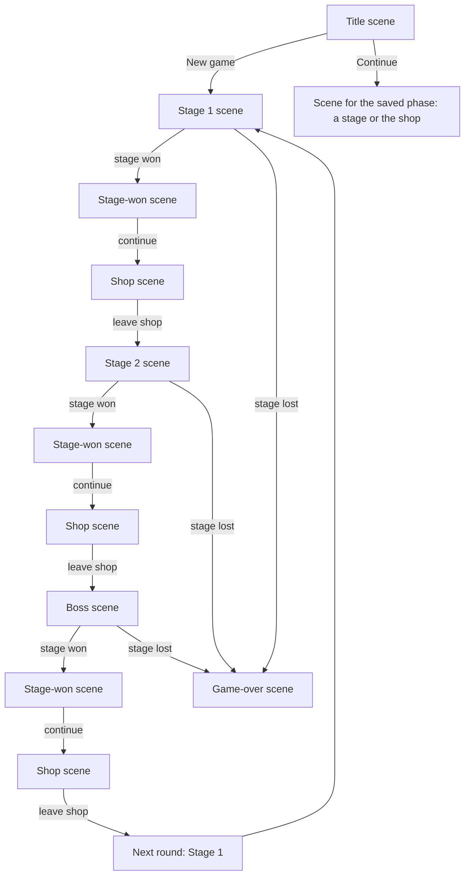

# Game architecture notes

Status: core principles agreed; the current drag-and-attach demo implements the initial spatial rules and the trait container. The general trait event/effect design is still open.

## Game concept

Poker Blocks will be a puzzle game in the style of poker solitaire. Its main source of interest should be the unexpected ways players can combine reusable game features.

A basic block represents one of the 52 cards in a standard deck. An `identifiable` trait holds its rank and suit and answers shared identity queries. Every geometric face of its cube shows that same identity; geometric faces are distinct from behavior traits. The identity model should later admit special cards unique to this game.

The deck is the collection of cards currently possessed. A new stage starts with an empty field. The base dealer draws six distinct blocks into the hand from a standard 52-card deck, leaving 46 in the deck at the start of a new run. The first play places the centre block on the field. The hand is rendered in a row at the bottom of the screen.

The base hand size is a tuning value in `src/balance.ts`; another dealer may set a different size.

## Agreed principles

- Composability takes priority when designing game mechanics.
- A block is defined by data and configured trait instances. Block types do not own behavior code.
- Behavior code lives in reusable traits. Each trait instance carries configuration for its block.
- The game engine should run traits through shared rules and events. It should not branch on specific block types or implement one-off block behavior.
- The same holds at every level, not only blocks: no code branches on a phase, scene, mode, screen, material, kind or id, and no code reads a trait as a flag (`if (traits.x)`). A trait brings its behaviour with it.
- **Identity is opaque.** A mode's or scene's id is a handle for lookup, save keys, URLs and display, never a key that selects behaviour: no `includes`/`has` on it, no table indexed by it, and no mode named outside `src/game-modes.ts`. A thing's data lives on its own definition, not in a side table keyed by its id or kind. Both rules are enforced by `src/guardrails.test.ts` and by review; see AGENTS.md, "No special cases".
- The same trait can be attached to multiple block definitions with different configurations, and multiple traits can be attached to one block.

## Examples

- `additiveScore` has a numeric amount configured per block, such as `+5`.
- `scorable` supplies a block's base numeric score as trait configuration. Standard cards use 2–10 as printed, J = 11, Q = 12, K = 13 and A = 14. Hand recognition reads card identity; line scoring reads the scorable value of each contributing block. Future blocks can configure a different value without adding a scoring branch for their type.
- `identifiable` supplies rank and suit and reusable queries such as `isFaceCard()`, `isNumberCard()`, and `hasSuit(suit)`. Standard cards derive these answers from one identity configuration rather than storing duplicate flags: J/Q/K are face cards, 2–10 are number cards, and Ace is neither category. Special card identities can extend the same query vocabulary.
- `explosive` destroys its block and adjacent blocks; its configured scalar controls the strength or reach. The exact meaning of that scalar is undecided.

These names and payloads are examples, not a frozen API.

## Core runtime

Four small modules under `src/core/` carry the trait pattern. They are independent of cards and of rendering, and none of them knows about a specific trait.

`registry.ts` is a named collection of definitions with unique names. `register` throws on a duplicate name and `get` throws on an unknown one, so a double import or a misspelled reference fails loudly rather than silently overwriting or returning nothing. It holds no gameplay meaning of its own; it is the lookup that lets definitions stay plain data while behavior lives elsewhere.

`emitter.ts` is a minimal named-event channel with `on`, `emit`, `listens`, and `clear`. Every dispatch iterates a snapshot of the listener set, so a listener may subscribe or unsubscribe during a dispatch without disturbing it.

`trait.ts` defines what a trait is. `defineTrait` takes a name, default settings, an optional `setup`, and an optional per-frame `update`, and returns the definition. `trait(def, settings)` builds a type-checked settings override for one attachment.

`block.ts` is the container. A block holds an id, a map of attached traits, and an event channel. It has no gameplay code of its own: `add` merges the override over the trait's defaults and runs `setup`, `remove` runs the attachment's cleanup, and `update` ticks every attached trait each frame.

## Trait configuration pattern

A trait is a reusable behavior plus the configuration that makes it concrete. A block is a list of configured trait entries, and no block type carries behavior code.

The configuration has three properties that the container enforces:

1. Settings are merged over `structuredClone(defaults)`, so every attachment owns its settings object and mutating one block's configuration cannot affect another block using the same trait.
2. `setup` may return a cleanup function, or a `TraitInstance` with its own `update` and `dispose`. Per-attachment runtime state closes over the trait's own locals, so it needs no `WeakMap` and no field reserved on the block.
3. Settings must stay plain, serializable data. This is what lets a block's configuration be inspected, compared, and eventually saved. Behavior belongs in the trait definition, not in a function stored in settings.

Traits are referenced by their definition object, not by a name string, so `add`, `has`, and `settingsOf` are fully typed and a missing trait is a compile error rather than a runtime lookup. Named data that definitions refer to each other by, such as an effect id, goes through `Registry` instead. Keeping the two mechanisms separate is deliberate: direct references get type checking, and string ids get data that can be authored and serialized.

Traits are detached in reverse order of attachment when a block is disposed, so a trait may rely on anything it was attached after.

The demo's pure helpers separate behavior from container wiring. `toggleBlockSelection`, `attachmentCell`, `faceFromNormal`, and `inspectBlock` are plain functions over plain state, and the trait wrapping one calls it rather than reimplementing it. This keeps a trait's rules testable without constructing a block, a scene, or a renderer.

### Traits whose settings hold a function

`inspectable` currently stores a closure, `inspectable(description)` returning `{ inspect }`. That fits the present struct-shaped block type but conflicts with the rule that settings stay serializable. When the trait is ported, the description becomes the trait's `defaults`, and the invocation belongs to the trait definition or to a trait-level function, not to per-block settings. Future traits should not store closures in `defaults`.

## Selectable trait

A block with the `selectable` trait can respond to a player click or tap. The trait toggles that block's selected state; selecting one block does not clear other selections. Clicking the same block again unselects it. Hand blocks carry this trait. Playing a block removes `selectable` from its field instance and clears its selection, while leaving `inspectable` intact. A block drawn into a later hand regains `selectable`. Selection is separate from identity: the card remains the same rank and suit. The toggle behavior belongs to the trait, not to a particular card or block type.

The current serialized block shape uses trait keys. `block-trait-behaviours.ts` resolves those keys through registered behavior objects owned by the trait modules. Selection, cursor, drag eligibility, attachable faces, destruction causes, and transparency handover call the resulting capabilities without inspecting which trait provided them. A new trait can register a capability without changing those consumers. This is a transition toward the definition-object model above; the trait key is only a registry lookup, never a branch in the caller.

The visual cues (owner decision on #305) are face illumination and an **outline**: a selected block's edges turn the accent cyan. A selected **hand** block also **lifts** a little above the others (instantly under reduced motion), and with two or more hand blocks selected a "N selected" badge shows over the hand, so a drag that carries the whole selection is never a surprise. Selection never changes a block's size, and a **table** block never moves, so connected cubes remain aligned; only loose hand blocks lift. True bloom remains an option if a softer glow is wanted later.

What an operation does to the selected cards is still to be decided.

## Inspectable trait

An inspectable trait instance implements `inspect(): string`. The hover UI calls that method and displays its result beside the pointer for a block in the hand or in play. Standard cards configure the trait with their rank and suit name. Future block types can provide their own description through the same trait, with no tooltip behavior on the block itself.

## Attachable trait and dealer

The `attachable` trait lists the faces of a block that may accept another block: `north`, `south`, `east`, `west`, `up`, and `down`. Standard cards allow all six. A face can accept a dragged hand block only when its neighboring grid cell is empty. The block snaps face-to-face into that cell, leaves the hand, and becomes part of the structure. Any exposed face of any placed block can be used; dragging the structure reveals its other sides.

The dealer is a rule system, rather than a block. After a successful attachment it draws from the remaining deck until the hand contains six cards, or the deck is empty. The six opening hand blocks and all subsequent draws remain unique.

When dragging a hand block starts, the structure's wobble slows to one-tenth of normal over half a second. On drop or cancel it eases back over half a second. Small numeric easing helpers live in `src/easing.ts` for later animations.

The hand is rendered as a fixed overlay with its own camera. Only the structure uses the perspective board camera. After a block attaches, the board camera waits one second, then eases over two seconds to a distance calculated from the grid's bounding box, so the growing structure stays visible. The hand's size and position do not follow that camera move.

All standard cubes currently have equal mass. The structure keeps a running sum of block grid positions and divides by the block count to find its true center of gravity after each attachment. The rotation pivot moves to that center while preserving the existing block positions. The structure gently oscillates on two axes around the pivot instead of spinning continuously. Dragging any placed block rotates the structure on horizontal and vertical axes; the oscillation continues around the new orientation. A click without dragging still toggles selection.

## Stage overlay and discard area

Each stage starts at score 0 with the target, plays and discards from the session configuration. A successful attachment consumes one play and scores the field. Dropping a hand card into the fixed two-dimensional discard area, marked by a pixel art bin, adds it to the discard pile and consumes one discard. The dealer refills the hand after either action. Invalid drops consume nothing.

The deck count appears at the lower right. The counters and discard area stay fixed on screen while the board camera moves.

## Game state and dealer

`GameState` is the single source of truth for the field, hand, deck, discard pile, and round counters. Each zone holds the actual card blocks, not a count of them. The field pairs each block with its grid cell. The UI's Three.js objects, animations, and selection highlights remain presentation state outside `GameState`.

The canonical domain terms are in [terms.md](terms.md): a **stage** is one score-target game and a **round** contains three stages, each followed by a shop. Within a round, the deck and discard pile persist across stages and shops, while the dealer resets the field and sets fresh play and discard allowances for each stage. Cards discarded in an earlier stage stay unavailable in later stages of that round.

The stage opens with an empty field and a dealer-filled hand. The player may discard before placing anything. The first play is a drag from the hand into the empty field, creating the centre block and consuming one play.

`GameRun` owns progression through stage one, shop, stage two, shop, boss stage, shop, and the next round. It selects the active dealer and target score for each stage, asks that dealer to set the stage's field and allowances, and carries the deck and discard pile across the three stages. Its snapshot includes the current round, phase, and stage that opened a shop for save/Continue.

A registered dealer reads `GameState` to decide whether a move is legal and returns the next state after a play or discard. The base dealer owns the current six-block hand, six plays, four discards, provisional target score of 100, opening deal, face attachment rules, and hand refill. `GameRun` holds the active dealer and current state; switching to another registered dealer preserves the exact state value. A future boss dealer can change rule methods without moving cards between zones or adding boss checks to the scene.

## Placement and card appearance

**Model first (owner rule, 2026-11-10).** User input commits to the model immediately, and animation catches up. An animation can take seconds, but the play has already happened: presentation never gates or delays a rule outcome. This applies to every input (plays, discards, purchases, sales). #272 implemented it for drops, discards and passive sales, replacing the #167 rule in which a drop waited for the last animation. The epic #271 restructures input so each thing handles its own input (a gesture router plus input owners registered by traits), following this rule.

**The drop contract (#167, #272).** A hand card, with any selected cards it carries, can be picked up at any time, including while earlier plays or discards are still animating. When it's dropped, each carried card ends up exactly once: played at the candidate, discarded, moved within the hand, or put back.

- **A drop commits at once (model first, #272).** It goes to the rules immediately, even while earlier plays are still being shown. Their animations and this one catch up with the model: the presenter keeps every play and discard in flight in a list. Each play's scoring lines are captured when it commits and queued behind any still being shown (`queueScoreSteps`), so plays that land close together score one after another. A stage outcome's pop-up waits until all of it has been shown.
- **The rules decide immediately.** A drop the current state refuses (the stage was just won by the play before it, say) goes back to the hand with the `action.denied` sound. Discards and passive sales commit at once too.
- **Nothing waits for an animation.** No drop is held, and no new drag is blocked, while something is being shown.

- **Hit-testing follows the game state, not the animation.** When a play is accepted, the field records each played block as an invisible stand-in at its final cell (`FieldView.expect`), which the real block replaces when it lands. A drop made while that block is still flying can attach to it, or finds the face it now covers taken. The empty-field check uses `occupiedCells()` for the same reason. `cells()` still means landed blocks, which is what the camera frames.

Before #167, a pointer down during an animation was silently ignored. A quick drag after a play did nothing, while the empty field's first-play prompt looked like a drop preview.

After a hand cube is dropped on an attachable face, its screen position is mapped through the board camera into the play scene. The same cube becomes a child of the rotating assembly and moves, turns, and grows toward the target cell in assembly-local coordinates over one second using the shared easing helper. Because the cube and target share a parent, the destination follows the board's wobble throughout the flight. Its hand slot remains empty during that second. The dealer refills that slot when the placement finishes, and the new cube materializes with a Perlin noise shader adapted from `../shrew_farmer/src/hud/materialise.ts`.

A discarded hand cube dissolves with the same shader over one second before its slot refills. The discard effect runs backwards from the appearance effect. Other hand cubes stay in their slots during either animation. Reduced-motion settings shorten the effect and use a fade.

Material appearance is defined on each material definition in `src/materials.ts`: printed ink, face pattern, relief, surface, geometry, edges, optical settings and the transparent trait attachment. `src/visual/block-appearance.ts` is a generic builder that dispatches named pattern, surface, relief, geometry and assembly handlers from that configuration. The same definition is used by blocks in hand, in the field and in the shop. A new material may combine existing handlers without changing the builder; a genuinely new visual technique gets one new registered handler. Material gameplay effects remain separate and are tracked in #8 and #63.

**Filled vessels and visual experiments (#227, #330).** A filled vessel is a **contained block** (see "Contained components"): the generic `contained` assembly builds a registered container shell from the material's `appearance.container` data and, optionally, registered contents from `appearance.contents` (`src/visual/contained.ts`). Custard is the `plasticShell` (opacity, wall `inset`, gloss) holding the `vesselFluid` contents (fill and surface colours, level, a settle time constant, and a trace time constant and opacity), both registered in `src/visual/filled-vessel.ts`. The contents are placed through the shell's interior boundary: the fluid in its volume and the trace on its wall. They never see the shell. An **empty vessel** (`emptyVessel`, an experiment) is the same shell with no `contents`: a composition, not a special case. No code names the material. Custard is the first such material: it began as a visual experiment and is now a gameplay material, sold in the shop from round 5 (#342).

- **How it works:** it is a lightweight approximation, not a fluid simulation. A copy of the block's shape is cut by a flat surface: fragments above it are discarded, and back faces seen through the cut are shaded flat, so the cut reads as the fluid's top. Each frame, the surface's normal eases toward "up" in the block's own space (the world's up, turned back by the block's rotation), using an exponential with the settle time constant. The fluid therefore levels slowly, without splashing or overshooting.
- **Wall residue (now #334):** custard's wall now carries a **fading film** with local history (below). The old wall trace, described next, is kept as the `wallTrace` residue but no material uses it.
- **Old wall trace (#227):** a second normal follows the surface more slowly. Inner wall that lies below that old surface but above the current one is tinted faintly. As the old surface catches up, the band shrinks to nothing, so the trace fades. Exact volume is not preserved as the block tilts.
- **Where it can appear:** experimental materials live in `experimentalMaterials`, not `materialDefinitions`. No shop, reward, material sample or attract sequence ever deals them, and they carry no scoring, prices or rewards. A developer mode deals one only by asking: `materialDeck` with the `registered` pool (dev0 deals every registered material, so a new experiment appears there automatically), or the `uniformMaterialDeck` run setup step. **Air** (`airVent`, #357) is the current experiment: a pale powder-coated housing drawn by the `ventHousing` face pattern. It has a PC fan on its two variant faces (`endGrainFaces: [0, 1]`, so the fans face each other across the block) and louvred slats on the other four, on the ordinary `sixFaces` assembly. The fans are static for now: a turning fan would need a per-frame visual behaviour, which is left for later rather than drawn into the face texture. It has no airflow, scoring, price or reward, and borrows steel's attach sound. See it in `?mode=dev9#materials/airVent` or dealt in dev0. Custard, the first experiment, graduated to `materialDefinitions` when the shop began to sell it (#342), so it is dealt like any gameplay material; `dev6` (sandbox play, every card custard) still shows it alone. `src/visual/filled-vessel.test.ts` checks that no file in `src/visual` names an experimental material, and that experiments stay out of gameplay.
- **Shared simulations (#230):** blocks of one effect type show one simulation result. `src/visual/shared-simulation.ts` is a generic registry: `sharedSimulations.acquire(config, create)` returns the simulation for a configuration object (a material's appearance data), creating it on first use. It is released when the block's material is disposed, and dropped when no block uses it. A simulation advances at most once per frame, keyed on the frame's timestamp (`document.timeline.currentTime`), however many blocks render it. The vessel simulation keeps the fluid's surface and trace as world-space normals. It is driven by the rotation of the first block drawn each frame; blocks on the table all share the structure's rotation. Each block turns that result into its own space, so placement and orientation stay per block while the simulation runs once. `src/visual/shared-simulation.test.ts` checks one simulation and one step per frame for many blocks, separate configurations kept apart, identical results at one orientation, and the same world surface at another. It also guards that the per-block vessel factory gets its simulation from the registry. The flame core needs nothing more: it is a stateless shader of the shared clock, so every flame already looks identical. A future flame particle system should acquire its simulation the same way. **Amended by #329:** simulations are shared per configuration _and_ motion cohort, and residue history is per block; see "Simulation sharing: amending #230" under Contained components.
- **Performance:** each vessel adds three meshes (inner wall, fluid and trace) and two transparent layers (shell and trace), and the fluid is double-sided. That is more overdraw than an opaque block, and transparent sorting can occasionally flicker where vessels overlap. The shaders are cheap: one dot product and a discard, with no textures or extra render passes. A table full of vessels on a low-end phone is the case to watch. If it struggles, the first savings are to drop the trace mesh and use the outer shell alone.

**Random amounts in rules (#97).** A scoring effect's amount can be a registered **value source** (`fixed`, `roll`) instead of a number. Dice are just `add-line-score { amount: { valueSource: "roll", sides: N } }` on the `score.afterLineClamp` phase. The rules are resolved once per scoring resolution, before candidate hands are compared, using the run's seeded random source. No controller rolls dice or knows that a die exists; `src/dice.test.ts` checks that no die name or dice field appears in the run, the controller, the scorer or the rule runner. The token's polyhedral shape comes from #125's registered shapes and applies to passive tokens only.

**The beat signal (#255).** `src/audio/beat-signal.ts` tells presentation where the music is, so visuals can follow it.

- **Where the numbers come from:** each frame it reads `musicPlayer.position(performance.now())`. That comes from the shared beat clock, which is built from each loop's registered `tempo_bpm` and `first_beat_seconds`; nothing analyses audio.
- **Heard time:** the position is taken at the time actually being heard, through `AudioContext.getOutputTimestamp()`, falling back to `currentTime` less the output latency.
- **What it gives:** a continuous `beat`, `beatPhase` and `barPhase` (each 0–1), `bar`, `tempo`, and an `energy` from 0 to 1. Energy eases up while music plays and down when it stops, so movement settles instead of freezing. Muted music keeps its energy, because its clock still runs.
- **Events:** `beat` and `bar` fire once when a frame crosses a line, never as a burst after a long frame, and not when a track change re-anchors the clock.
- **Bar length:** the player now uses each loop's `beats_per_bar` (4 when absent) for bar alignment and crossfade length.
- **Scope:** presentation only; rules and scoring never read it. The `danceToBeat` trait (#256) is its first consumer.

**Dancing (#256).** Things move with the music by joining the **dance floor** (`src/dance/dance-floor.ts`).

- **Dancers:** a dancer names the cycle it follows (`halfBeat`, `beat`, `bar` or `twoBars`, a registry of cycle lengths) and an optional `offset` in beats. It implements `dance(move)`, which is called every frame with its `phase` through that cycle, the music's `energy` and the `tempo`.
- **What a dance may change:** the dancer decides. Usually that's its appearance, but not always. The floor never asks what a dancer is.
- **Shapes:** pure functions of phase, from 0 to 1, in a registry keyed by name (`src/dance/beat-shapes.ts`): `sine`, `pulse`, `bounce`, `gate` and `saw`.
- **Resting:** with no music, or with reduced motion, `energy` is 0, so dancers settle.
- **The first dancer is the ghost cube.** `firstPlayPrompt`'s `dance` data (cycle, shape, offset, swell) makes its prompt join the floor. Its **size** and its **glow** each join the floor independently, from their own data:
  - **`dance` (size):** a sawtooth over the bar, growing steadily through each bar and dropping back to its base size on the downbeat (`{ cycle: "bar", shape: "saw", swell: 0.12 }`).
  - **`flash` (glow, #324):** a pulse on every beat, a touch early so it reads as on time (`{ cycle: "beat", shape: "pulse", offset: 0.04 }`).

  Each records its shaped level and the music's energy, and the prompt **blends by energy**: with no music (energy 0) the size rests and the glow keeps its own slow idle pulse; as the music's energy rises, the size follows the dance and the glow gives way to the flash. A prompt composes either, both or neither; one with neither never joins the floor.

**Action history and the drop inspector (dev10).**

- **The action log** (`src/action-log.ts`) is a record of the last 30 seconds of interaction events and callbacks; anything older is thrown away, however many entries remain. Each entry has a `performance.now()` time and the main loop's frame number, and runs of pointer moves are folded into one entry. It records only while a scene composing the **`actionHistory`** trait is showing.
- **What `actionHistory` records:** raw pointer and window events, every change in the watched state (animating, presenting, dragging, a held drop, model blocks against drawn ones), and the input's decisions, which arrive through the input's optional `trace` hook. The game passes the hook nothing outside the log, and tracing never changes behaviour.
- **The copy button:** `actionHistory` adds a **Copy action history** button, which puts the log on the clipboard as plain text. A header carries the version, mode, screen, scene stack and current state. It's meant for pasting into a bug report after a drag-and-drop failure.
- **The drop inspector:** **`devDropInspector`** is a live panel of the same state and the newest entries.
- **Where they're composed:** both traits are composed only into dev10, a development-only sandbox room. Composing `actionHistory` into a main mode's scenes would record there too.

## Input (#284, epic #271)

**Each thing handles its own input.** Two libraries turn pointer, touch, keyboard and wheel input into intents, and every decision about what those intents _mean_ belongs to the thing they're aimed at, through traits composed into scenes. The vocabulary is the industry's: HTML5 drag and drop and dnd-kit for dragging, use-gesture for gestures.

- **Libraries** (owner decisions on #286, 2026-11-10). Each is pinned to an exact version: dnd-kit is pre-1.0.
  - **dnd-kit** (`@dnd-kit/dom`, the framework-free core) owns **drag and drop**: its `DragDropManager`, **sensors**, **draggables**, **droppables** and **collision detection**. The pointer sensor's **activation constraints** (minimum distance, delay) settle a tap (select) against a drag. Its keyboard sensor gives keyboard drag and drop. #282 adopts it.
  - **use-gesture** (`@use-gesture/vanilla`) owns the **board gestures** dnd-kit doesn't have:
    - dragging empty board to turn the structure;
    - **pinch** zoom, mapped logarithmically, with two-finger **twist** to rotate;
    - **wheel** zoom.

    #275 adopts it.

  - **Who takes a pointer:** where it lands decides, never a branch on what's there. A pointer that starts on a drag source is dnd-kit's; one on empty board, or a second finger, is use-gesture's.
- **The gesture lifecycle.** Whichever library takes a pointer drives its owner through **began, changed, ended, cancelled** (dnd-kit's drag start, move, end and cancel; use-gesture's `first`, active and `last` states). Every owner must handle **cancelled** by putting its things back.
- **Drag sources** (#276, #277): things that can be picked up (the hand, the passive rack, the shop stock), registered as dnd-kit draggables by the trait that brings them: `dragSource` names the hand on play scenes, `passiveRackView` names the rack (`{ source: "rack" }`), and `shopStock` names the shop's offers (`{ source: "shop" }`; the shop view supplies that source and `main.ts` registers it). A drag source says what is picked up under a pointer, and **runs its own drag**: `begin`, `move` and `end` (dropped or cancelled). The manager hands each step to the source that started the drag, so every drag shares dnd-kit's threshold, capture, release and cancel handling, and the #267 capture-loss grace. A drag that ends without a drop the target accepts (let go off every target, cancelled, or refused by the model) is put back by its source; the shop's offers **fly back** to their slot rather than snapping (`src/return-to-source.ts`, #482): the CSS offset eases to zero over a configurable 0.5 s, so the flight always lands on the slot's live position, reduced motion puts it back at once, and an offer can be picked up again mid-flight from where it is. The refusal and its sound are decided and committed on release; the flight only shows them.
- **Drop targets** (`dropTarget` trait, #273): places dragged things can be dropped (the grid, the bin, the hand for reordering, the rack, the shop's BUY), registered as dnd-kit droppables. Play scenes compose `{ target: "discard", priority: 10 }` and `{ target: "grid", priority: 0 }`: the **grid** (#274) accepts where an attachment fits (a single block, a selected group's line, or the first play on an empty table), previews the cells and commits the play on drop. The **hand** (`{ target: "hand", priority: -10 }`, #276) takes a single block back where nothing else does, and moves it to the slot under the pointer (a reorder: not a play, and nothing refills). While something is dragged, the targets a scene allows are **hit-tested** in priority order:
  - the **3D grid** uses a custom collision detector over the existing raycasting; DOM targets (the bin) use dnd-kit's own;
  - `canDrop` answers **accept**, **reject** (the point is the target's, but it won't take them) or nothing (ask the next target);
  - the target shows **hover** feedback;
  - on **drop**, the target commits to the model; a rejected drop triggers the target's **reject** feedback.
- **Our code is a thin adapter.** `src/drag-drop.ts` (the drag-and-drop manager today; an adapter over dnd-kit after #282) and `src/table-input.ts` turn traits into dnd-kit draggables and droppables, and the board into use-gesture handlers. They never name an owner, a scene or a kind of block: what a scene allows is exactly the set of owners its traits register. The input holds **no scene switches** (#278, guarded by `hand-bin-composition.test.ts`): it reaches hand blocks only while the renderer shows the hand (`handShown`), and the bin's presentation (shown, Discard or Sell) is `src/bin-view.ts`, driven by the `discardBin` and `sellBin` traits. `setFieldActive` and the `fieldPlacement` trait went with #274.
- **Selection** (`selectable` trait, #276): what a click selects. The trait names **select sources** in order (play scenes and the shop: `hand`, then `field`); each answers the block under a point, and the block's own traits decide whether it toggles. Dragging a selected hand block carries the whole selection.
- **Model first** (#272). Input commits to the model immediately; animation catches up. No input is held back for an animation.
- **Browser behaviour** (#267, #283).
  - Pointer capture can be lost before the release arrives, so a drag that loses capture waits briefly for its release before cancelling. That has to stay true through both libraries: #282 checks dnd-kit's pointer sensor, and #275 checks use-gesture.
  - **The game surface is not a document** (audited in #283):
    - `touch-action: none` is on the canvases and the draggable DOM (rack items, shop offers);
    - `.scene` has `user-select: none`, `-webkit-touch-callout: none` and `-webkit-user-drag: none`, while text fields keep selection;
    - the input service cancels native `dragstart` on the surface (a native drag fires `pointercancel` and stops the pointer stream) and the long-press `contextmenu` on the table.
  - **Zoom is logarithmic:** a pinch multiplies the zoom by the finger-spacing ratio, and the wheel by `exp(step)`, so equal gestures zoom by equal factors at every level (`view-zoom.test.ts`).
- **Debugging.** The action history (dev10, `actionHistory` trait) traces every input decision with timestamps. It's the regression tool for input changes: capture the same gestures before and after a change and compare the decisions.

## Field visual effects (proposal)

Field visual effects are presentation behaviors, separate from gameplay effects such as adding score or destroying blocks. The current `tintRow` effect temporarily colors a scoring line gold. A future field effect registry could resolve named requests with target block IDs and visual parameters such as color, intensity, duration, and easing. The same mechanism could later draw glows, bursts, or explosions for unrelated game events.

Gameplay resolves first. A presentation coordinator may turn the resulting events into field visual effect requests, but the visuals never determine score or mutate `GameState`. An explosive trait, for example, would use gameplay effects to remove blocks and a separate field effect request to show an explosion. Multiple temporary effects and persistent selection illumination need a defined visual composition policy so one highlight does not erase another; that policy is still open.

After each play, scoring calculates all line scores first, filters out zero-point lines, and orders the remainder from lowest to highest. Presentation then steps through that ordered result, tinting each row gold and playing a `score.magnitude.*` sound chosen for its points. The scorer does not call shaders or audio directly.

## Passive registry and triggers (design)

The proposed event order, reaction contract, and effect boundaries are specified in [game-events.md](game-events.md). The current game has only a general event emitter; it does not implement that gameplay contract yet.

Passive definitions live in a named registry with a stable id, display name, visual design or icon, and a trait reference. The passive itself is a block instance in the ordered `GameState.passiveRack`. Behavior code belongs to reusable traits, not the block instance or an ad hoc function attached to one registry entry. A trait may listen for gameplay events such as block placement, apply a condition, produce a gameplay effect such as coins proportional to the placed card's rank, and request separate presentation effects.

The passive trait declares its event subscriptions; it need not respond to every event. A reaction may also request a further named gameplay event. The run's passive event queue delivers that event after the current one and applies a loop guard, preserving deterministic ordering and preventing recursive callbacks. The `?mode=dev2` sandbox draws two distinct active passives at each fresh start. Do Nothing remains a retired registry definition so a save naming it still resolves; `fromSaveRecord` drops it rather than keeping a slot with no effect.

Passives may react throughout the stage or session, not only during scoring. The engine should expose named lifecycle events with explicit timing and context: for example, before the first play in a stage, before/after a block is placed, before/after one line is scored, after all lines are scored, and when a stage is won or lost. These are examples, not an exhaustive event list. A passive's trait checks its configured condition against the event and returns gameplay effects; an event may also lead to separate sound or visual requests. This gives designers callback-like trigger points without storing arbitrary callback code on individual blocks.

Timing matters: a trait that changes a block's base value or a line's points must run at a defined pre-score point, while a reaction to a finalized `lineScored` event sees the completed result. An `allLinesScored` reaction sees the aggregate after the line pass. Victory and loss reactions need an explicit place relative to the dealer's outcome check. The pure line scorer remains free of lifecycle dispatch; a coordinator invokes it within the larger event/effect sequence. The exact event vocabulary and resolution rules are still to be specified.

Trigger usage is configurable per passive: unlimited, a fixed count, or one-shot. Remaining uses are instance state; exhausting them can destroy the passive. Passives are not discardable. A separate sell interaction can remove an installed passive at any time and award coins without using a stage discard. The rack size, sale values, and installation flow remain open.

The proposed hand and passive rack are ordered zones in `GameState`. A generic reorder action would change item order when a block is dragged between slots in its own zone; it would not consume a play or discard. For passives responding to the same trigger, the default resolver would use a snapshot of rack order and apply their gameplay effects left to right. An explicitly defined timing rule could override that default. The renderer would reflect the new order but would not decide effect order itself.

## Passive categories

Each passive category is a trait, and the **category facet** (`src/passive-categories.ts`) is the set of them. A **facet** is a group of traits of which a block composes exactly one. Every passive composes exactly one category trait, and a test enforces it. A category trait brings presentation defaults (block colours, an appearance finish, an activation visual and sound, and for Scoring an accent tint from its operations) and no behaviour: gameplay rule evaluation never reads it, and a test enforces that too. A definition's own `palette` overrides the default.

## The HUD frame and the table's layers (#116)

The table draws as layers, bottom to top: the **back canvas** (room and table, with the blocks' shadows on the baize), the **HUD frame** and its panels (DOM), the **front canvas** (the playfield blocks, then the hand, then a dragged block), and then the passive rack, shop overlays and menus. `src/table-renderer.ts` renders the back pass with only the room's layer, letting each shadow-casting block stand in with an invisible material so its shadow still falls on the table. It then renders the blocks, hand and drag on the transparent front canvas, which never takes input: pointers pass through to the HUD's controls and, beyond them, to the back canvas, where the table input listens. Zoom moves the board's camera, so the room and blocks zoom together while the frame, hand and rack stay put.

The **HUD frame** (`src/hud-frame.ts`) is one full-screen grid of named zones inside the safe area: `top-left`, `top-center` (the passive rack), `top-right`, `bottom-left`, `bottom-center` (the hand) and `bottom-right`, with the middle left to the playfield or the shop's stock. It is a layout surface, not a clipping mask, and it knows nothing about scenes or modes: a service places its element in a zone, and scene traits keep showing and hiding panels as before. Landscape is the only layout so far, and on landscape screens a control placed in a zone flows into it. **The gameplay HUD** (#117) is placed from one table, `gameplayHudZones` in `src/hud-layout.ts`: the round panel (stage, score, target, moves, discards, coins) and the coin panel top left, the menu button top right, the Discard bin bottom left and the deck counter bottom right. `src/main.ts` places each element from that table, so no panel positions itself and nothing depends on scene or mode; each panel's scene trait still decides whether it shows. On landscape screens every element in a zone flows into it. The passive rack keeps the top centre without being in the frame, because it is drawn over the blocks. The deck counter becomes the way into the deck view in #175. The shop uses the same frame: coins top left, menu top right, rack top centre, BUY and SELL bottom left, hand bottom centre, and Continue bottom right (#118). **The shop's stock** is a circular scatter (#122, `src/shop-scatter.ts`): a round area in the middle, with each offer centred on a predefined spot. There is one hand-placed arrangement per stock size from 5 to 9 (an even ring for other sizes), so there is no runtime randomness. Offers are squares `spotSize` radii across. No two are closer than that across or down, and each corner stays inside the circle; `src/shop-scatter.test.ts` checks this for every size. The area is never smaller than 232px, so each offer keeps a 44px touch target. The area sits clear of the passive rack. An offer keeps its spot when others are bought (`createScatterPlacer`), so nothing jitters, and a new stock is laid out afresh. On short screens the name is shortened with an ellipsis but the price always shows. **Layouts** (#119): the frame has a landscape and a portrait layout, chosen by the player's **Layout** setting (Settings, saved with the other settings; Landscape by default, including for settings saved before it existed). The run controller applies it with `hudFrame.setLayout`. **Automatic** (#120, the default, including for settings saved before it existed) picks landscape when the viewport's width-to-height ratio is above `landscapeAspect` (1.25) and portrait below it, re-evaluated on every resize or turn. A ratio exactly at the threshold keeps the current layout, so it never flips. The threshold is above 1 so that narrow landscape windows such as 600×510, which have no room beside the rack for the landscape layout, get portrait (#238) (`resolveLayout` in `src/settings.ts`). A fixed Landscape or Portrait choice is never overridden by the device's orientation. Either way the frame's CSS is keyed on its `data-layout` only, never on an orientation media query (`src/hud-frame.test.ts` checks this). Portrait gives the passive rack a band across the top, puts status and Settings in the row under it, and puts the bottom corner zones in a row above the hand, which spans the bottom band. The landscape layout keeps clear of what is drawn outside the frame: `--hud-hand-clear` (the full-width hand on a tall screen) lifts its bottom corners, and `--hud-rack-clear` (the rack on a narrow screen) lowers its top corners. These measure space on this screen; they never choose the layout.

## Shop offer kinds (#67)

A shop offer is plain data, `{ kind, block }`. What a kind means is registered once in `src/offer-kinds.ts`: its price (from the run's rules and the balance config), the drop target that buys it (`hand` or `passive-rack`), what buying adds to the run, what leaving the shop does with it unbought, and how it's saved and restored. The shop view registers how each kind is drawn and named (`registerOfferView` in `src/shop-view.ts`), and the run controller shows a purchase by its destination. Nothing compares `offer.kind`; a new kind registers its handlers and needs no other edit (a test registers one). A save naming an unknown kind is invalid.

**Refusal reasons (#481).** `GameRun.purchaseVerdict(id, destination)` says why a purchase would be refused, or null when it would succeed. It is side-effect free and uses the same rules `buyShopOffer` applies (buying checks it first). The first reason that applies wins, in this order: `closed`, `unknown-offer`, `wrong-destination`, `unaffordable`, then the offer kind's own `refusal` (`rack-full`, `already-owned`, `locked`), else `refused`. So when both apply, a player short of coins hears "can't afford" rather than "rack full". Rack-bound kinds build `refusal` and `receive` from one ordered list of checks, so the two never disagree. The controller plays `refusalSound(reason)`, from a registry keyed by reason (`unaffordable` → `shop.buy.denied`, `rack-full` → `shop.rack_full`, anything else → `action.denied`); it never branches on the reason. The shop's live drag guidance (#499) will query the same verdict.

## Balance config and resale

Tuning numbers live on the definition they belong to, never in a side table keyed by identity: a passive's `shop` balance (base price, unlock round) is on its definition (#7), and its block carries the base price as a `priced` trait. `validatePassiveBalance` (`src/balance.ts`) checks every definition's balance in one place, and a test requires one for every passive the shop can stock. Prices are fixed data; anything that changes a price is a modifier applied on top. Selling uses `resaleValue` (`src/resale.ts`): the default policy (half the `priced` base price, rounded down, at least 1), then `RunRules.resaleModifiers` in order. That list is the extension seam for future sale-modifying passives. The sale transaction (`GameRun.sellPassive`) asks the policy; the drop target and the run controller never compute a payout, and a test checks they don't.

## Line scoring

**Materials (#8, #141):** a card's material is a block trait. Its scoring effect is a `scoringModifier` trait (`additive`, `multiplicative`, `exponential`) whose values come from its material definition. It contributes event rules to the same queue as passives (#63): additive on `score.beforeBlockValue`, multiplicative on `score.lineMultiply`, and exponential on `score.linePower`, for contributing cards only. The line scorer supplies contributor IDs and never names a material; see `doc/game.md`, "Material scoring", for the order of operations. Material definitions also configure their own scoring activation pulse, accent and sound (#212); the presenter uses reported rule source IDs as each line is shown.

**Gold (#107, #218):** Its material definition adds 1 to a contributing card's base value through the shared scoring rule, with a pulse and registered sound when that rule activates. The same definition configures a reusable `handReward` of 2 coins per Gold still in hand at stage settlement. `GameRun.claimStageRewards` collects material hand rewards once on both wins and losses, before `advance` returns the hand to the deck or ends the run. A win ledger places its material row after the completion bonus and before passive rows; a loss has only the material row. Gold Standard is an independent `stage.won` passive that adds 1 coin per held Gold on a win. The saved paid-stage marker prevents repeat payouts after Continue, and malformed saved coin/reward data is rejected. Gold's +1 value, 2-coin rate and round-4 shop unlock live on its material definition and are validated centrally. Held-card scoring remains deferred.

`src/scoring.ts` holds pure scoring primitives with no UI, sound or state changes. `findScoringLines` returns every maximal gap-free run of two or more placed blocks along X, then Y, then Z, with its cells and blocks in cell order. `scoreLine` returns one line's numeric score, and `evaluateLine` adds the hand type and the ids of the cards that counted. Card points come from the configured `scorable` trait (`src/traits/scorable.ts`), never from the block type. `scoreField` scores every line, and `presentationOrder` drops zero-point lines and sorts the rest lowest first.

After each successful play the base dealer adds the points of every line on the field to the running total. `roundOutcome` reports the stage as won once the total reaches the target and lost when plays run out short of it; the dealer then refuses further plays and discards. The formula and its provisional edge rules are in `doc/game.md`.

When the placed card lands, the scene presents each scoring line from lowest to highest: the reusable `tintRow` effect flashes its blocks gold, the `score.magnitude.*` sound for its points plays (`src/score-presentation.ts`), and its points are added to the displayed score. The stage result and its sound follow the last line.

### Material reactions (proposal, #363, epic #362)

**Cooking (#372):** `src/cooking.ts`. A cookable material lists `cookable.steps` (Raw first), and a card's step is its `doneness` trait. Meat's reactions (beside `fire`, or water holding `boiled`) name the `advance-cooking` result. Its rule command steps the card on the field, saves the step in `cardStates.doneness`, names it in the inspector, and reports `reaction.applied` with the step names before and after, only when something changed. Doneness lasts one stage: cooking registers `resetDoneness` in the `stageEndResets` registry (`src/stage-end.ts`, keyed by card trait), and `GameRun.clearTable` runs every registered reset after the stage's rewards. The run never names cooking. `applyCardStates` moved to `src/card-states.ts`, which avoids an import cycle between card materials, cooking and reactions.

**Card ownership (#424).** A card's `owner` trait names a registered owner in `cardOwners` (`src/card-ownership.ts`); without one, its owner is the deck. When a stage's table clears, `GameRun.clearTable` hands each field card to its owner's `atTableClear` and never asks what the card is. `deck` puts it back in the deck. `field` (a card made during play, `asGenerated`) takes it out of play and out of `GameState.generatedCards`, the list a save writes in full so Continue can rebuild cards that aren't in the starting deck. Generated cards never join the deck or a later draw.

**Spawning beyond a pair (#425).** A reaction result, `spawn-beyond-pair` (`src/pair-spawn.ts`), configured on the reacting material with its `partner` (material and optional state bonus), the new block's `material` and a `sound`. Air's definition carries it, for boiling water and cloud. Its rule command:

- for each matching face neighbour, takes the two axis-end cells that are free;
- scores each with the run's own scorer on a copy of the field (any passive value source, such as a die, reads a fixed mid-range roll, the same for both, and the run's random stream is untouched);
- places the card made by `spawnedIdentity`, owned by the field (`asGenerated`), and adds it to `generatedCards`;
- reports `reaction.applied` for the new block.

The play presenter now draws every block a reaction reports as the model has it, new ones included, and finds the cards just played by ID rather than by their place in the field's order.

**Scoring eligibility (#423).** A card in a scored line but not in its chosen hand takes part as its material's `scoringEligibility` says. That names a handler in `scoringEligibilities` (`src/scoring-eligibility.ts`); the default is `contributing`, which adds nothing. Each handler says two things. The first is how much of the card's own block bonus is **guaranteed** whatever hand is chosen. The line scorer (`scoreFieldWithPassives`) leaves that part out of the card's value while it chooses the hand, so it can't change which hand that is (a cloud 8's +2 never beats a paper 9 for high card). It then adds that part once for every card in the line, at the hand's multiplier. The second is whether the card's own line rules **join** the line phases when it's outside the hand. `rowPresence` (cloud) guarantees its whole bonus and joins. The hand's classification is untouched.

**Gelato (#383).** Custard's reaction is `neighbour-material` ice with `unlessNeighbour: [neighbour-heat]`: any matcher listed there that accepts the same neighbours prevents the reaction. `neighbour-heat` accepts a neighbour whose material declares `heat` (fire does), so heat is data on the heating material, not a list of names. Gelato's own reaction thaws it on `neighbour-heat`. Round-scoped state has its own registry, `roundEndResets` (`src/round-end.ts`), run by `GameRun.leaveShop` as the round's last shop is left, after the discard-pile policy. Its first entry, `roundEndMaterial` (registered in `src/card-material.ts`), turns every card of a material that declares `roundEndMaterial` into that material, wherever the card is. It goes through `changeCardMaterial`, so the saved ledger agrees.

**Heating (#368):** water lists one reaction: beside `fire`, `transform` to the `heated` bonus (sound `reaction.heat`). Its matcher config has `unlessState: ["boiled"]`, a generic `neighbour-material` option that refuses the match when the block already holds a listed bonus, so boiling water is never downgraded.

**First reaction (#367):** ice's definition lists two reactions: beside `fire` (`neighbour-material`), and beside water with the `heated` bonus (the new `neighbour-state` matcher). Both `transform` it to water with the `melted` bonus and name the `reaction.melt` sound. The play presenter redraws reacted blocks already on the table straight after the play and plays each reaction's sound, while a reacted block still landing is drawn from the model when it lands (#389). Water is a gameplay material with no shop price, drawn as custard's vessel with a blue fluid until #333.

**Status: the runner is built (#366)** in `src/reactions.ts`: the `reactions` list on a material definition, the `reactionMatchers` registry (`neighbour-material`), the `reactionResults` registry (`transform`, which uses `changeCardMaterial` and `setCardStateBonus`), and `resolveReactions`, which `GameRun.play` calls after scoring. Each fired reaction emits `reaction.applied` after `play.completed`, and `GameRun.lastReactions` lists them for presentation. No gameplay material has reactions yet: #367–#371 add them as data. `advance-cooking` is registered with the cooking state in #372. The first visible reaction (#367) also adds the play presentation that redraws the reacted blocks and plays a registered reaction sound.

**What is agreed** (#362): only blocks that share a face interact; edge or corner contact does not. Reactions advance once per play, never in real time. Rank and suit never change; a transformation changes the card's material and/or its state bonus (see "State bonuses (proposal)"). Discards, camera motion and elapsed time are never plays.

**The authoritative event.** A reaction happens only in `GameRun.play`, after the dealer has committed the placement (`activeDealer.play` returned the next state). That is the one moment a play is real. Nothing else runs reactions: not placement previews, not hit tests, not the speculative scoring of candidate hands (`scoreFieldWithPassives` stays pure and never sees them), not presentation frames, and not `discard`, `refillHand` or stage advance.

**The contract.** A reaction is data on the reacting material's definition, in the same shape as event rules, so generic code never names a material:

```ts
// On a MaterialDefinition
reactions?: readonly {
  /** What must share a face with this block, as a registered matcher and its config. */
  when: { id: string; config: unknown };      // e.g. { id: "neighbour-material", config: { material: "flame" } }
  /** What happens to this block: registered results, each with its configuration. */
  results: readonly { id: string; config: unknown }[];
  // e.g. [{ id: "transform", config: { material: "water", stateBonus: "melted" } }]
  //      [{ id: "advance-cooking", config: { steps: 1 } }]
}[];
```

- **Matchers** are a registry keyed by handler name (`neighbour-material`, later `neighbour-state`). A matcher gets the block and its face neighbours from a snapshot and answers yes or no. Adding a reaction kind means registering a matcher, not adding a branch.
- **Neighbours** are the six face offsets already defined in `src/traits/attachable.ts` (`faceNormal`), looked up in a cell map of the field. Edge and corner cells are never consulted.
- **Results** are a registry keyed by handler name, like matchers. `transform` turns its config into a `transform-block { blockId, material?, stateBonus? }` command. `advance-cooking` turns its config into an `advance-cooking { blockId, steps }` command, so meat asks to cook through data on its own definition (`when` a heat source, `results: [{ id: "advance-cooking", config: { steps: 1 } }]`) with no branch on meat. A new kind of outcome is a new registered result handler. Commands are committed through the existing `commitCommands` path, as discard rules are. A reaction never edits state directly.

**Reactions never score (owner, 2026-11-11).** A reaction does not add to the score of the play that caused it, or of any play. The play is scored on the field as placed, and its reactions are resolved and committed afterwards. What a reaction changes is the state of the game (a material, a state bonus), and that raises what later plays can score. A later modifier may subscribe to `reaction.applied` and award points for the reaction itself, but that would be an ordinary rule on that event, not part of the reaction.

**One step per play, with no cascades.** The resolver works on a **snapshot** of the field taken once, after placement:

1. Every block on the field is checked against its own material's reactions, with its neighbours read **from the snapshot**. Every block is checked, not only the one just placed, so meat keeps cooking on each later play while it stays beside heat.
2. Each block takes **at most one** reaction per play (all of that reaction's results): the **first** of its material's reactions whose matcher accepts, in the order listed on the definition. That listed order is the conflict rule, and it is deterministic. A block next to both flame and aggressive flame takes whichever reaction its material lists first.
3. All transformations are committed together, after resolution. Because everything read the snapshot, a block changed this play cannot trigger its neighbours until the **next** play. Air makes flame aggressive on one play, and that aggressive flame boils water on a later play, never both at once. That is what "one step per play" means here, and it also rules out repeated rewards from one play.
4. Blocks are visited in a fixed order (field order, which is placement order), so the commands, events and presentation are reproducible. Which reactions are selected does not depend on that order, because of the snapshot. Anything that subscribes to the resulting `reaction.applied` events (a passive with limited uses, say) sees them in that field order, and its own outcome may depend on it.

**Events and presentation.** Each committed transformation emits a `reaction.applied { blockId, from, to }` event after `play.completed`. The play presenter uses it to restyle the block and to play the reaction's registered sound, which is configured on the reaction and has a placeholder until its audio exists. Presentation never decides whether a reaction happened (model first).

**Persistence.** A transformed card is a new object with the same id, so it follows the card through deck and stages, as in "State bonuses (proposal)". The save's optional `cardStates` record from that section carries `material` as well as `stateBonus`, and a cooking step for meat, so both are restored on Continue.

**Rule change to record when #366 lands:** `doc/game.md` currently says every card has exactly one material and that "changing a card's material is a distant-future idea". Reactions make material changes real. Each card still has exactly one material at a time, but a reaction may replace it. #366 updates that rule in the same PR.

**Out of scope here:** creating new blocks (cloud from air and boiling water, #374) is identity creation, not a transformation, and gets its own contract. So do container visuals (#328): a reaction changes the model, and the material's appearance follows.

**Guardrails for #366:** a test that edge or corner contact never reacts; that a block changes at most once per play; that a two-step chain (air → aggressive flame → boiling water) takes two plays; that discards, refills and stage advance never react; that candidate-hand scoring is unchanged by pending reactions; that the same reactions are selected whatever order the blocks are visited in (events are still dispatched in field order); that a transformation survives save and Continue; and the guardrail scan, so that no generic code names a material.

### State bonuses (#364, built in #365, epic #362)

**Status: built (#365)** as proposed below: `src/state-bonuses.ts` (registry, `stateBonusRules`, `withStateBonus`, `setCardStateBonus`), the `stateBonus` card trait, `cardScoringRules` adding the bonus rules after the material's, and the `cardStates` save entries carrying `stateBonus`. The registered bonuses are `melted` +1, `heated` +1 and `boiled` ×2; nothing assigns them until the reactions (#366–#369). Two owner questions on #364 are taken at their defaults (assumptions on #365): contributing cards only, and ×2 multiplies the whole line, stacking multiplicatively with other multipliers. The separate activation cue (`RuleActivation.cue`) is not built yet: a state bonus's activation presents with its card's material cue until the reactions give it its own.

A **state bonus** is a scoring bonus a card gains from a reaction (ice melted into water: +1; water heated: +1; water boiled: ×2). It never changes the card's rank, suit or poker-hand identity. A new state **replaces** the old one rather than adding to it. Bonuses on different cards in a scored line still combine, as material modifiers do.

**Representation.** A card has at most one state bonus, in one trait slot:

```ts
// On CardBlock.traits
stateBonus?: { id: string };   // a registered state bonus, e.g. "melted", "heated", "boiled"
```

The numbers live once, in a registry of state-bonus definitions (`src/state-bonuses.ts`), not on the card. They are validated like a material's numbers:

```ts
type StateBonusDefinition = {
  name: string; // shown by the inspector: "Boiled (×2)"
  modifier: ScoringModifier; // the existing type: additive / multiplicative / exponential
  activation: MaterialActivationCue; // pulse accent and registered sound when it fires
};
```

Reusing `ScoringModifier` means a state bonus can be additive, multiplicative or exponential with no new arithmetic. Replacing is a plain overwrite of the trait (`{ ...card, traits: { ...card.traits, stateBonus: { id } } }`), so the old bonus can never stack with the new one. Removing the trait returns the card to no bonus.

**Exactly where it applies in scoring.** `cardScoringRules(block)` in `src/materials.ts` is the single place a card's own rules are collected. It becomes the material's rules followed by the state bonus's rules (`scoringModifierRules(definition.modifier)`). They enter the scorer as the same card's rules, so they run in the phases and order already agreed in `doc/game.md` ("Order of operations"):

1. additive on `score.beforeBlockValue` (step 1, with the material's additive, before passives);
2. multiplicative on `score.lineMultiply` (step 3);
3. exponential on `score.linePower` (step 4);

and then passives (step 5), the clamp (step 6), after-clamp bonuses (step 7) and rounding (step 8), all unchanged.

Within one card, the material rule runs before the state rule. That invents no order: sums and products commute, and exponents add their increases above 1 (#431: the power phase carries its total exponent in `RuleFrame.exponent` and its starting value in `RuleFrame.powerBase`, and each `power-line-score` raises that base to the new total, so the order never matters, even when the total passes through 0), so the result is the same either way. `scoreFieldWithPassives` needs no change. It already asks `rulesForCard` and reports activations with the card as source.

**Contributing cards only (default):** like material modifiers, a state bonus applies only while its card contributes to the line's scored hand, because it travels through the same card rules. Question 1 on #364 asks the owner to confirm this.

**Presentation:** an activation from a card is presented with that card's material cue today. A state bonus needs its own cue (the "Boiled" pulse and sound), so a `RuleActivation` gains an optional `cue` naming which of the card's rule groups fired: its material, or its state bonus. The presenter looks the cue up in that group's definition, and nothing branches on which group it is. The new sound gets a registered id with a placeholder (`score.state-bonus`).

**Persistence.**

- **Within a run:** a reaction replaces the card object in `state.field` with a new object of the same id (model first). At stage end the field's blocks return to the deck as those same objects (`dealer.ts`, `game-run.ts`), so the bonus follows the card through hand, deck, discard and later stages with no extra work.
- **Save and Continue:** the save stores card ids and rebuilds each card from the starting deck and `boughtCards`, so a state bonus would be lost. #387 has since built the per-card ledger for changed materials (`GameState.cardStates`, saved as the optional `state.cardStates`; see "Permanent material change" below). #365 extends each entry with an optional `stateBonus` id, validated against the state-bonus registry on restore. An unknown id rejects the record, and older saves stay readable.
- **Across runs:** none. A new run deals fresh cards (`dealer.ts`), so no bonus carries over.

**Guardrails for #365:** a test that a state bonus leaves rank, suit and hand evaluation unchanged; that a second state replaces the first; that a non-contributing card's bonus does nothing; that the bonus survives the field → deck return, and survives save → Continue; that an unknown saved bonus is rejected; and that no generic code names a state bonus (guardrail scan, as for materials).

### Triggers (#433)

A block can be **triggered**, and responds with configured actions. `src/triggers.ts` holds the contract; it knows nothing about bombs or any other user.

- **Responses** are data on the block's material definition: `triggerable: { responses }`, a list of registered rule commands. A saved card restores them with its material. A block with none ignores a trigger and emits nothing.
- **Dispatch** is one more rule command, `trigger-block { blockId, cause, path? }`, committed through the shared `commitCommands` path like reactions and passive effects. There is no separate trigger queue.
- **Snapshot before removal:** before any response runs, the target's block and cell are captured as `trigger.source` and passed to every response, with the `cause` and the chain `path`. A response that removes the block (a future self-destruct, #435), and the responses after it, still know what and where it was.
- **Order:** responses commit in their listed order. A response that triggers another block does so depth-first, in place, through the same command (propagation is #435).
- **Cancellation:** a target no longer in the hand or on the table does nothing.
- **Repeats:** a chain keeps one shared record of every block it has triggered across all its branches (`trigger.visited`, transient), and never triggers one twice. So it can neither loop nor reach a block by two routes (four blocks in a square run once each). `trigger.path` keeps each block's ancestry. A separate, later trigger starts a new chain.
- **Events:** each trigger that runs emits `block.triggered` (with its `trigger` context) before its responses' own follow-up events. Presentation listens; it never decides what a trigger does.
- **Persistence:** a trigger resolves inside one model step, so nothing is pending across a save.

### Trigger countdowns (#434)

`src/trigger-countdown.ts`. A block that triggers itself after a number of committed plays, through the shared trigger contract above; it knows nothing about what the trigger does.

- **Configuration** is data on the material definition: `triggerCountdown: { start, countPlacement }`. With `countPlacement`, the placing play counts, giving the agreed sequence: 3 in the hand, 2 once placed, 1 after the next play, then 0 and the trigger.
- **Counting** happens only in `GameRun.play`, after reactions, through `commitCountdowns(target, placedIds)`, for blocks on the table. Previews, rendering and reloading never count. Reaching zero commits `trigger-block { cause: "countdown" }` through the shared command path, and the events it causes join the play's event queue.
- **The count** is the card's `countdown` trait and its card-state ledger entry (`cardStates[id].countdown`), validated on load. `countdownOf(card)` exposes it for presentation: the start before placement, null for a block that doesn't count down.
- **Zero fires once:** a count at 0 is never decremented or fired again.
- **Material change** clears the count, trait and ledger (`materialScopedStates`), like doneness: a card made a counting material again starts from its start.
- **Reset:** the count belongs to the block on the table. A registered stage-end reset returns it to its start when the table clears.

### Trigger responses: self-destruct and target triggers (#435)

`src/trigger-responses.ts` registers two rule commands a material can list in `triggerable.responses`. Neither knows about bombs.

- **`self-destruct { removal, sound? }`:** the triggered block removes itself through a registered removal mode (`removalModes`). `field` takes it off the table into the discard pile, so it returns with the deck like a destroyed block. `run` removes it for good through the shared card-removal service (`removeCardForRun`, as the Nothingifier does). It emits `block.removed` with the trigger and the configured sound (`block.self_destruct` is registered) for presentation to play; removal plays nothing itself, so no explosion sound is wired into removing.
- **`trigger-targets { select, cause }`:** asks other blocks to run their _own_ responses, through `trigger-block`. Targets come from a registered selector (`triggerTargetSelectors`); `face-neighbours` gives the blocks sharing a face with the source. Selection reads the source's cell from the trigger's snapshot, so it still works once the source has removed itself. Targets go in field order and carry the chain's shared record on, so no block is triggered twice in one chain, by any route, and chains can't loop.
- **Order:** a block's responses run in their listed order. Listing `trigger-targets` before `self-destruct` lets neighbours respond while the source is still on the table; after it, once it has gone. Either way they see its snapshot.

### Explosion resistance and blast destruction (#437)

- **`resistant { causes }`** (`src/traits/resistant.ts`) is a block trait whose registered behaviour `resists(config, block, cause)` protects the block from destruction by the causes it names. `blockResists(block, cause)` asks every trait the block has, as `blockCanDestroy` does; no code names a material. Steel and gold compose `resistant: { causes: ["explosion"] }` on their definitions, so it comes and goes with the material (a steel card turned to paper no longer resists).
- **`destroy-targets { select, cause, removal, sound? }`** (`src/trigger-responses.ts`) is the reusable blast response. It selects targets as `trigger-targets` does, from the source's snapshot, and checks each before removal. A block resisting `cause` stays, with its identity and acquired bonuses, and emits `block.resisted`. Any other block is removed through the configured removal mode and emits `block.removed` with the cause. Presentation reflects those events.
- **Scope:** resistance applies only to destruction that names its cause. The Nothingifier, a block's own `self-destruct` and manual destruction are unchanged.

### Bonus transfer (#436)

`transfer-bonuses { select, lifetime, from? }` (`src/trigger-responses.ts`) is a trigger response by which the triggered block passes its acquired bonuses on (#431 registers).

- **What moves:** only acquired registers, never the material's own values. They come from the trigger's snapshot, so a block that has already removed itself still passes on what it had. `from` names which registers (default: all), combined with the shared rules (sums, products, exponent increases summed above 1).
- **Where it goes:** each recipient from the configured selector (`triggerTargetSelectors`) gets the combination added once to its `lifetime` register (`run` promotes stage and round bonuses), through `addCombinedModifier`. That stores any combination that can be saved, since a register's exponent may be 0 or below, and records it in the card-state ledger. This chooses no reward policy; bombs (#24) will choose their recipients by configuration.
- **Once:** a trigger runs once per chain, so a recipient is never paid twice by one blast. A recipient's own bonuses combine with what it receives. `bonus.transferred` is emitted per recipient.

### Gift box (#496)

The `giftBox` block assembly (`src/visual/gift-box.ts`, listed in the appearance's assembly registry) draws a wrapped present; a material names it in `appearance.assembly`, so no rendering code knows what a Present is. Foil wrap (painted creases double as the bump map, on a metallic clearcoated surface with the shared reflection environment) on slightly rounded geometry; a shiny ribbon band on each side, a ribbon cross on top (+y) under a rosette, and folded-paper seams on the bottom (−y), always opposite the rosette. Wrap colour is red, green or blue, and the ribbon never shares it; both come from the block's art seed (cosmetic, never the run's random stream). No rank or suit is printed. The rosette is a procedural fallback (radial loops round a knot) until a licensed model is approved. It is auditioned through the `giftWrap` experimental material only.

### Dazzle (#493)

`createDazzle(host, camera, { config, random, reducedMotion })` (`src/visual/dazzle.ts`) draws being dazzled by a bright discharge over the view. It is adapted from Encabulator's `createDazzle` (the owner's project) and rewritten for this project's configuration, lifecycle and sounds; its runtime-synthesised click is replaced by a registered sound. `flash(worldPoint, { strength })` plays the configured sound once (default `block.dazzle_pop`, #519) through `playSfx`. Where the point is in view, it whites the view out round it for `flashFrames` and blooms one to `circles` circles of light (`popPattern`, never the same twice). Each circle leaves a dark, faintly purple afterimage fixed to the screen (it is on the eye, so it doesn't move with the camera), fading over about `ghost.mean` seconds. It draws on a DOM layer that never takes input. At most `maxGhosts` afterimages are kept, oldest first out. The glare is capped (`glare.max`) and is only a soft brightening under reduced motion (`glare.reduced`). Call `update(delta)` each frame and `dispose()` on scene exit. It is presentation only, with cosmetic randomness.

### Block exits (#439)

How a block leaving play is presented: the shared lifecycle the per-material blast responses (#438) and the exit effects (#440 fade, #441 flash and shudder, #442 crack and fracture, #443 shred and splinter, #444 particle bursts) build on. `src/visual/exit-presentation.ts`.

- **Model first.** Whether a block leaves is decided by the model (destroyed, self-destructed, removed). Only afterwards does presentation play its exit. An exit never decides survival, damage or reward; a block that survives (steel under #437) gets a damage response, not an exit.
- **Snapshot and handover.** The caller passes an `ExitSnapshot` (block id, cell, material), taken before removal, and the block's `ExitVisual`: its root, shell and contents, and the owner's `release`. From then on the visual belongs to the exit. It is not a gameplay entity and is never hit-tested, and its cell may be reused.
- **Composition.** An `ExitSequence` is ordered steps. Each step runs its effects in parallel and ends when they all have. Effects are registered handlers (`exitEffects`), named and configured as data, so a material's exit will be a list on its definition (#438). No code names a material.
- **Targets.** Each effect acts on a registered target (`exitTargets`): `whole`, `shell` or `contents`. A solid block's contents are empty; that is not a special case.
- **Ownership:** an exit records the departing block's own objects when it starts. `ExitContext.ownsObject(object)` tells them apart from what effects add (particles, overlays), so one effect never treats another's output as part of the block.
- **Effect contract.** `update(delta)` returns false once finished, after which the effect is never updated again; `finish()` jumps to the end state and is called only on an effect still running at the step cap or on cancellation; `dispose()` frees what the effect made and is called exactly once, when its step ends. Effects that animate a target restore or own what they change.
- **Bounds.** Each step has a time cap (`maxSeconds`, default 2), at which running effects are finished. Effects receive `reducedMotion` and should end at once or soon under it; the cap still applies. A scene's runner (`createExitRunner`) caps the work to the exits in progress.
- **Cancellation and cleanup.** `cancel(blockId)` (its cell is needed, the stage clears) finishes and disposes that exit's effects at once. When any exit ends, by completion or cancellation, the visual is removed from its parent and released through the owner's `release`. Disposing the runner (scene exit) cancels every exit.
- **Shred and splinter (#443)** (`src/visual/exit-fragments.ts`): two separate exit effects, `shred` and `splinter`, built on one fragment emitter (`emitFragments`). Each fragment is a mesh of a registered shape (`fragmentShapes`: `scrap`, `splinter`), launched from the configured target (whole, shell or contents; an empty target emits nothing), falling under gravity, slowed by drag, tumbling and fading. The two differ only in their default data: `shred` throws many light paper scraps with strong drag that flutter down, and `splinter` a few thin slivers that tumble and drop. Any setting can be overridden (`shape, count, speed, lift, gravity, drag, tumble, life, colour`). Counts are bounded (`maxFragments`, 64). Shapes are built once and shared; each effect makes one material, freed on dispose. No material dispatch; randomness is cosmetic; reduced motion shows nothing.
- **Particle burst (#444)** (`src/visual/exit-burst.ts`, effect `burst { count, speed, lift, gravity, life, size, colour, stars }`): launches a bounded number of particles (at most `maxParticles`, 256) outward from its configured target (whole, shell or contents, measured by `localBounds`; an empty target emits nothing), falling under world gravity on parabolic paths and fading over their life. Speeds and sizes are in block sizes, measured in the block's own space (`localBlockSize`), so neither its world scale nor its rotation changes them. One `THREE.Points` added to the exit's root; dispose frees its geometry and material, but never the shared star texture used when `stars` is set. Reduced motion shows nothing and ends at once. Its randomness is cosmetic. Earth sprays, star releases and confetti (#494) are configurations of it.
- **Flash and shudder (#441)** (`src/visual/flash-shudder.ts`): two damage presentations that run on any visual, so a block that survives (steel in a blast, #437) can flash and shudder in place (`createFlash`, `createShudder`). Both are also registered exit effects, `flash { colour, intensity, seconds }` and `shudder { amplitude, seconds, frequency }`. Flash draws an additive overlay of each target mesh's own geometry in one flash material and pulses its opacity up and back. No original material changes, whatever its kind; disposing removes the overlays and frees the material. Shudder shakes the target's visual transform about its own position, decaying to rest. It never moves the grid cell. Shudder is purely additive: each frame it takes back its last offset and adds its new one, so it composes with any other motion (a fracture's flight, another shudder) and on ending takes back only its own offset. Overlapping flashes never overlay each other's overlays. `src/visual/exit-effects.ts` loads every registered effect and re-exports the runner; code that runs exits imports it from there. Both end at once under reduced motion and restore when stopped part-way.
- **Crack and fracture (#442)** (`src/visual/exit-fracture.ts`). **`crack { pattern, seconds, colour }`** grows crack lines across its configured target's faces (whole, shell or contents; an empty target gets none) as an overlay, with the block untouched; lines come from a registered pattern (`crackPatterns`, first `radial`). It works on its own, before a flash or burst. **`fracture { pieces, speed, spin, gravity, life, colour }`** throws pieces apart under gravity, spinning. The pieces come from a registered piece source (`pieceSources`). `components` throws the block's own meshes (a shell breaking up, a fan's parts): its outermost meshes fly and any mesh inside another rides along, so nothing moves twice or changes parent, and each goes back to its transform on dispose for `release`. Overlapping fractures share one record of what they hide, so a real material comes back exactly once. A piece set registered with `registerPieceSet` (first `slabs`, five pieces standing in for authored ice, and `shards`, for pottery) is a recipe built once into shared geometry that is never disposed, never a runtime fracture of the mesh; its pieces are sized and placed to the selected target's bounds in the block's own space, and an empty target gets none. Each fracture gives its pieces one material, freed on dispose. Only the block's own objects are measured, broken up or hidden, never another effect's particles or overlays (`ownsObject`). Every original that draws (meshes, outline lines, points) and doesn't fly stops drawing through a shared invisible stand-in material and gets its own back on dispose, so its children (flying components, a flash's overlay) and any material other meshes share are untouched. Authored pieces can register under a new name without code changes. Randomness is cosmetic; reduced motion shows nothing.
- **Fade (#440)** (`src/visual/exit-fade.ts`, effect `fade { seconds }`, default 0.4): fades its target, whole, shell or contents, from its current opacity to nothing. The departing visual's materials belong to the exit (the handover above), so it works on them in place and never copies one. Every material keeps its shader hooks, program key and live uniforms, whatever its kind, with no branch on material type. It saves each material's opacity, transparency and depth writing and restores them on dispose, before `release`. Materials whose shaders ignore `opacity` keep their look until the exit ends. Reduced motion ends it at once. In an exit it fades only the departing block's own materials (`ExitContext.ownsObject`), never a sibling effect's overlay or particles.
- **Reuse.** The lifecycle knows nothing of explosions. Any removal (the Nothingifier, a future destroyer) can present an exit through it.

### Acquired modifier registers (#431)

`src/modifier-registers.ts`. A card's acquired modifiers live in its `modifiers` trait, one `ScoringModifier` per lifetime register, apart from its material's values. Lifetimes are registered (`modifierLifetimes`): `stage` and `round` each register their clearing with `stageEndResets` and `roundEndResets`, `run` registers none, so neither the run nor the scorer names a lifetime. `addCardModifier(state, cardId, lifetime, modifier)` combines into a register on the card wherever it is, and records it in the card-state ledger (`cardStates[id].modifiers`). Saves validate each entry (a registered lifetime, valid numbers) and the `modifiers` card-state applier restores it. `cardScoringRules` adds the combined acquired modifier's rules after the material's and state bonus's, so the scorer needs no change. They are the card's own rules, so they share its scoring eligibility (`scoringEligibilities`): a cloud's acquired bonus applies in any scored line it is in, as its material's does (scored-subset eligibility is preserved, #431). The power phase composes exponents additively (see "State bonuses"). Nothing in the normal game writes a register yet; bombs (#24, #436) will.

### Permanent material change (#387)

`changeCardMaterial(state, cardId, material)` in `src/card-material.ts` (and `GameRun.changeCardMaterial`) gives one card a new material for the rest of the run. It finds the card wherever it is (hand, field, deck, discard pile, and the bought-card ledger) and replaces it with a copy carrying the new material, with the same id, rank and suit. `rematerial` first removes the traits the old material's definition brought (a transparent card turned to wood is no longer transparent), then applies the new definition. It returns null and changes nothing when the card isn't in the run or already has that material, so a transmogrifier can refuse such a drop without spending a use.

The run keeps a ledger, `GameState.cardStates` (`{ [cardId]: { material } }`), because a save stores card ids and rebuilds cards from the starting deck and `boughtCards`. The save writes it as the optional `state.cardStates`, and restore applies it to the rebuilt cards. A saved entry naming an unknown material or card rejects the record. Older saves without it stay readable, and `saveVersion` stays 1. The changed card is the same object the dealer moves from field to deck at stage end, so the change also carries through later stages. Material reactions (#366) and state bonuses (#365) are meant to extend this same record.

### Transmogrifier items (#388)

`src/transmogrifiers.ts` generates one passive definition per material that has a transmogrifier balance (`transmogrifier.<material>`). The balance is the material's own `transmogrifier` override, or by default twice its shop base price and its shop weight curve. A material with neither gets no transmogrifier, so no price is invented. The definitions have no event rules, and their shop balance names the `dedicated` frequency curve (`src/offer-weights.ts`), which is never drawn, so the ordinary passive offers never include them. A bought item is a passive block with `limitedUse { uses, total }`, `priced { basePrice }` (what it cost, the resale basis for #390) and `transmogrifier { material }`.

The shop draws `itemSlots` of them after the ordinary stock (`shopPreviewState`), each by its material's weight this round, at most one per material, laid out after cards. The ordinary count is capped so the total stays within the nine-offer layout. They are offered and bought through their own registered offer kind, `transmogrifier`, which saves the material and price. The rack save (`SavedRackItem`) carries an item's persisted traits under `traits`, through a registry keyed by trait name (`src/rack-trait-persistence.ts`): `limitedUse` and `priced` are registered there, and the transmogrifier module registers its own `transmogrifier` trait. The save service never asks what kind of item it holds. Restore validates each trait (uses in 1..total, a gameplay material), and an unregistered trait rejects the record. Random passive grants (Ace Exchange) skip definitions the passive shop never offers (the `dedicated` curve), so a transmogrifier is never granted as a bare passive. An exhausted item is removed rather than saved (#389).

**Item slots and the Nothingifier (#156).** The item slots draw from every pool registered in `itemOfferPools` (`src/item-offers.ts`): each pool lists its candidates for a round, with a weight and how to make the offer, and the shop never asks what kind of item a candidate is. `src/transmogrifiers.ts` registers one per unlocked material; `src/nothingifier.ts` registers the Nothingifier. Its `nothingifier` trait registers a rack item effect that calls `removeCardForRun` (`src/card-ownership.ts`): the card leaves the hand or field, then its owner's `atRemoval` hook decides what remains. The deck owner records the id in `GameState.removedCards` and forgets its saved card state; the field owner drops a made card as it does at table clear. A save carries `removedCards`, and restore accounts for those ids as run cards that are dealt nowhere, so the every-card check still holds. The run controller's `redrawCard` shows a card as the state has it, so a removed card is taken off the table or out of the hand. The item's look is the `dottedCube` passive visual builder (`src/visual/dotted-cube.ts`).

### Using rack items on cards (#389)

`src/rack-item-effects.ts` holds a registry of effects keyed by an item's **trait name**. `applyRackItem(state, itemId, cardId)` runs the effect of every trait the item has that registers one, then each of its traits' **use hooks** (`rackItemUseHooks`, also keyed by trait name). `limitedUse`'s hook spends one use and returns null (the item leaves the rack) after the last. The runner never asks which trait makes an item wear out. It returns null and changes nothing when the item has no effect on cards or an effect refuses. The `transmogrifier` trait's effect is `changeCardMaterial` (#387). `GameRun.applyRackItem` commits it.

Input follows "Input": the rack drag source decides where a carried item goes. A drop inside the rack reorders it, a drop on a hand or table card (`pickAny`) asks `rules.applyRackItem`, and a drop on the bin sells it. The run controller commits first (model first), then redraws that card in place: the field block is replaced at its cell, and the hand cube is swapped and re-slotted. It then re-renders the rack. A refusal plays `action.denied`; a use plays `item.apply`, which stands in with the scoring chime until it has audio of its own.

### Le Chef's toque (#378)

Le Chef's definition names the `chefToque` visual builder (`src/visual/chef-toque.ts`): a lathe-turned chef's hat (a band, then a puffed crown with seven pleats) in matte white. It's the hat alone, with no enclosing cube, and it fits inside a standard passive cube's bounds, so selection, drag and hit testing keep using the passive's own bounds. The rack outline only draws its strongest creases. The tricolore badge is left as an audition idea.

### Card looks from card state (#376)

A card is drawn from `cardLook(card)` (`src/card-look.ts`): its material's definition, adjusted by each of its traits that has a handler in the `cardLookAdjusters` registry, keyed by trait name. Drawing code (`rendered-blocks.ts`, the shop view) asks for the look and never names a trait or material. Cooking registers `doneness`: the step's entry in `cookable.looks` on the material definition becomes `appearance.tint`, which the face texture washes over the pattern under the print (`drawTint`). The look follows the authoritative state (a reacted block is redrawn from the model); it never advances cooking or decides a reward. A future state that changes how a card is drawn registers its own adjuster and configures its looks on the definition.

### Transmogrifier look (#391)

- **Token:** a passive token's appearance may name a registered **visual builder** (`passiveVisualBuilders` in `src/passive-visual.ts`). `createPassiveVisual` uses it, or the painted shape when none is named, so the rack, the shop and the object browser all follow. Transmogrifier definitions name `materialBlock` (`src/visual/material-token.ts`), which draws the material's own block appearance with blank face art: the material, with no rank or suit. The token carries the block's extra meshes too (`PassiveVisual.extras`: the fire's flame, custard's fluid), which the rack, shop and browser attach, so every transmogrifier shows its whole material. Pulsing (an audition idea in #384) is not built.
- **Charge dial:** a rack item shows **badges** registered per trait name (`rackBadges` in `src/passive-rack.ts`), redrawn on every render. `limitedUse` draws a clock-like conic dial of uses left: full when unused, a half-moon after one of two uses. It shows charges, not a cooldown.

## Session controller

`GameRun` (`src/game-run.ts`) controls one run: stage 1 → shop → stage 2 → shop → boss stage → shop → next round. It holds the round number, the phase (a stage, `shop` or `over`), the stage that opened the current shop, the active dealer and the current `GameState`. `advance()` opens a shop after any won stage and sets the phase to `over` on a loss. `leaveShop()` starts the next stage, or stage 1 of the next round after a boss. The shop can be skipped without spending coins. `snapshot()` preserves the completed stage so Continue leaves a restored shop for the right destination; older boss-only shop saves still lead to the next round.

Each stage's dealer, target, plays and discards come from a `RunRules` (`src/run-rules.ts`), not from the scene. The opening target and each ordered stage's incoming multiplier live in `stageTargetBalance` (`src/balance.ts`); `targetForStage` walks the sequence and rounds after every step. The config also names the open rules as explicit options: what happens to the hand at a stage boundary, and whether the discard pile returns to the deck after the boss-stage shop. Earlier shops do not recycle discards. Plays, discards and the boss dealer remain demo placeholders.

A dealer's `startStage` returns the field to the deck, sets the stage's counters and fills the hand. The field starts empty, and the first play needs no target: `placementFor` returns the centre cell when the field is empty. In the scene, dropping a hand block anywhere above the hand on an empty field plays it at the centre. When a stage is decided, a button in the round panel offers the next step (next stage, shop, next round or a new game), and taking it clears the table and deals the new hand.

## Ordered zones and hand reordering

`GameState.hand` is the source of truth for hand order; the scene's hand slots always follow it (`syncHandSlots`). `src/zones.ts` provides `moveItem` and `insertAt` for any ordered zone, so the future passive rack can reuse them. `GameRun.reorderHand(from, to)` moves a card without changing counters, score or any other zone, and `refillHand(slot)` puts a drawn card in the gap left by the card just played or discarded.

In the scene, a dragged hand card that is over the hand area (the bottom of the screen, where neither a field face nor the discard area applies) previews its new position: the other cards glide aside. Dropping there reorders the hand, plays `hand.reorder` and autosaves; dropping on a field face or the discard area still plays or discards. The passive rack itself, and resolving passives in rack order, wait for the passive implementation (issue #4).

## Card room and shadows

`src/visual/card-room.ts` sets the board scene in a dim card room: a procedurally drawn backdrop (warm panelled walls, lamp glow, vignette) and a round green baize table with a wooden rim. No image assets are used. The table is fixed in the world rather than in the rotating pivot; each frame it eases to sit just below the structure's bounding sphere and grows with it, so the structure can still turn freely above it. An overhead lamp (a directional light above and slightly in front) casts soft PCF shadows onto the baize and between cubes. Its shadow camera is re-fitted around the structure as it grows. The hand keeps its own neutral light in a separate scene and stays a fixed overlay.

The **Shadows** setting chooses high (2048 px shadow map), low (1024 px) or off; automatic picks low on touch-first devices and high elsewhere. Changing it rebuilds materials, since shadow support is compiled into them.

## Title, settings and saving

The page opens on a title screen over the empty table. The title is a **scene**: its `titleScreen` trait shows the panel as the scene enters and hides it on exit, and its items are declared there with the condition each one needs, so **Continue** appears only when a valid saved run exists (`hasSave`) and resumes it exactly; **New game** asks for confirmation first if it would replace a save; **Settings** dispatches the `openSettings` navigation action. `src/menus.ts` renders those items and routes each choice to a title command or a navigation action; it does not decide which appear.

A `panelFooter` trait adds the build's version and links out to the panel in front (#129). The destinations are configured once in `src/game-modes.ts` (`projectHome`, `projectLinks`), not written into the menu code: the title shows the version with both links, and the pause menu shows the version and the bug-report link. The version is `appVersion` from `src/version.ts`, derived from the commits since the last release, so the panel always names the build actually running. Escape, or the ⚙ button during play, opens the **pause menu** (Resume, Settings, and Quit to title during a run), and Back returns to wherever Settings was opened from. When a run is lost, the HUD's "New game" returns to the title screen. The screens are DOM overlays that cover the scene, so the board takes no input while one is open.

Settings (`src/settings.ts`) are sound volume, mute, sound effects on/off, music on/off (both under the master mute, which silences everything and greys out the two toggles), motion (follow system, reduced or full) and shadows (automatic, high, low or off). They apply immediately and persist in `localStorage` under `poker-blocks.settings`; invalid stored values fall back to defaults field by field.

The run is saved automatically (`src/save.ts`) at safe points only: when a placement or discard has finished resolving, after a stage transition, and when a run starts or resumes. The record is versioned and stores card ids rather than `CardBlock` objects, because some traits hold functions and the deck definition is the source of truth:

```json
{
  "version": 1,
  "round": 1,
  "scene": "stage-2",
  "dealer": "base",
  "state": {
    "field": [{ "cardId": "7-hearts", "cell": { "x": 0, "y": 0, "z": 0 } }],
    "hand": ["K-spades"],
    "deck": ["..."],
    "discardPile": ["..."],
    "round": { "score": 0, "targetScore": 525, "movesLeft": 6, "discardsLeft": 4 }
  }
}
```

Loading rebuilds the blocks from the mode's starting deck and `GameRun.fromSnapshot` restores the session. A corrupt or incompatible record is rejected, which makes Continue unavailable. This includes another version, an unknown scene or dealer, unknown or duplicate card IDs, a missing card, malformed numbers or seed, and a material deck without the seed needed to reconstruct its original cards. A lost run clears the save. All storage access is wrapped so the game still works, without Continue or remembered settings, when storage is unavailable.

### Card identity across Continue (#214)

`toSaveRecord` writes card IDs and order for the hand, deck and discard pile, and card ID plus cell for the field. `fromSaveRecord` resolves those IDs against the mode's starting deck and the run's `boughtCards` ledger. A normal starting deck is rebuilt from `standardDeck`: each ID maps to its current rank and suit, with paper as its default material. A mode's `materialDeck` step rebuilds its material mix from the saved deck seed using `makeDevDeck`; the seed, rather than each starting card's material, is serialized. With the same deck definitions and seed, the card in each zone returns with the same rank, suit and material. The field copy loses only its selectable trait.

Newly bought cards differ: `boughtCards` serializes each card's ID, rank, suit and material in full. Card shop stock also saves these four fields through its offer kind; a passive offer saves its own definition and ID. `restoreCard` rebuilds a card from the saved rank, suit and material definition. Unknown ranks, suits or materials invalidate the save rather than silently changing the card. `fromSaveRecord` also rejects unknown or duplicate card IDs and requires every owned card to appear in exactly one of field, hand, deck or discard pile. Old borrowed-card offers saved only by ID are returned to the deck and removed from stock on load.

The starting deck's rank and suit mapping and the material assignment algorithm are **current code**, not frozen in the record. Changing either while retaining an ID can change a starting card after Continue. A material-deck record without a valid seed is rejected before starting-card IDs are resolved (#216). The mode's run-setup registry declares which deck steps require a saved seed, so an unseeded standard-deck run remains valid. Invalid present seeds are rejected in every mode. A regression guardrail compares ID, rank, suit and material across the field, hand, deck and discard pile after JSON save/load; bought cards and offers are covered by their own save tests. Future changes to the starting deck or material algorithm that break reconstruction require a save version or migration decision rather than silently remapping identities. **Decision (#342):** adding a material to the gameplay pool (custard) remaps the materials of starting cards in saved `materialDeck` runs, which only developer modes use; the normal game's standard deck is unaffected. Those saves are developer sandboxes, restartable with `&restart=true`, so the change is accepted without a save version or migration. A change that would remap the normal game's saves still needs one.

## Modes, scenes and traits

### Concepts

- **Game mode** (`GameMode`): a named playable configuration. It lists scenes and a start scene, supplies mode-wide configuration such as save identity and optional game features, and declares its **run setup** as ordered steps in `runSetup`. Music is a mode trait (`traits.music`) whose behaviour lives in `src/mode-music.ts`. The scene list is a catalogue of definitions, not a scene graph.
- **Scene** (`Scene`): a presentation context such as title, stage, shop, settings, stage-won or game-over. Scene data composes traits. `SceneManager` calls trait lifecycle hooks when scenes enter and exit.
- **Scene stack**: the runtime layers currently active. Settings and stage-won are pushed over gameplay and popped to resume it. Title and game-over replace the stack.
- **Game flow**: outcome-keyed scene-stack transitions declared by a mode. `GameRun` reports its current run-position outcome; `run-controller.ts` applies the mode's transition through `src/game-flow.ts`. Menu actions and stage results still have legacy presentation paths pending the screen-scene slices.
- **GameRun**: live mutable state for one playthrough: cards, field, scoring, coins, passives and phase. It remains the same run while the scene stack changes. Its `snapshot()` method produces data that the run controller persists through `save.ts`.
- **RunRules**: progression and economy rules used to create a run. Mode traits may further configure its save key, starting deck and optional features.
- **Trait**: reusable behavior plus plain data, attached at a declared scope. A mode trait is not automatically copied onto each scene; composition between scopes must be explicit.
- **Service**: a narrow capability (camera, input, hand, field, HUD, audio, overlays, console, dazzle, tweening) that owns its technical resources. It does what it is asked and knows no scene, mode, material or item identity; it never decides a gameplay outcome. See "Services and controller traits".
- **Controller trait**: a composed trait that connects capabilities to game-world events. It subscribes to configured events through lifecycle hooks or registered handlers and asks one or more services to act. It is a trait like any other, with no exemption from "No special cases".

- **Dev trait**: a trait that exists only for testing. Its name begins with `dev` (`devManualBlockDestroyer`), and only dev modes compose it.

### How they fit together

```text
main.ts ── builds ──> services + SceneManager + selected GameMode
GameMode ── catalogs ──> Scene definitions and start scene
run-controller ── coordinates ──> GameRun state and game flow
SceneManager ── owns ──> active scene stack; calls scene trait lifecycle hooks
RunRules + the mode's run setup ── create ──> GameRun
```

The pause menu is a scene pushed over gameplay or the title, and Settings is a scene pushed over either. Popping it resumes the underlying scene. Stage-won is pushed while rewards are presented; the shop is a scene between stages while the same run persists. Title and game-over currently replace the stack. A future victory ending should be represented by a scene as well.

### Services and controller traits (#537)

**Target architecture.** Two kinds of code meet the game world, and they have different jobs.

- A **service** provides a **narrow capability** and owns the technical resources behind it: the audio context and music player, the renderer, a DOM layer, a tween group, a pool of particles. Its interface is mechanics ("play this sound", "fade the music to this filter", "flash a dazzle at this point", "interpolate this value over this time"). It never knows which scene, mode, material, item or block kind asked, never inspects game state to infer what happened, and never decides or delays a gameplay outcome.
- A **controller trait** owns **policy**: when and why capabilities are used. It is composed onto a scene, mode, block or item with configuration, subscribes to committed game events (or lifecycle hooks), and asks services to act. One controller trait may coordinate several services. All its variation comes from its configuration and from handlers registered by trait or step name, never from identity checks.

```text
GameRun / rules ── commit outcome ──> committed events (immutable)
                                          │
controller traits (composed, configured) ─┤ subscribe; choose policy from config
                                          ▼
          services (narrow capabilities, own resources; no identities, no outcomes)
          audio · music · camera · dazzle · tweens · visual-event scheduler · HUD · overlays
```

**Rules.**

1. **Model first.** Rules commit the outcome first; controller traits present what was committed. A service or controller trait never awards points, rolls the run's RNG, buys, removes or transforms a card, and never holds input back while it presents.
2. **Events, not state diffs.** A controller trait reacts to an event that says what happened (for example `block.removed`, with its cause and configured sound). Nothing infers an outcome by comparing state before and after (`coins > coinsBefore`).
3. **Data lives on the definition.** Which sound, look or effect a thing uses is configuration on that thing's definition or on the controller trait composed onto it, never a table in a service keyed by its identity.
4. **Coordinate spaces are interfaces.** When a controller needs a position (where a block is on screen), a service exposes it through a narrow interface; nothing branches on which scene's coordinates are in use.
5. **No exemption.** "Controller" does not license special cases. A controller trait follows "No special cases" exactly as any trait does, and generic code still dispatches to handlers instead of asking what something is.
6. **`main.ts` is wiring.** It builds services and composes controllers; it holds no policy.

**Examples.**

- _Music:_ the music player and its controller are capabilities: play, fade, filter, wind down. Scene traits (`musicCue`, `musicTrack`, `musicFilter`) are the controllers: the scene's configuration says what to request on enter and exit.
- _Explosions:_ the dazzle (`createDazzle`), smoke and the SFX player are services that render or play at a supplied location. An `explosionEffects` controller trait consumes a committed detonation (`block.removed` with cause `explosion`) and coordinates dazzle, smoke and sound from its configuration. The removal happened in the model already.
- _Tweening:_ the Tween.js service (`doc/tweening-library-research.md`, #556) supplies interpolation only; effect and controller traits choose endpoints, easing and interruption, and the visual-event scheduler decides when (#541, #545).

**Naming.** `X` / `XController` names a genuine pair: one object and the controller that drives only it (`MusicPlayer` / `MusicController`). A controller trait that coordinates several services is named for its **responsibility** (`explosionEffects`, `scoringFeedback`), not forced to look like one service's controller. #473 audits existing names against this.

**Current gaps (transitional code).** These are where today's code differs from the target. They are the scope of #538, each to be fixed in a small PR of its own. Untouched legacy code is not a review finding; a PR that changes these lines should move them toward the target.

| Where                             | Today                                                                                                                                                                                                                                                                                              | Target                                                                                                                       |
| --------------------------------- | -------------------------------------------------------------------------------------------------------------------------------------------------------------------------------------------------------------------------------------------------------------------------------------------------- | ---------------------------------------------------------------------------------------------------------------------------- |
| `src/play-presenter.ts` `discard` | No longer diffs state (#538): `add-coins` and `grant-unowned-passive` commit `coins.gained` / `passive.installed` events carrying their configured sound, and the presenter plays each committed event's sound from `GameRun.lastDiscardEvents`. The presenter (a service) still does the playing. | A controller trait plays committed events' sounds, shared by plays and discards.                                             |
| `src/run-controller.ts`           | Plays presentation sounds inline at outcome sites (`shop.stock.burn`, `shop.leave`, `run.lost`, `block.destroyed`, `round.cleared`).                                                                                                                                                               | Outcomes are events; sounds come from scene or controller trait configuration (as `enterSound`/`exitSound` already do).      |
| Block exits                       | `block.removed` / `block.resisted` are emitted, but no controller presents them: the exit effects (#439) and the dazzle (#493) are not wired into play.                                                                                                                                            | An exit/explosion controller trait consumes the committed events and drives the exit runner and dazzle (#510, #520).         |
| `src/audio/music-controller.ts`   | The controller's API names scene meanings (`switchToBossTrack`, `playTitle`).                                                                                                                                                                                                                      | Cue names come from scene trait configuration; the controller maps a cue to tracks through the music plan, knowing no scene. |

Acceptance for #538 children: the gap's row is gone or rewritten; the behaviour players see and hear is unchanged; tests cover the event and its configured response; the guardrail and production build pass.

### Example: game progression is a flow

Flow answers **what happens next?** The run controller currently follows game events and run outcomes to choose the next scene, and the scene manager applies the stack change; the `GameRun` remains the same object as the player advances through stages and shops.



Here `stage-won` is a success presentation for one stage, not the end of a complete run. The current game repeats rounds, so it has no terminal run-victory screen. If a mode later has a finite objective, its flow can route the final successful outcome to a distinct **run-won scene**, just as a failed outcome routes to **game-over**. Both are flow destinations; the result scene itself is presentation.

### Example: title, game and Escape menu use a scene stack

The stack answers **what is currently layered on top of what?** Starting a new game replaces the title scene with the active stage scene. Escape pushes the pause menu above that stage; choosing Settings pushes Settings above the pause menu. Back pops only the top item, revealing the pause menu, and Resume pops that, revealing the same stage and run state underneath.

```mermaid
sequenceDiagram
  participant Player
  participant Flow as Run controller / flow
  participant Stack as SceneManager
  participant Stage as Stage scene
  participant Settings as Settings scene
  Player->>Flow: New game
  Flow->>Stack: replace(Stage)
  Stack->>Stage: enter traits
  participant Pause as Pause scene
  Player->>Flow: Escape (keyAction: openPause)
  Flow->>Stack: push(Pause)
  Stack->>Pause: enter traits (menu, low-pass)
  Note over Stack,Stage: Stage remains on the stack; scene-managed input and updates pause
  Player->>Flow: Settings (menu item: openSettings)
  Flow->>Stack: push(Settings)
  Stack->>Settings: enter traits (panel, high-pass)
  Player->>Flow: Back
  Flow->>Stack: pop()
  Stack->>Settings: exit traits
  Stack->>Pause: resume traits (menu again, low-pass again)
  Player->>Flow: Resume
  Flow->>Stack: pop()
  Stack->>Pause: exit traits (menu hidden, filter cleared)
  Note over Stack,Stage: Stage is visible again; it is not re-entered
```

For each stack operation, the manager invokes `enter` on the newly active scene's composed traits and `exit` on traits of scenes removed from the stack. A push does not exit the scene underneath; a pop does not re-enter it, but calls its traits' `resume` hooks so they can restore what the popped scene changed (the `screen` trait puts back `host.dataset.scene`). A replace exits the old stack and enters the replacement. Trait hooks can start or stop scene-owned behavior such as music, input handling or animation. In this code these hooks are named `enter` and `exit` (often called `onEnter` and `onExit` in engine APIs), and they belong to each trait attached to the scene rather than to a special callback on the stack item.

### Menus as scenes (#87)

The pause menu is the pilot for screens as scenes. It is the `pause` scene, composed of four traits:

- **`menu { label, items }`** shows a menu of items while the scene is in front and hides it on exit. An item is `{ id, label, when?, enabledWhen?, disabledHint? }`. `when` decides whether it appears; `enabledWhen` keeps it visible but disabled (greyed, with `disabledHint` on hover, choosing it plays `action.denied`), as Continue is with no save. `when` names a **menu condition** from a registry in `src/scene-behaviours.ts`. `inRun` holds while a scene composing the `runInPlay` trait (the stages and the shop) is on the stack, so Quit to title appears only during a run; no scene is identified by name. Choosing an item dispatches its `id` as a named action; the menu never decides what happens.
- **`pausesBelow`** stops input and updates reaching the scene underneath.
- **`musicFilter { kind }`** filters the music while the scene is in front: `lowpass` muffles it (the pause menu), `highpass` thins it (Settings), both with the 550 Hz cut-off and a two-second ease. A scene pushed over it replaces the filter with its own, and `resume` restores it; exit clears it.
- **`musicCue { cue }`** plays a named music cue as the scene enters; the audio service keeps each cue's handler. The title composes `title`, game over `windDown`, and the shop `resumeTable` (the table's music as the mode plays it, for a shop entered from the title). Play scenes start their own music with `musicTrack`. No "screen" tells the audio service what to play any more (#179).
- **`gameOverScreen { items }`** shows the game over screen while the scene is in front: the run's totals (`RunController.runStats`) and one button per item, each dispatching its id like a menu item. Exit hides it. The run controller only follows the flow to the `game-over` scene; it never opens the screen itself (#90).
- **`stageWonScreen { next }`** shows the stage-won pop-up while the scene is in front: the won stage's paid reward rows counting in (`RunController.stageReward`), then a button for `next` (`leaveStage`, "Visit shop"), which dispatches its id. Exit closes the pop-up. The run controller pays the rewards (gameplay) and then follows the flow outcome `run.stage.won`, which the standard flow maps to pushing `stage-won` (#91).
- **`musicTrack { pool }`** starts a fresh track as a play scene comes in front: the stages ask for the `stage` pool (a random vibe), the boss for the `boss` loop (#92). Covering and uncovering the scene (the pause menu) doesn't restart it, and quiet modes keep their stages silent. The pools are data in `src/audio/music-plan.ts`; nothing chooses music by phase or scene name.
- **`firstPlayPrompt { colour, glow, laser?, armed, dance?, release }`** (`src/scene-traits/first-play-prompt.ts`) is the ghost cube that invites a stage's first play. All of its behaviour lives in the trait: its meshes, when it shows, its steady idle glow (no pulse or flash: the laser edges' noise and its `dance` with the music give it life), its response while a dragged block is over its cell ("armed": brighter, breathing larger), and its release when the first block is played (an outline that grows and fades). Reduced motion keeps each response without the movement. It asks the table only generic questions through `FirstPlayTable`: where the first play would go, how many blocks are on the field, which cell a drag would play into, whether anything is busy, and where to put a model. The play scenes compose it with the game's settings; the title doesn't, so it never shows there. The field's ordinary drop preview marks only attachments to a block, so on an empty table the trait's ghost is the only preview. `src/scene-traits/first-play-prompt.test.ts` guards that no prompt code remains in the field view, the run controller or `main.ts`.
- **`enterSound { sfx }`** plays a sound as its scene comes in front: `round.start` for the stages and boss, `shop.open` for the shop, `ui.title.enter` and `ui.settings.enter` for the title and settings screens. **`exitSound { sfx }`** plays one as its scene leaves the stack: `ui.title.exit` and `ui.settings.exit`. Settings therefore plays no sound on its own Back button or Escape key; leaving it is the sound. **`shopEntrance`** runs the shop's camera entrance (#19) on entering, unless motion is reduced (#93). The run controller no longer asks whether the run is in the shop to choose either.
- **`keyAction { key, action }`** dispatches a named action for a key, once per press (a held key's auto-repeat is ignored). Escape opens the pause menu from the title, the stages and the shop, resumes from the pause menu, and goes back from Settings. Keys reach the scenes from the window after bubbling, so a focused field or the open developer console handles them first.

**Actions.** `RunController.dispatch(action)` carries out a named action. A **navigation action** (`openPause`, `openSettings`, `back`, `resume`) is mode data: `GameMode.navigation` maps each one to a stack operation, applied by the same `followFlow` as the game flow. A **game action** (`quitToTitle`, `newRun`, `leaveStage`) runs its handler in the run controller. A menu item may name the sound its button plays (`sfx`, `ui.click` by default). The Settings scene composes `settingsPanel`, which shows and hides the Settings panel (`src/settings-panel.ts`, #89): its own controls, kept in step with the player's settings, with Back dispatching the `back` navigation action. Settings no longer has a music track of its own; its `musicFilter` thins whatever is playing.

### Run rules and the game flow (#94)

`GameRun` holds the rules state and reports the run's position (`positionOutcome`); the mode's flow decides which scene that shows. No stage is special in `GameRun`: the round is the ordered `stageKinds`, its last stage is simply the last one, and a round ends when play leaves that stage's shop. What happens to the hand when a stage ends and to the discard pile when a round ends are handler tables keyed by the run rules' options (`handAtStageEnd`, `discardPileAfterShop`). The stage-target balance data carries each stage's incoming multiplier, and the run rules compute targets from it without a kind-keyed table. `GameRun` still has run phases, including the shop position, until #36 removes them.

### Scene definitions

A scene is defined **once**, in `sceneDefinitions` (`src/game-modes.ts`): a name and the traits every copy of it composes. A mode does not keep its own catalogue. `composeScenes(modeId, additions)` gives the mode every shared definition under its own scene ids, each with a `screen` trait first, and a mode adds traits to the scenes it names (dev4 adds `devManualBlockDestroyer` to `playScenes`). Additions never change the shared definition. A new scene is a new entry in `sceneDefinitions`; no code is keyed by scene name.

**Scene ids** are `<mode id>/<scene name>` (`modeSceneId`), because every mode's scenes share one scene manager. A save records only the **scene name**: the save key already names the mode.

**Saves and the flow (#86).** A save writes `scene`, the name of the scene the mode's flow shows for the run's position, and no `phase`. Loading reads the flow in reverse: the run position whose transition shows that scene. A scene no resumable position shows (game over, or an unknown name) invalidates the save, so a renamed scene needs no code change. Saves written before this have `phase` and migrate explicitly (`legacyPhaseScenes` in `src/save.ts`): `stage-1`, `stage-2` and `boss` to the matching scene; `shop` to the shop scene, with `shopAfter` defaulting to `boss`; `over` to none, which clears the save; and an unknown phase invalidates it. That table is the one sanctioned phase-keyed lookup (`// branch-ok: #86`), and goes once no legacy saves remain.

### Where the code is today

`src/scenes.ts` defines the scene-trait behavior registry and scene-stack manager. A switch exits the stack top-to-bottom and enters the replacement; push enters only the new top; pop exits only the top and resumes what is underneath. Updates run bottom-to-top unless blocked, and input dispatch runs top-to-bottom. DOM input routing is scaffolding: no current scene trait handles real input, so `pausesBelow.input` does not yet pause legacy DOM listeners.

`src/game-modes.ts` defines each mode's scene catalogue, start scene, outcome-keyed flow, run setup and mode traits. `startScene` opens first on page load; a restored run then reports its position outcome so the mode flow can select its saved scene. The mode's `onLoad` handler chooses whether to show the title, start a new run, resume a saved run or show its configured start scene without creating a run (the developer balance editor). `?mode=` is canonical; `?room=` remains accepted as a legacy URL alias. Developer-console mode changes update the URL and switch in memory without reloading. `src/game-flow.ts` dispatches each transition's replace, push or pop stack operation without inspecting the outcome or scene name. `GameRun` still sequences stages and shops; moving that sequencing and the remaining screen transitions into flow is later work in #35.

### Run setup

Run setup is what a game mode does to a **new** game run, and nothing else. It is ordered data on the mode (`runSetup: RunSetupStep[]`), not flags: a step is `{ step: "sandbox" }`, `{ step: "materialDeck" }` or `{ step: "shopPreview", coins: 5 }`. `src/run-setup.ts` holds the typed `RunSetupRegistry`, which pairs each step name with its own config type the same way `SceneTraitRegistry` pairs scene traits, and `src/run-setup-behaviours.ts` holds the behaviour. The steps compose in declared order in two passes:

- `prepare`, before the run is dealt: the `RunRules` it will be judged by, and the deck it is dealt from. `sandbox` widens the rules; `materialDeck` replaces the deck and records the seed it used; `destructibleMix` (testing only) marks its share of the deck.
- `start`, once the opening snapshot exists: what the run begins holding. `materialSample` puts a block of every material on the field, `startingPassives` fills the rack (never past its capacity), and `shopPreview` opens the run in a stocked shop.

Choosing the deck is run setup, so every deck decision is one of these steps rather than a mode trait the controller applies afterwards.

Continue never applies a step. A saved run is restored exactly as saved, and the deck it was dealt from is rebuilt from the `seed` recorded in its snapshot, so a reload matches. Because a run always records its own seed, no deck state is kept outside the run: a new run gets a new mix, and Continue gets the same one. Only card ids are saved, so a testing-only deck step is re-derived from the mode's own run setup. Save-format changes go through explicit migration in `src/save.ts`.

A sandbox is a rule policy rather than a starting state, so `rulesForRun` applies it to every run in the mode, including a resumed one. Without that, a reloaded sandbox would lose its endless plays as soon as the next stage began.

The controller therefore calls the registry instead of branching on the mode. `modeTraits` keeps only mode-wide configuration: the save key, the console and restartable traits, the rack and shop configuration, and the music.

The extracted services own presentation and interaction. `main.ts` constructs and connects them; it does not decide what the player may do or which scene follows an outcome.

| Service                                 | Responsibility and current caller                                                                                                                                                                                                 |
| --------------------------------------- | --------------------------------------------------------------------------------------------------------------------------------------------------------------------------------------------------------------------------------- |
| `camera-view.ts`                        | Owns cameras, board pivot, framing, zoom, rotation and resize. `table-input.ts` uses it for gestures and picking; the run controller and presenter request camera transitions.                                                    |
| `audio-service.ts`                      | Owns music, player settings, gesture unlock and view sounds. The run controller reports game events; the mode's `music` trait selects ordinary or quiet music through `src/mode-music.ts`. Action sounds play at the action site. |
| `hud-panels.ts`                         | Builds round, deck, shop coin and exit panels, then renders a `HudView`. The run controller assembles the numbers; a scene shows or hides each panel through the `show`/`hide` API its own panel trait calls.                     |
| `console-host.ts`                       | Adapts the run controller's `ConsoleApp` and the audio service to developer-console commands. Mode switching updates the URL and opens the mode in memory.                                                                        |
| `overlays.ts`                           | Owns title, settings, game-over and stage-won menus, inspection tooltip and refused flash. The run controller supplies menu actions and scene-stack operations.                                                                   |
| `passive-visual.ts`                     | Builds passive tokens for the rack and the shop from appearance data: a shape from the `passiveShapes` registry and per-face artwork placed in opposite pairs. It never branches on a shape or a passive.                         |
| `hand-view.ts` and `rendered-blocks.ts` | Own hand layout, motion, refills and cube rendering. The run controller chooses hand contents; the presenter animates accepted actions.                                                                                           |
| `field-view.ts`                         | Owns placed cubes, centre of mass, drop preview, first-play prompt, picking and row tints. Input obtains legal candidates through run rules and shows them through this service.                                                  |
| `table-input.ts`                        | Turns pointer gestures into plays, discards, reorders, selection, board rotation and zoom. Its `TableRules` comes from the run controller.                                                                                        |
| `table-renderer.ts`                     | Owns the WebGL scenes, lights, reflection environment, drag layer and frame drawing. The card room is its physical backdrop.                                                                                                      |
| `play-presenter.ts`                     | Animates accepted plays and discards, presents scoring lines and announces outcomes to the run controller.                                                                                                                        |

`src/run-controller.ts` completes the split. It owns the run and its mode: the `GameRun`, the mode configuration (run rules, deck and save key), starting, resuming and saving runs, moving between stages and the shop, following an announced outcome with the stage-won pop-up or game over, applying settings, and opening the start screen. It answers the other services through `rules` (input), `menus` and `screenScenes` (overlays) and `consoleApp` (the console). `src/scene-behaviours.ts` holds the behaviour each scene trait installs.

**Mode traits shape run rules (#36).** `src/mode-trait-rules.ts` maps a mode trait to its contribution to the run's rules, keyed by the trait: `passiveRack` sets `rackCapacity`, and `shop` sets `stockShop`. `baseRunRules` applies whatever the mode composes, then the run setup steps adjust the result. The run controller holds no phase or mode-trait branches; its last ones moved to their owners:

| Was in the run controller                          | Now owned by                                                                                      |
| -------------------------------------------------- | ------------------------------------------------------------------------------------------------- |
| Stocking a shop entered empty (`modeTraits.shop`)  | `GameRun.stockEmptyShop`, using the rules' `stockShop` from the mode's `shop` trait               |
| The rack capacity ternary in `baseRunRules`        | The `passiveRack` entry in `modeTraitRules`                                                       |
| "Can I sell?" (`phase !== "over"`, unpaid rewards) | `GameRun.canSellPassives`, which `sellPassive` also uses; the controller adds only "not mid-play" |
| Next action at game over (`phase === "over"`)      | Nothing: the game-over scene is already in front, and `advance()` refuses a finished run          |

### The title's attract sequence

The title screen's background is a slow field of card cubes drifting toward the camera on black, with no table under them (#147). It is its own `THREE.Scene`, camera and canvas: the renderer draws it to a quarter-resolution buffer and CSS blurs it, so the menu over it stays sharp.

Two scene traits decide what a scene draws behind its content, and no generic code asks which scene is in front:

- **`tableBackground`** draws the card room and the baize table. Every scene played on the table composes it, as do the menus opened over a game. **The title does not**, so on the title the table is not drawn at all — not covered up, simply never rendered. The renderer counts the scenes composing it, so a menu pushed over a game leaves the table on.
- **`attractBackground`** draws the attract sequence described below. Only the title composes it.

The two are independent: a scene showing cards drifting through space composes the first without the second, and a scene on the table composes the second without the first.

Its motion is **configuration**, `AttractTuning` in `src/attract-scene.ts`: a mean and a deviation for velocity (units per second), spin (radians per second) and the interval between a card passing the camera and its replacement appearing. A card is dealt its values when it spawns, so changing a value changes what appears next rather than moving cards already in flight.

`?mode=dev7` composes a `devAttractTuning` trait that shows live sliders for those six values, plus word size (0.25–1.5×) and adjacent-word precession phase difference (0–360°) controls (#322). These update the existing words live without rebuilding their materials. The title cue and ordinary music policy play music after the first browser gesture so beat dancing can be judged. The panel scrolls on short screens. It also has a **Copy values** button that puts them on the clipboard in the shape `defaultAttractTuning` expects. It is a dev mode: the normal game never composes it.

In development builds, `?mode=dev9` is the **object browser** (`src/tools/object-browser.ts`): every object the game defines, by category, one page each. A page shows a turning preview built by the game's own builders (`createBlockAppearance` for a material, dressed on a sample card; `createPassiveVisual` for a passive's token) and a table of the object's properties, with nested data flattened to dotted paths. The categories are Materials (gameplay and experimental), Passives and Sounds (with each sound's usage record). Each is listed from its registry, so a new object appears without touching the browser. Every page has its own address (`?mode=dev9#materials/wood`). The scene composes `devObjectBrowser { backTo }`. The browser draws with its own WebGL renderer, so while it is open it sets the block builders' reflection map to a room environment of its own; the game draws no blocks in that mode.

In development builds, `?mode=dev11` is the **block-title audition room** (#295): a `title-audition` scene composing only the attract scene's flying-block background (`attractBackground`), the `blockTitle` trait (`{ text: "Poker Blocks", scale: 1 }`, one rigid row per word) and the title music cue, so the title can be judged on its own, moving to the beat. The rows stay still until the first pointer or keyboard gesture starts the title cue, so click the page or press a key first, and turn off reduced motion before judging the movement. Music is on by default but need not be audible for the rows to move. It reuses the same traits as the title screen and adds no code of its own.

In development builds, `?mode=dev12` is the **block design room** (`src/tools/block-designer.ts`, #296): type a word, choose a material for each letter and a lettering font for each material, and the real letter-block factory (`createLetterBlock` with a `lettering` override) draws the result, turning. Materials come from the `registered` material pool and fonts from the font catalogue (`src/visual/font-catalogue.ts`: the bundled fonts plus a few system faces), so new ones appear without editing the room. Choices are a preview only. **Copy config** copies JSON shaped like each material's `lettering` data (`{ "lettering": { "steel": { "font", "fallback", "weight" }, … } }`) to paste into `src/materials.ts` or hand to an agent. The scene composes `devBlockDesigner { backTo }`.

In development builds, `?mode=dev13` is the **menu block room** (`src/tools/word-cube-room.ts`, #303): the game's menu items as word cubes made by the real creator (`createWordCube`, `src/word-cube.ts`), drawn with the title screen's look (`src/visual/attract-look.ts`), so the blocks can be judged before the production menus move to them. Hover a cube to lift it, press to push it in, and release over it to activate: the footer shows the action it would dispatch (the production menus' own ids) without running it, and what its inspectable trait says. The disabled example (Continue) is dithered to one-bit black and white, refuses activation with `action.denied`, and explains itself on hover or a long-press. The items are data on the scene: it composes `devWordCubeRoom { backTo, items: [{ label, action, enabled?, description?, disabledReason? }] }`, and the room places them in rows of four and sways each cube gently; the cubes' own traits (`menuAction`, `interactionFeedback`, `disabledAppearance`, `inspectable`) do everything else, and the room only turns pointer events into their `input.*` events.

In development builds, `?mode=dev14` is the **dialog room** (`src/tools/dialog-room.ts`, #347): the game's dialogs as rows of word cubes, shown in turn (**Previous**, **Next**, and **Hold** to stop the cycle). **Toggle availability** flips every shown cube between available and disabled through its `input.enabled` event, to audition the disabled look's transitions (#461). Each dialog is its own scene trait carrying its heading and buttons as data (`titleMenuDialog`, `newGameDialog`, `pauseDialog`, `stageWonDialog`, `gameOverDialog`, all `DialogConfig`, with the game's copies in `gameDialogs` in `src/game-modes.ts`). Every one of them has the same behaviour: while its scene is on the stack it hands its config to the `dialogs` service, so the room shows exactly the dialogs its scene composes and no code names one. The room is configured by `devDialogRoom { backTo, seconds, spring, beat }`. dev13 and dev14 share a cube stage (`src/tools/cube-stage.ts`): the title screen's look, a camera that fits what is shown, and pointer input turned into the cubes' own `input.*` events.

**Block menus (#528, part of #463).** `createBlockMenus(host, { spring, beat, floor, background?, reflect? })` (`src/block-menu/block-menus.ts`) is the production layer that shows a `DialogConfig`'s choices as word cubes over the game; `show(dialog, { onAction, onBack?, onInspect? })` returns `{ setAvailability, focusFirst, hide }`. It names no menu, scene or action: actions are opaque data handed back. It draws through the cube stage (`src/block-menu/cube-stage.ts`, moved from dev tooling). Over the game the stage is transparent and leaves the game's global reflection setting alone, pointing its own cubes' reflective materials at its own studio environment instead (it draws with its own renderer, which can't sample the game's); a developer room passes a `background` and `reflect` for its own studio. Cubes sit in one centred row on `springAnchor`, kicked on the beat when a dance floor is given. Inspection text goes to a polite live caption. **Pointer** input goes through the shared router (`src/block-menu/pointer-router.ts`). **Keyboard and screen readers:** each choice has a visually hidden real `<button>`, which gives native Tab order and semantics without drawing a second text menu. Focus describes its cube and gives it the hover lift (a visible keyboard focus), activation is a complete press on it, arrow keys move along the row, and Escape calls `onBack` (`src/block-menu/choice-keys.ts`). **Availability** is set live with `setAvailability(action, { enabled, reason })`, which updates the cube and the button's `aria-disabled`; a value set before the cubes are built applies when they are. `hide` disposes cubes, listeners and dancers. The dialog room (dev14) uses this layer, and the menu block room (dev13) the same stage, so there is one implementation. The production screens move to it in #529–#531.

**Spring anchor (#347).** `springAnchor` (`src/traits/spring-anchor.ts`) ties a block's outer transform to a fixed point with a damped spring: acceleration = −stiffness × offset − damping × velocity, integrated in fixed 1/240 s steps, with a second spring of the same tuning on its roll. Hover kicks it up and a press kicks it down; a scene may kick it too (`spring.kick`), as the dialog room does on each beat, a little later for each button along the row. Every kick also draws a new rest point around home (`restJitter` units and `tiltJitter` degrees, as standard deviations), so it never settles quite where it started but never drifts away. It composes with `interactionFeedback`, which owns the inner transform. Reduced motion holds it at home. Its randomness is presentation only and is exempt from the session randomizer.

In development builds, `?mode=dev8` composes `devShopBalanceEditor` only on its developer scene. The trait supplies its return mode, and the editor builds the Back link with `modeLink`. The trait mounts `src/tools/shop-balance-editor.ts` through a development-only dynamic import; production builds exclude the editor UI, styles and mode; leaving the scene hides it. `src/tools/shop-balance-draft.ts` builds a fresh JSON draft from `defaultShop`, rank tuning, material and passive definitions, and the named frequency registry. Editing never mutates those sources or `GameRun`. The editor uses entry handlers for the stock, material, passive and frequency panels and a shared SVG keyframe graph. Validation checks the JSON shape and numeric constraints before enabling a complete copy/download. Stock-count constraints come from `validateShopStock`, which also guards live shop generation. Applying an exported draft remains a source change followed by a restart, rather than a runtime balance mutation.

The cards' randomness is cosmetic and comes from `Math.random`, never the session's seeded stream, so the title cannot change a replayable run (#134). `src/random-guardrail.test.ts` enforces that.

### Scene trait catalogue

`src/scene-behaviours.ts` registers each scene trait against its own config type, and a scene composes whichever subset it needs. Behaviour therefore comes from the scene in front, and a scene that gains or loses a trait leaves the others alone.

**Background traits bring their own layer (#189).** `tableBackground` and `attractBackground` each mount the canvas they draw on into the background layers (`src/scene-layer.ts`) while a scene composing them is on the stack, and remove it when the last such scene leaves. The canvas is created once and reused. A scene without a background trait has no background canvas in the page, so nothing has to be hidden, made transparent or covered.

**Every game feature is a trait.** What a scene offers is exactly the traits it composes, so its definition lists its features. A scene without `handView` has no hand: it is neither drawn nor reachable. A scene without `discardBin` has no discard bin; the shop composes `sellBin` instead. Nothing appears by default, and nothing has to be hidden by a special case (#183).

| Scene trait               | What it does while its scene is in front                                                                                                                                                    | Composed by                                 |
| ------------------------- | ------------------------------------------------------------------------------------------------------------------------------------------------------------------------------------------- | ------------------------------------------- |
| `screen`                  | Marks the host with the scene, for styling and tests.                                                                                                                                       | Every scene.                                |
| `roundPanel`              | Shows the round panel, configured with the stage's name and its next-action label per outcome (#180).                                                                                       | Stage 1, stage 2, boss.                     |
| `deckPanel`               | Shows the deck counter through the HUD service.                                                                                                                                             | Stage 1, stage 2, boss.                     |
| `coinsPanel`              | Shows the coin counter through the HUD service.                                                                                                                                             | Shop.                                       |
| `shopExit`                | Shows the shop exit button, configured with its label (#180).                                                                                                                               | Shop.                                       |
| `handView`                | The hand exists: drawn by the renderer and reachable by the input. Counted, so a menu pushed over the scene keeps it (#183).                                                                | Stage 1, stage 2, boss, shop.               |
| `discardBin`              | Shows the discard bin during play. Counted the same way (#183).                                                                                                                             | Stage 1, stage 2, boss.                     |
| `sellBin`                 | Shows the SELL target for installed passives; hand blocks cannot be discarded through it.                                                                                                   | Shop.                                       |
| `passiveRackView`         | Shows the passive rack, sized from the run's rack capacity. Counted (#187). A mode with a rack adds it to its play scenes and shop; the mode's `passiveRack` trait stays a rule (capacity). | Play scenes and shop of `game`, dev2, dev3. |
| `shopStock`               | Shows the shop's stock, and lets its offers be bought, through the shop view.                                                                                                               | Shop.                                       |
| `pausesBelow`             | Stops lower scenes taking input or updates while a pop-up or menu is open.                                                                                                                  | Settings, stage-won.                        |
| `devShopBalanceEditor`    | Shows the developer-only draft shop balance screen; it owns no run state.                                                                                                                   | `dev8` editor scene.                        |
| `devManualBlockDestroyer` | Testing only: destroys a double-clicked table block with the configured cause.                                                                                                              | dev4's play scenes.                         |

The numbers a panel shows are not the scene's: the run controller keeps handing the HUD service a `HudView` snapshot, and the traits only decide which panels exist. Likewise what a shop stocks is game-run state, chosen by run setup and held by `GameRun`; `shopStock` owns only its display and buying.

`src/main.ts` is the composition root. It may create the DOM host, construct services and the scene manager, connect their narrow interfaces, open the selected mode, run the frame loop and dispose resources. Rules and progression belong in the run controller; gestures in `table-input.ts`; presentation in services and scene traits. The comment at the top of `main.ts` records this boundary, and the architecture test guards it. The run controller has no legacy branches left in the guardrail baseline (#36).

The migration order is set out in epic #30: scene manager, trait lifecycle, services split, run-config/scene-trait split, scene rollout (Esc menu as pilot), removal of phase branches, and moving sequencing out of `GameRun`. A `console: { name }` trait lists a mode in the developer console, and a `restartable: { param }` trait makes it honour `&restart=true` (#38).

## Architecture to discuss

Settled: the data-only block definition, the trait container, the named registry, and the event channel described above. The demo's existing traits are still plain fields on a `CardBlock` struct and have not been ported onto the container yet; that port is what makes new traits like `additiveScore` and `explosive` a file each with no engine change.

Still open: the effect engine. A trait receives an event and a limited view of game state, then returns effects such as `addScore` or `destroyBlock`. The engine applies those effects in a defined order and emits any resulting events. Rendering reads game state separately.

This keeps behavior reusable, but the event and effect rules need deliberate design. Before implementing them, decide:

1. Which events traits can react to, and whether a trait can react to effects it caused.
2. How to order multiple traits and resolve simultaneous effects.
3. How chain reactions terminate and how to prevent accidental infinite loops.
4. What `explosive` strength means: radius, damage, number of targets, or something else.
5. How poker-hand scoring and spatial rules fit into the same composition model.
6. Whether a trait's `update` may mutate block state that another trait reads in the same frame, or whether changes must go through the event channel.
7. How to migrate the demo's current data-only `identity` field to the agreed `identifiable` trait without duplicating rank and suit state.

### HUD styles (#121)

A HUD style is data: a registered entry in `src/hud-styles.ts` listing the `--hud-*` CSS custom properties it sets (panel background and border, ink, accent, fonts, ornament). The HUD panels, Discard bin, menu button, passive rack and shop overlays read those properties with today's look as the fallback, so a style changes typography, borders and decoration, never layout, and no code or CSS rule names a style. Two scene traits apply styles. `hudStyle: { style }` is the production path: a scene composing it wears that style while it is on the stack. `devHudStyleAudition: { styles }` (testing only) shows a selector in the `dev5` mode that switches between candidate styles immediately, across gameplay and the shop. Once the owner chooses, the chosen style moves into production by composing `hudStyle` into the gameplay and shop scenes; extending it to the title, menus and end screens is follow-up work. `src/hud-styles.test.ts` holds the rules: every property is one the stylesheets read, no style touches layout, no style is named outside its registry and the developer mode, and no player-facing mode composes a style yet.

### The hand and the Discard bin are composed by scenes (#185)

`src/main.ts` builds the services behind the hand (`createHandView`, the renderer's hand pass, the input's hand gestures) and the Discard bin (`createDiscardTarget`), but it never shows them. The bin is built hidden, and the hand is neither drawn nor reachable by input until a scene asks for it. A scene asks by composing the `handView` scene trait (the hand is drawn and can be picked and dragged while such a scene is on the stack) and the `discardBin` trait (the bin, which is also the passives' sell target, is shown). Each service counts the scenes that entered it, so stacked scenes compose cleanly. The play scenes compose both traits; the title and the menus compose neither; another scene can reuse or omit them with no special case. `src/hand-bin-composition.test.ts` holds the rule: only those traits reveal the hand or bin, the bin starts hidden, and the composition root never reveals it.

### The deck view (#175)

The deck view is its own scene, `deck`, pushed by the `openDeck` navigation action and popped by `back`. It composes `deckView` (shows `src/deck-view.ts`'s overlay with the run's deck, read-only), `pausesBelow` and an Escape `keyAction`. The deck counter opens it through data: the play scenes compose `deckPanel: { opens: "openDeck" }`, and the HUD dispatches whatever action its panel config names, so the HUD knows nothing about the deck view.

### Activation pulse (#485)

When a rule fires, the thing it belongs to swells and glows: a passive's rack token (#81) and a card on the field whose material rule fired (#212). Both use one reusable **activation pulse** (`src/activation-pulse.ts`), composed onto any object, so the rack and the field are hosts, not owners of pulse logic.

- **What it is given:** a mount (the object to scale and the face materials to glow) and an activation config, `{ effect: { id, colour }, sfx }`. The effect is a registered token effect (`src/passive-activation-effects.ts`: `pulse` 450 ms, `echo` 520 ms), which says how long it lasts and its scale and glow at each moment. `milliseconds(effect)` exposes that length, so a label shown alongside (an activation descriptor) can last as long.
- **Where the config comes from:** the item's own definition. A card's material gives its `activation`. A passive composes `activationPulse` or takes its category's default (doc/passives.md). The host never picks one.
- **Lifecycle:** `start` begins the pulse; `frame(now, reducedMotion)` advances it; at its end it puts the object back. It captures the object's resting scale and the materials' emissive colour and intensity when it starts, and restores them when it ends or is `stop`ped (the item leaves, the table clears, the scene exits).
- **Composing with other motion:** the pulse multiplies the resting scale and never sets position or rotation. If a host or another effect changes the object's scale while a pulse runs (the rack's arrival tween, a spring), the pulse takes that as the new resting scale instead of overwriting it.
- **Repeats:** an activation while one is still playing restarts the timing from the new start. It keeps the resting pose captured the first time, so overlapping pulses never ratchet the scale or glow.
- **Sound:** the host plays the config's `sfx` once per activation, through the registered sound path. The pulse itself is silent, so composing it elsewhere never doubles a sound.
- **Reduced motion:** keeps the glow and drops the swell, as the effect's frame says.

Presentation only: the pulse shows activations the rules already decided (a line's committed `activations`, a resolved discard's), and never blocks input or decides a result.

### Shared block face artwork (#292)

`createBlockAppearance` takes a `FaceArt` provider with a stable seed and a `paint(context, pen)` function. Material assemblies ask this provider to draw colour, relief and transparent skin artwork using the layer’s ink pen. Card callers supply `cardFaceArt(identity)`, preserving the existing centred rank/suit and fonts. **Rank glyph styles (#489):** each rank's display definition (`src/visual/rank-faces.ts`, `rankFaces`) carries its plain glyph and optional alternates by style name. `cardFaceArt(identity, { rankStyle })` prints the rank's own glyph for that style where it has one, and its plain glyph otherwise; the renderer never names a rank. The first style, `underlined`, gives 6 and 9 a combining low line (U+0332); omitted, the artwork is unchanged. It is artwork only: the canonical rank, matching, scoring and saves are untouched, and the art's `seed` (which seeds material noise) is the same either way. Face textures are built per block from its art, with no shared cache keyed by artwork, so styled and plain blocks never share a face. The object browser's **Rank glyphs** category shows each styled rank, plain and styled, on paper, wood, steel, ice and gold, for audition in the real canvas fonts. New face artwork can reuse geometry and material appearance without adding kind branches to the builder. **Card faces (#568):** how a card shows its identity is a registered card face (`cardFaces` in `src/visual/face-art.ts`), chosen by the material's `cardFace` (omitted: `rankAndSuit`) and passed by every card caller as `cardFaceArt(identity, { face })`. `concealed` prints nothing, so the Present's gift wrap never shows a card's rank or suit, while its letter and word blocks (which use `textFaceArt`) still print their text. The seed is unchanged, so the material's noise is the same.

### Block writing (#293)

`createLetterBlock(character, { material?, random?, size? })` creates one grapheme on every face. `createWord(text, options)` returns a rigid group of letters and reserves space for whitespace. Material selection enumerates the registered material pool (including experiments); callers can supply a seeded scene random source. Each choice is retained on the created letter and never rerolled during rendering. Dispose the returned visual on scene exit.

Material definitions own `lettering` font/fallback/weight data. Fonts are bundled under `src/assets/fonts/` with licenses and loaded before canvas painting. Card faces keep their existing typography. The shared `textFaceArt` uses measured multi-line layout for colour, relief and transparent skin layers. Glyphs beyond the bundled Latin fonts use platform fallback.

## Block faces (#292, epic #291)

A block's **geometry and material** come from its material definition; what is **printed on its faces** is its **face art** (`src/visual/face-art.ts`), passed to `createBlockAppearance`. The renderer never knows what the art is (a guardrail test checks it names no card fields). It asks the art to paint itself, centred on a face, for each layer a material needs:

- the **colour** print, in the material's ink;
- the **relief** stamp pressed into height maps (steel, wood, gold);
- the **skin** of see-through materials (fire, ice, crystal), on front faces.

A pen turns an **ink tone** (`red`, `black`) into the layer's colour: the art picks the tone (a card takes it from its suit's `tone` data), the material picks the colour. The art's `seed` also seeds the material's noise, so a block looks the same every time. Cards use `cardFaceArt` (rank above suit, centred; owner decision: everything centred for now). Letter blocks (#293) add their own face art without touching the renderer.

### Menu word cubes (#302)

`createWordCube(label, { id, action, material?, random?, size?, enabled?, description?, feedback? })` returns an outer scene-owned group, a core `Block`, the retained material, and a disposer. Labels share the text-face provider and material fonts with letter blocks, wrap/resize to fit, and appear identically on six faces. Geometry is a cube. This factory does not bind DOM listeners or implement a menu scene.

Compose `menuAction`, `interactionFeedback`, `disabledAppearance`, and `inspectableTrait` to obtain the behavior. An input owner hit-tests the cube and emits `input.enter/leave/press/release/cancel`; `input.enabled` changes availability and cancels an in-progress press. Only a completed enabled press/release emits `menu.action` with the configured opaque action. The scene listens and dispatches it. Inspection (#462) uses the existing inspectable capability and emits `inspection` text: hover (`input.enter`), keyboard focus (`input.focus`) and a long-press all show the same explanation, the item's `description` of what choosing it does, and while it is unavailable, `Unavailable:` and the reason. A plain press never inspects: on touch it is the tap that activates. `longPressInspect` (`src/traits/long-press-inspect.ts`, `holdSeconds`, default 0.5) counts a press in the block's own update; at the threshold it cancels the press, so release activates nothing and plays no click, then emits `inspect.request`. Leaving the block, releasing or cancelling first stops the hold. Availability arrives with `input.enabled` as a boolean or `{ enabled, reason }` (`src/traits/availability.ts`), from the scene's own conditions. While a block is being inspected, a change re-describes it, so the reason is never stale; otherwise the configured `disabledReason` is the fallback. A disabled block can still be inspected and never activates. No label or action string chooses behavior in generic code.

The scene updates the core block each frame. Feedback modifies only an inner group, leaving the outer scene animation intact. Reduced motion suppresses hover/press transforms through feedback configuration. Disabled presentation dithers the rendered colour to pure black and white through a shared material filter (`disabledAppearance`): each pixel's brightness against an interleaved-gradient-noise threshold, fixed to the screen in `pixelSize` cells; Floyd–Steinberg's serial error diffusion can't run per pixel on the GPU, and this reads much like it. It changes no material definition or source texture. Production readiness (#461): each block's filter is its own (per-block uniforms on that block's own materials, so disabling one never changes another); a material is wrapped once however often the block is mounted; enabling restores the exact original output; disposal restores every shader hook; glow layers that write premultiplied colour are dithered on their unscaled brightness so they keep their coverage. The trait never decides availability: `menuAction` refuses a disabled activation. Dispose on scene exit to remove listeners and free rendering resources. The separate developer audition room is #303.

### Reusable block titles (#294)

A scene composes `blockTitle: { text, scale, rowSpacing?, dance? }` to create one rigid letter-block row per whitespace-separated word. The trait owns a view instance through enter/exit; it does not branch on scene identity. The block-title view service mounts into a caller-supplied surface and disposes pending asynchronous words safely if that scene exits before fonts finish loading. Each letter retains its randomly selected material for that instance's lifetime.

Each row joins the existing dance floor with a configured beat cycle and phase offset. Bounce and tilt affect only the word group. No music and reduced motion bring the rows to rest through the dance floor's energy signal. Views render independently of paused game-scene updates, so menus can use the same behavior. Scale changes the word group uniformly. The longest word at scale 1 spans approximately two-thirds of the viewport width, shrinking to fit the available height on short screens. A parent pivot adds a constant-cone circular precession (configured seconds and angle, default 16 seconds and 7 degrees); word phases default to index / word count, with optional `phaseDegrees` configuring the angle between adjacent words. The view service clones scene definitions and exposes live presentation tuning without mutating them. Beat dancing stays on the child row, and the dance floor energy also stills precession for reduced motion. The renderer owns its environment map and releases it only after its letter materials are disposed.

### Title and pause composition (#310)

The title and pause scene definitions compose `blockTitle` with identical text and scale 1. The composition root supplies the scene host as the mounting surface, outside the HTML menu overlay. CSS stacks the menu wash, block-title canvas, and menu panels/footer in that order, with the menu in front of the blocks. Only the last mounted title is visible when scenes stack. The menu markup no longer draws the old text headings. The block view supplies a labelled heading and an aria-hidden decorative canvas. Neither menu services nor the title renderer branch on the scene to choose a title or scale.

### Smoke-modulated laser outlines (#318)

`createLaserOutline(geometry, colour, size, config?)` is a reusable presentation effect, composed into the first-play prompt and placement-preview visuals. It builds a narrow core and wider soft halo from merged edge tubes. Both passes share uniforms, and placement-preview clones share their geometry/materials. There is no particle or fluid simulation and no gameplay state in the effect.

The haze is one small tileable 2D value-noise texture (64×64, two octaves), made once and shared by every outline (#467): cheap, since each pixel does one texture read. Two fixed directions turn a block-local edge position into texture coordinates, so each edge reads its own line through the noise and corners stay continuous. Each frame the read offset scrolls steadily (`scroll` along it, `evolution` across its rows, which changes the pattern rather than sliding it) plus a sinusoidal `sway`. Configuration controls frequency, scroll, evolution, sway and core/halo radii relative to object size. The caller supplies elapsed seconds and its existing opacity; reduced motion holds the offset still while opacity and placement feedback continue. The effect owns its generated tube geometry and shader materials (the shared texture lives for the page) and leaves its input geometry alone. Release fades and scene cleanup dispose the effect through its existing owner.

## Contained components (#329, epic #328)

**Status: design.** Nothing here is built yet. It records the contracts that #346 (the rendering proof) and #330–#336 and #349 (the extractions) implement. Code follows this section; where a mission learns something that changes it, the change is recorded here in its own documentation PR first (documentation first, #537).

**Laser lines and drop guides (#498).** `createLaserLines(segments, colour, size, config)` draws the laser beams along any line segments (pairs of points); `createLaserOutline` is now its outline's edges as segments. `createDropGuide({ shape, colour, laser })` (`src/visual/drop-guide.ts`) uses it to show where a dragged offer can go or that it can't. Shapes are registered segment recipes on a width × height rectangle (`dropGuideShapes`): `rectangle`, the target's outline, and `cross`, a large X across it. `setBounds(width, height)` fits the guide to a target's live size, rebuilding its beams only when the size changes; an empty size shows nothing. The guide is never hit-tested, so it can't intercept input. It is presentation only, holds its haze still under reduced motion, and frees everything on `dispose`. Placing it over a DOM drop area, and following layout and drag lifecycle, is #500.

### What exists today

| Piece               | Where                                                                                                                           | What it is                                                                                                                                                                                                                                                                    |
| ------------------- | ------------------------------------------------------------------------------------------------------------------------------- | ----------------------------------------------------------------------------------------------------------------------------------------------------------------------------------------------------------------------------------------------------------------------------- |
| Plastic vessel      | `src/visual/filled-vessel.ts`, the `filledVessel` assembly (now the `contained` assembly: `plasticShell` + `vesselFluid`, #330) | Clear plastic outer skin, inner skin drawn from the back for wall thickness, a fluid mesh cut by a plane, a wall-trace mesh and an optional additive gloss. One function builds shell, fluid and trace together, configured by `appearance.vessel`.                           |
| Framed glass        | `flameFrame` and `glassPanes` in `src/visual/block-appearance.ts` (now the `framedGlass` shell holding `flame` contents, #335)  | An open iron frame (`frameRelief`), an additive glass sheen at 0.97 scale, and the raymarched flame (`src/visual/fire-core.ts`) inside.                                                                                                                                       |
| Retired glass block | Removed in `f99d307` (2026-11-08); history in `9b23a60`, `c9779cf`, `b10308e`                                                   | A stained-glass lantern panel on each face: lead-and-steel came standing proud of six panes, each pane its own tint, refracting on the table. It was removed because it "looked too much like fire and prismatic crystal". Its code is recoverable from that commit's parent. |
| Shared simulation   | `src/visual/shared-simulation.ts` (#230)                                                                                        | One simulation per configuration object, stepped once per frame, driven by the first block drawn.                                                                                                                                                                             |

Custard mixes three things the epic wants apart: a container (plastic shell and its inner wall), contents (a levelling fluid and its colours) and residue (the wall trace). Fire mixes a container (frame and panes) with contents (the flame).

### The composition

A contained block's appearance is three independent parts, declared as data on the material's appearance and built by one generic `contained` assembly:

```ts
appearance: {
  assembly: "contained",
  container: { shell: "plasticShell", shellConfig: { opacity: 0.18, gloss: 0.6 }, inset: 0.92 },
  contents: { effect: "levellingFluid", config: { level: 0.55, settleSeconds: 1.2 }, look: "opaqueFluid", lookConfig: { fill: 0xf3d36b, surface: 0xffe9a8 } },
  residue: { effect: "fadingFilm", config: { seconds: 6, opacity: 0.35 } },
}
```

- `shell`, `effect`, `look` and residue `effect` are **handler names** in registries (`shellRegistry`, `contentsRegistry`, `fluidLookRegistry`, `residueRegistry`), the same pattern as `assemblyRegistry`. The assembly looks each name up and calls it; it never asks what a name is.
- `contents` and `residue` are optional. **An empty container** (no contents) and **a fluid without residue** are valid. A block with no `container` is not a contained block; atomic materials (paper, wood, steel and the rest) stay as they are, and the block-writing and letter-block decomposition (#291) is untouched. The print skin is added by the assembly as today, so lettering stays independent.
- Appearance values (colours, opacity, refraction, timings) are configuration, never a trait or handler per colour.
- Experiments stay in `experimentalMaterials`, out of shops, rewards and material pools, as today.

### The interior boundary

The **interior boundary** is separate from the **visible shell**. The boundary is what contents live inside; the shell is what you see. They may share geometry but are never required to be the same mesh.

```ts
type InteriorBoundary = {
  /** Immutable, shared: the block's own geometry. */
  geometry: THREE.BufferGeometry;
  /** Uniform scale from the block's outer surface to the inside of the wall (0–1). */
  inset: number;
  /** Half the block's size, in block-local units, at scale 1. */
  halfSize: number;
  /** A mesh placed just inside the wall, drawn from the back: where residue and wall effects draw. */
  wall(material: THREE.Material, layer: ContainedLayer): THREE.Mesh;
  /** A mesh filling the interior, for contents that clip against a plane or march a volume. */
  volume(material: THREE.Material, layer: ContainedLayer): THREE.Mesh;
};
```

- **Coordinate space:** block-local, unscaled. Every content and residue works in it. World "up" reaches them as `upLocal` (world up turned back by the block's rotation), computed once per block per frame by the assembly and passed in the frame context below. Nothing inside a container reads world space itself.
- **Shapes:** only what exists: the block's rounded box, scaled by `inset`. No arbitrary concave vessels, SDFs or particle solvers. A future shape is a new boundary handler, not a branch.
- The shell handler supplies the inset it needs (plastic is thin, the iron frame thicker), so contents never know which shell they are in.

### Shells

```ts
type ShellHandler = (
  context: AssemblyContext,
  config: unknown,
) => {
  faces: THREE.Material[]; // the six outer-face materials
  meshes: THREE.Mesh[]; // inner skin, panes, gloss…
  inset: number; // where its interior starts
  dispose(): void;
};
```

Three shells are planned, each reusing an existing design: `plasticShell` (custard's two skins and gloss, #330), `framedGlass` (fire's frame and panes, #331) and `stainedLantern` (the retired glass block, recovered from `f99d307^`, #331). Whether the retired lantern may come back as a shell, given why it was removed, is an owner decision raised on #329; #331 does not revive it without that answer.

### Contents and their capabilities

Contents receive the boundary and a per-frame context, and publish **capabilities**: named, typed things other parts can query. Liquid surfaces and bounded volumes are different capabilities, so cloud and flame never invent a fluid surface to fit an interface.

```ts
type ContainedFrame = {
  seconds: number;
  delta: number;
  upLocal: THREE.Vector3;
  reducedMotion: boolean;
};

type ContentsHandler = (
  boundary: InteriorBoundary,
  config: unknown,
  look: FluidLook | null,
) => {
  meshes: THREE.Mesh[];
  update(frame: ContainedFrame): void;
  capabilities: Partial<Capabilities>;
  dispose(): void;
};

type Capabilities = {
  /** A liquid's top: points p (block-local) with dot(p, normal) <= height are inside it. */
  liquidSurface: { normal: THREE.Vector3; height: number; wet(p: THREE.Vector3): boolean };
};
```

- **`levellingFluid`** (custard, water; #332) is today's settler: a surface normal easing toward `upLocal` with `settleSeconds`. It publishes `liquidSurface`. Its colours come from a separate **fluid look** (#333): `opaqueFluid` (custard's flat shade and lighter top) or `refractiveFluid` (water: transmission and refraction from `MeshPhysicalMaterial`). The fluid's dynamics never know its look.
- **`flame`** (#335) is `fire-core.ts` moved inside the boundary's `volume`. It publishes no capabilities.
- **`cloud`** (#336) is a cheap volume effect in the boundary, the same shape as flame. It publishes nothing either.
- **Contained stars** (#349) emit the crystal title-trail star sprites inside the boundary, drifting under weak `upLocal` gravity, coloured by an age ramp. They are presentation only.

Composition is checked when a material is built, by data: a residue declares the capability it requires (`requires: "liquidSurface"`), and the assembly throws a clear error at load if the contents don't publish it. That is a check of declared data, not a branch on what the contents are.

### Residue

Residue is optional and the fluid never knows it exists. Each frame, after contents update, the assembly hands the residue the contents' `liquidSurface`; the residue samples it (on the GPU, the plane as uniforms; on the CPU, `wet(p)` for any probe points) and keeps **its own** history of where the wall has been wet. No event per wetted texel or vertex is sent.

Today's trace is one such history: a second plane that lags behind the surface. It costs nothing, but remembers only one previous surface, so a slosh back and forth leaves no trail. #346 compares representations before #334 picks one (below).

### Render layers

Composed parts must not pick render orders on their own: nested transparent layers (glass, refractive water, film) only look right in one order. The `contained` assembly owns a single table, and parts ask for a named layer:

| Layer                 | Order | Holds                                            |
| --------------------- | ----- | ------------------------------------------------ |
| `shellBack`           | 1     | Inner skin / back walls, drawn from the back     |
| `contentsOpaque`      | 2     | Opaque fluid, the fluid's cut top                |
| `residue`             | 3     | Wall film, just inside the wall, from the back   |
| `contentsTransparent` | 4     | Refractive water, flame, cloud, stars (additive) |
| `shellFront`          | 5     | Front panes and plastic                          |
| `gloss`               | 6     | Additive reflections over everything inside      |

The print skin keeps its global order (20), above every contained layer. These orders replace today's ad-hoc numbers inside contained blocks (vessel 1–4, fire core 10); other global orders (face highlight 10, prompt 11, laser outline 12, meltwater 15, print 20) are unchanged. #346 checks this order with glass + refractive water + film, the hardest stack, before any extraction.

### Lifecycle and ownership

- **Build order:** shell (gives `inset`) → boundary → contents (given the boundary and look) → residue (given the boundary and the contents' capabilities) → print skin. The assembly returns one `BlockAppearance`, as every assembly does.
- **Per frame:** one `onBeforeRender` on the block's first contained mesh builds the `ContainedFrame` once (`upLocal` from the block's world rotation, `seconds` from the frame clock) and calls `contents.update`, then `residue.update`. No other part reads the clock or world rotation.
- **Dispose:** the reverse order, each part disposing what it created and releasing what it acquired. `rendered-blocks.ts` keeps disposing materials and textures as today; the parts' `dispose` releases shared simulations and history buffers.
- **Ownership:** immutable definitions (configuration, geometry, shader programs) are shared; per-instance state (residue history, a block's own frame context) belongs to the block; rendering resources are created by the part that uses them and released by it.

### Simulation sharing: amending #230

#230's rule is "blocks of one effect type show one simulation result", one simulation per configuration, driven by the first block drawn each frame. That holds while all such blocks turn together (the table's structure). It is wrong for blocks that move independently, which contained blocks now do: a held block being dragged, hand and shop blocks, block-title rows each turning to the beat. Their fluid then levels with another block's motion. Residue makes it worse: wetting history is the record of one block's own past, so it cannot be shared at all.

The amended rule has three tiers:

1. **Immutable resources are shared per configuration**, always: geometry, shader programs, textures, fluid looks.
2. **Simulations are shared per configuration _and_ motion cohort.** A cohort is a set of blocks that move rigidly together: the structure on the table, or a single free block (in hand, dragged, in the shop, in a title row). The cohort key is the rigid parent object the blocks share (the field's assembly group; a free block is its own cohort). `sharedSimulations.acquire` becomes keyed by `(configuration, cohort)` and the driving block is always a member of its cohort, so "first block drawn" can no longer be a block that moved differently. The table's case is unchanged: one simulation for the whole structure.
3. **History is per block.** Residue keeps its own bounded history per contained block; nothing shares it.

Stateless shaders of the clock (the flame core, cloud) need no simulation and are unaffected.

**Cost and evidence.** A simulation step is a few vector operations: well under 0.01 ms. With cohorts there are at most (configurations × cohorts) steps per frame: one for the table, plus one per free contained block (a hand of 8 and a shop of 4 would add 12 tiny steps). The real cost is per-block residue history and transparent overdraw, which #346 measures.

### Extraction status (#330)

The plastic container is extracted. `src/visual/contained.ts` holds the layer table (`containedLayers`), the interior boundary (`createInteriorBoundary`: `wall` and `volume` meshes at the shell's `inset`), the shell and contents registries, and `composeContained`, which builds shell → boundary → contents. The `contained` assembly in `block-appearance.ts` uses it. Custard's fluid and trace were one contents handler (`vesselFluid`) in that slice. #332 has since split them into `levellingFluid` and the `wallTrace` residue. A separate look is #333, and richer residue is #334.

### Levelling fluid and wall residue (#332)

Custard's contents are now separate parts:

- **`levellingFluid`** (contents) fills the boundary's volume, cut by a surface that eases toward world "up" as the block turns. Fill level, settle time and colours are configuration. It publishes `liquidSurface`: a live, block-local normal, a height and `wet(p)`.
- **`wallTrace`** (residue, in the material's new `appearance.residue` slot) is an adapter for the old trace until #334. It keeps its own lagging plane, easing toward the published surface with `seconds`, and tints the wall between the two.

Both are driven by the block's **one frame**. `composeContained` builds one `ContainedFrame` (seconds, delta, first, world rotation) per block per frame and calls each part's `update`, contents before residue. Three.js draws opaque and transparent meshes in separate queues whatever their order, so the tick sits on every contained mesh: whichever draws first in a frame runs it, before any part draws. No part reads the clock or its own rotation. On the first frame the trace starts at the published surface, so a vessel first seen tilted shows no false wet band. The fluid never knows the trace exists. A fluid with no residue works, and adding or removing the residue changes no fluid code. A residue names the capability it needs (`requires: "liquidSurface"`), so composing it with contents that don't publish one (an empty container) fails when the material is built.

**Simulation sharing (decision on #332):** each levelling fluid keeps its own surface, so independently moving vessels (hand cubes rocking, a dragged block, title rows) level by their own motion. Only immutable definitions are shared. This applies #329's per-cohort rule with every block as its own cohort. Nothing in the scene graph yet tells a group apart from individually moving cubes, and a settle step costs a few vector operations (#346). Grouping table blocks into one shared cohort can return if a measurement calls for it. The generic `sharedSimulations` registry (#230) stays available for effects that are genuinely shared.

### Fluid looks (#333)

A levelling fluid's optics are a registered **look** (`fluidLooks` in `src/visual/filled-vessel.ts`), named in its config (`look: { id, config }`), separate from its mechanics (level, settle time). Every look cuts the volume at the same shared surface uniforms, so the surface, the published `liquidSurface` and any residue behave the same whatever the look.

- **`opaqueFluid`:** custard's flat-shaded colour and lighter top (`fill`, `surface`), in the opaque contents layer.
- **`refractiveFluid`:** a transmissive `MeshPhysicalMaterial` (tint, IOR, thickness, roughness, attenuation). The surface cut is a discard injected into its shader, so it needs no renderer clipping. Per #346, three.js transmission refracts only opaque things behind it, not other glass or fluid, and transmissive objects draw in their own pass before every transparent layer.

Experiments: `waterInPlastic` and `waterInLantern` (the same clear water config in two containers), and `darkFluid` (custard's look and mechanics with only its colours changed). They're in `experimentalMaterials`, out of production pools. Optics never touch gameplay.

### Fading film residue (#334)

`fadingFilm` (`src/visual/fading-film.ts`) replaces custard's two-plane trace with a **local history**, the representation chosen by the #346 proof. The wall is a six-face atlas, `resolution` texels per edge (32 for custard). The history is kept in 16-bit fixed point and written to the texture as bytes, 18 KB per vessel: 12 KB of history and 6 KB of texture, three times #346's 6 KB budget. That's the price of a fade that's correct at any frame rate. A one-byte history rounded away slow fades at 144–240 fps. The texel centres are shared per resolution. Each frame, through the block's one contained frame, every texel asks the published `liquidSurface.wet()` whether it is under the fluid. A wet texel goes back to full strength, so rewetting refreshes it. A dry one keeps `exp(-delta / seconds)` of its strength, so each exposed patch fades by its own age. The shader shows it only above the current surface, where the fluid doesn't hide the wall, and finds each fragment's face from its local position with no UVs. The fluid has no presence check for residue, and a fluid without residue works unchanged. Colour, opacity and fade time are the film's own configuration. Each vessel keeps its own history, and the texture is released with the film's material. Reduced motion needs nothing extra: the film only presents state, and it moves only when the vessel does.

### Inclusions: rising bubbles (#353)

A contained block may list **inclusions**: things suspended in its contents, registered in `containedInclusions`. Like residue, each names the capability it reads and is refused at build time when the contents don't publish it; unlike residue, it lives in the volume rather than on the wall. Removing one changes nothing else.

**`risingBubbles`** (`src/visual/rising-bubbles.ts`) reads only `liquidSurface`:

- **Pool:** a fixed pool. A bubble is born at a random wet point and rises along the surface normal (world up, as the liquid levels) with a gentle sway. It's retired the moment it reaches the current surface, then rests before rebirth; in an empty vessel it simply keeps resting.
- **Drawing:** soft rings of constant world size under any camera, using the helper shared with the star field (`src/visual/world-sized-points.ts`).
- **Reduced motion:** the bubbles hold still.

**Hot water** (`hotWaterInPlastic`, an experiment) is the clear water with slow bubbles: `count: 20, rise: 0.06, size: 0.1, rest: 1.6`. Ordinary water omits the inclusion and settles identically. **Boiling water** (`boilingWaterInPlastic`, #354) is the same water and handler, configured fast and busy: `count: 48, rise: 0.6, rest: 0.25`. Ordinary, hot and boiling water differ only in their inclusions.

**Steam was left out** of boiling water (#354, which made it optional). A surface-sourced vapour would be one more additive transparent layer above the liquid, on top of refractive water, which is already the most expensive contents in #346's budget. Its headspace is also small at the water's 0.55 level. The fast bubbles alone make the distinction the ticket requires. Steam could later be its own inclusion reading `liquidSurface`, with no change to the bubbles.

### Gelato: settling scoops (#382)

**Gelato** (`gelato`, an experiment) is the plastic vessel frosted (more opaque, low gloss, so it refracts little) holding **`settlingScoops`** (`src/visual/settling-scoops.ts`): one solid sphere per configured colour (chocolate, vanilla, strawberry).

- **Motion:** each frame a tiny rigid-body step pulls the spheres toward world down, turned into the vessel's space from the shared frame. It damps them, clamps them at the walls with a margin of their radius, and separates overlapping pairs so they rest against one another. The spheres start slightly staggered so they can slide past each other.
- **What it isn't:** there's no fluid, no surface capability and no residue.
- **Reduced motion:** the spheres are brought to rest each frame instead of rolling.
- **Cost:** three draw calls and a constant handful of vector operations per block. The spheres share one geometry, which is released with their materials.
- **Tuning:** at opacity 0.42 the frosting is still fairly clear, which can be raised. The scoop radius (0.16 of the interior) lets three sit side by side.

### Earth and growing grass (#358)

**Earth** (`earthInPlastic`, `earthInLantern`, experiments) is #332's levelling fluid, configured slow (`settleSeconds: 5`) and brown with the `opaqueFluid` look. It has no residue: the slot is simply omitted. #332's settling model gives the requested visual as it is, so it gains no earth code.

**`growingGrass`** (`src/visual/growing-grass.ts`) is an inclusion reading `liquidSurface` and the shared frame's rotation:

- **Turning:** the block's world rotation moving more than `turnDegrees` (30°) from where the grass started clears every blade at once and resets the stillness timer. Camera motion doesn't change the block's rotation. The tolerance sits above the board's automatic wobble (8–12°), which would otherwise reset it forever, and far below a deliberate quarter turn (90°).
- **Surface readiness:** stillness is timed from the end of the last turn. No blade is born until the published surface normal is within `settledDegrees` (20°) of world up seen from the block, so grass never grows on an obsolete top. The first blade therefore appears at whichever comes later: `delay` (5 s) of stillness, or the earth settling. After a quarter turn at `settleSeconds: 5`, settling to 20° takes about 7.5 s.
- **Growth:** one blade at a time, about `interval` (0.12 s) apart with jitter, at random places on the top inside the walls. Each tip draws up from its base over `growSeconds` (0.8 s), and earlier blades stay. The pool is bounded (90 blades).
- **Rendering:** one opaque mesh of triangles, in the contents' opaque layer.
- **Reduced motion:** blades appear at full height instead of growing.
- **Previewing:** the object browser's turntable keeps turning the block, so grass correctly never grows there. To see it, hold a block still in the game.

### Magic Lock: contained stars (#349)

The proof that the contained-effect contract is reusable. **Magic Lock** (`magicLock` in plastic, `magicLockLantern` in the stained lantern, both experiments) is an existing shell holding the **`stars`** contents (`src/visual/contained-stars.ts`): the crystal title trail's four-pointed star and its lifecycle, extracted into `src/visual/star-particles.ts` and shared with `rainbowStars`, which is unchanged.

- **Population:** a fixed pool (36 stars) with staggered ages, so it never pulses in step. A star reaching the end of its life is reborn at a random place inside. Memory is constant over any length of run.
- **Motion:** each star drifts and fizzes in its own direction, with weak gravity toward world down, turned into the container's space every frame from the block's one contained frame. Walls deflect stars, damped, with a margin for the star's footprint, so none leaks through.
- **Colour:** a configured ramp over life: brilliant white, cream, brown, black. Stars are drawn additively, so black adds no light and a dying star vanishes. The fade runs over a stretched span, so brown stays visible before the ramp takes it to black.
- **Contract:** it publishes no capabilities, and no container, fluid, residue or material code names it. The same contents config works in two shells.
- **Reduced motion:** the frame now carries `reducedMotion`, from a provider that main wires to the player's setting (`setContainedReducedMotion`). Under it the stars neither move, age nor twinkle. The cloud (#336) now holds still under it too.
- **Measured:** 32 vessels of 36 stars update in 0.065 ms per frame on the CPU (Apple M3 Max, Node 26). Each vessel adds one additive points draw call, so a plastic Magic Lock is 5 draw calls, within #346's budget of 7. GPU time wasn't measured separately, and no phone was measured.
- **Limitations:** the stars are point sprites, so their size is in world units and they don't rotate with the view. At the current size (0.3 of the interior) the four-pointed shape is small in the object browser; size, count, drift and gravity are configuration to tune. Randomness is cosmetic (`Math.random`, exempted in `src/random-guardrail.test.ts`), never the session stream.

### Contained cloud (#336)

`cloud` contents (`src/visual/cloud.ts`): a light raymarch (14 steps of soft noise) through the interior volume, in the contents' transparent layer, fading towards the walls so it stays inside. Colour, density and drift speed are configuration. Its drift time comes from the block's one contained frame. It computes its view ray in the shader, so it has no clock or camera uniform of its own. It publishes nothing, so residue that needs a liquid surface can't pair with it. No existing container, fluid, residue or flame code changed to recognise it. Experiments: `cloudInPlastic` and `cloudInLantern`, with the same contents config in two containers.

**Reduced motion:** the frame's `reducedMotion` (added in #349) freezes the cloud's drift.

### Flame as contents (#335)

The fire block is now a contained block: the `framedGlass` shell (its own iron-frame artwork, with the glass sheen in its openings) holding the **`flame`** contents, registered in `src/visual/fire-core.ts`. The flame is the same raymarched core, sized to the interior of whichever container holds it. It keeps the core's own render order (drawn last): it's additive and doesn't write depth, in the opaque queue, so the frame must be drawn first. The contained layer table orders only the transparent queue. It publishes nothing, because a flame has no liquid surface. The bundled `flameFrame` assembly and its `glassPanes` are retired. `flameLantern` (an experiment) shows the same flame in the stained lantern by configuration only. No container code names the flame.

### Glass shells (#331)

Two existing glass designs are now container shells beside plastic (`src/visual/glass-shells.ts`). Any contents sit in any shell by configuration only, and no contents code knows which shell it is in:

- **`framedGlass`:** the fire block's open iron frame, drawn from the material's own `ironFrame` artwork and `iron` surface, with the glossy additive glass sheen in its openings (#203) in the `gloss` layer. Its `inset` (0.86) starts the interior inside the thicker frame.
- **`stainedLantern`:** the retired glass block (`f99d307`), restored only as a shell, never as a material in player pools. The pattern is the `leadedGlass` artwork (clear glass with seed bubbles in a lead-and-steel came), with each of the six panes tinted from its config (`tints`, the original pane colours).

To build from a material's own artwork, a shell gets two hooks in `ShellContext`. `faceTexture()` gives the material's pattern without the print, made once and disposed with the block. `ownSurface(texture)` gives the material's configured surface. A shell may return one face material or six.

Experiments (developer modes only): `emptyLantern`, `custardLantern` and `custardFrame`, the last two holding custard's exact contents configuration. See them at `?mode=dev9#materials/<id>`.

**Limitations:** the lantern's panes are see-through by their texture's alpha, as the old glass was in the hand. The old glass's table refraction (`clearOnTable`) is not restored, so in the object browser the panes read darker and greyer than the old glass. The frame's panes are an additive sheen, so they never hide the contents. Neither shell refracts its contents.

### The rendering proof (#346): results and decision

`?mode=dev15` is the proof room (`src/tools/contained-proof/`, development builds only). It draws a glass shell, refractive water cut by its own levelling surface, and a fading wall film, in the layer order above, with every vessel turning independently over a checked backdrop (so refraction shows), optionally overlapping. It also draws the custard baseline, built by the game's own `createFilledVessel`. **Measure** records 240 frames as a Markdown row. Film storages and vessels are registered by name (`coatingStorages`, `vesselBuilders`), so the room never asks which it holds.

**What was compared.** The issue asked for wall-coating storage per vertex against a per-face texture, using local wetting queries:

- **Per vertex:** one strength per vertex of a box subdivided `resolution` times per edge, drawn just inside the wall. Detail depends on the mesh, so the coating needs its own dense mesh: the rounded block shell has too few vertices across a face to carry a wet line.
- **Per-face texture:** one strength per texel of a six-face atlas (`resolution`² per face). The shader finds the face and texel from the fragment's local position, so it needs no UVs and its detail is independent of the wall mesh.

Both keep each vessel's own history. A sample under the surface goes back to full strength (rewetting refreshes it); a dry one fades by `exp(-delta / seconds)`, so different places hold different ages.

**Measured** on 2026-11-10: headless Chrome 150, ANGLE Metal on an Apple M3 Max, 960×758 at 1×, frame-rate limit off (so frame time is the work, not vsync), overlap on, every vessel tumbling:

| Vessel               | Storage      | Resolution | Count | Mean ms | p95 ms | Update ms | Update + render ms | Draw calls | Triangles | Film KB/vessel |
| -------------------- | ------------ | ---------- | ----- | ------- | ------ | --------- | ------------------ | ---------- | --------- | -------------- |
| custard (baseline)   | —            | —          | 8     | 2.02    | 3.30   | —         | 1.78               | 49         | 46,658    | 0              |
| custard (baseline)   | —            | —          | 32    | 2.02    | 3.30   | —         | 1.72               | 193        | 186,626   | 0              |
| glass + water + film | face texture | 32         | 8     | 2.21    | 3.70   | 0.16      | 1.90               | 50         | 38,980    | 30.0           |
| glass + water + film | vertex       | 32         | 8     | 2.06    | 3.60   | 0.28      | 1.77               | 50         | 137,188   | 25.5           |
| glass + water + film | face texture | 16         | 32    | 2.35    | 4.40   | 0.21      | 2.01               | 194        | 155,908   | 7.5            |
| glass + water + film | vertex       | 16         | 32    | 2.27    | 3.90   | 0.34      | 1.95               | 194        | 253,828   | 6.8            |
| glass + water + film | face texture | 32         | 32    | 2.04    | 4.10   | 0.60      | 1.69               | 194        | 155,908   | 30.0           |
| glass + water + film | vertex       | 32         | 32    | 1.96    | 2.40   | 1.18      | 1.70               | 194        | 548,740   | 25.5           |
| glass + water + film | face texture | 64         | 32    | 2.77    | 3.10   | 1.98      | 2.53               | 194        | 155,908   | 120.0          |
| glass + water + film | vertex       | 64         | 32    | 4.88    | 5.30   | 4.16      | 4.67               | 194        | 1,728,388 | 99.0           |

"Update ms" times the room's explicit per-vessel update (the proof's settler and film). The custard baseline has none: it steps its simulation inside `renderer.render` (`onBeforeRender`), so only "Update + render ms" compares the two like for like. Changing a control during a measurement cancels it, so each row is one configuration.

Each proof vessel is 6 draw calls (back glass, water top, film, water, front glass, print), the same as custard (outer shell, inner wall, fluid, trace, gloss, print). Each scene adds a call or two of its own (the backdrop), so the table's totals are 6 per vessel plus 1 for custard and plus 2 for the proof. On this machine the GPU is never the limit: frame time stays near 2 ms up to 32 vessels except at resolution 64. The real cost is the **CPU film update**, which grows with samples × vessels, and the vertex storage's **triangles**, which grow with the square of its resolution on every face.

**Decision: per-face texture storage at 32 texels per face edge** for #334.

- It is independent of the shell mesh, as the acceptance requires, and costs no extra triangles (the film is a plain box).
- It updates twice as fast as vertex storage at the same density (0.60 ms against 1.18 ms for 32 vessels), and going from resolution 32 to 64 at 32 vessels, vertex storage raises the mean frame time from 1.96 to 4.88 ms (about 2.5 times) and the update time from 1.18 to 4.16 ms.
- Memory: "Film KB/vessel" counts each vessel's own history only. At 32 that is 30 KB, of which 24 KB is a CPU float copy kept for clarity; production keeps one byte per texel (6 KB per vessel) or moves the decay to the GPU. The texel positions the update tests against are immutable for a resolution, so they are made once and shared by every vessel (72 KB at 32, once in total, not per vessel). Vertex storage's positions live in its own subdivided geometry, which every vessel here builds afresh (about 150 KB at 32); production would share one geometry per resolution.

**Visual checks** (in the room, at 1, 2 and 8 vessels): the water is cut cleanly by its surface and refracts the backdrop; the print stays legible on every face, front and back; overlapping, independently turning vessels sort without flicker in the layer order above. Approximations judged acceptable: the water's top is not a cap mesh. As in custard, the clipped volume's back faces are drawn in one flat, semi-transparent colour, so looking down through the cut you see the far walls and bottom in that colour and they read as a flat top. A true cap along the plane is left to #333 if this proves unconvincing for clear water; the film is a box just inside the wall, so on a rounded corner it sits a little inside the glass.

**Limitations to carry forward:**

- **Transmission ignores render order:** three.js draws three queues in turn: opaque, then **transmissive** (any `MeshPhysicalMaterial` with `transmission` > 0), then transparent. `renderOrder` only sorts within a queue. So refractive water is drawn before every transparent layer in the table above, whatever order it is given, and its depth write hides the back glass and film behind it. The proof shows this is acceptable, because transmission only refracts opaque things anyway: through the water you see the refracted backdrop, not the back wall. But the layer table holds only for the transparent queue. **Rule for #333:** a transmissive content is its own queue, drawn before all contained transparent layers. Layers behind it are hidden where it covers them, and only layers in front of it (the film above the surface, the front glass, gloss and print) keep the table's order. An opaque or transparent fluid (custard) still uses the table as given.

- **Nested transmission:** three.js transmission samples only opaque objects (`transmissionRenderTarget`), so refractive water shows the backdrop through it but not other glass or water. That matches the agreed look closely enough for a single vessel, but stacked water blocks do not refract each other. Accept it for #333; revisit only if the owner wants it.
- **One machine:** these numbers come from one fast desktop GPU. No phone was measured. The budget below is set from the CPU cost, which scales predictably; #333 or #334 should measure on a phone before raising it.
- **Not measured in the game's own passes:** the room has its own renderer. The hand and table passes add their own layers (print 20, meltwater 15); #330 checks the layer table there when it extracts the plastic shell.

**Budget for later missions:** per contained block, at most 7 draw calls and 6 KB of film history; film update at most 1 ms per frame across all contained blocks (≈32 blocks at 32²); simulation steps at most 0.05 ms per frame in total; no per-block render target.

### Data flow by example

| Block   | Shell                           | Boundary inset | Contents                           | Look              | Residue                                                       |
| ------- | ------------------------------- | -------------- | ---------------------------------- | ----------------- | ------------------------------------------------------------- |
| Custard | `plasticShell`                  | thin (≈0.92)   | `levellingFluid` → `liquidSurface` | `opaqueFluid`     | `fadingFilm` (optional)                                       |
| Water   | `framedGlass` or `plasticShell` | per shell      | `levellingFluid` → `liquidSurface` | `refractiveFluid` | optional                                                      |
| Fire    | `framedGlass`                   | frame (≈0.97)  | `flame` (volume, `upLocal`)        | —                 | none (needs `liquidSurface`, so declaring it is a load error) |
| Air     | any shell                       | per shell      | `cloud` (volume)                   | —                 | none                                                          |
| Empty   | any shell                       | per shell      | —                                  | —                 | —                                                             |

The same boundary contract serves all of them; no content, look or residue knows which shell holds it.

## Visual scheduler library direction (#557)

The [library-backed scheduler proposal](visual-scheduler-library-research.md) recommends `tinyqueue` 3.0.0 as a priority-queue primitive behind a narrow, injected-clock presentation scheduler. It is not the similarly named Node `tinyq` package and is not itself a complete timed scheduler. This supersedes the provisional no-library preference from #543; no runtime dependency is installed by this decision. #541/#545 must define the adapter's scope, cancellation, completion, bounded-load and fallback contracts before #546 implements it. Registered traits bring effect behavior; generic scheduling never mutates gameplay or blocks valid input. Review queue changes against this proposal as well as the finalized interface documentation.

## Tweening library direction (#556)

The [tweening research decision](tweening-library-research.md) recommends Tween.js 25.0.0 for finite numeric interpolation behind a narrow service. This is a target integration, not an installed dependency. Controller/effect traits own policy and channels; the service knows no game identities. The shared presentation clock drives explicit updates; the visual-event scheduler owns starts, cancellation and completion scopes. Keep physical spring and ambient simulation behavior separate. Implementers and reviewers must check lifecycle cleanup, transform ownership, reduced motion and model-first input against that decision before migration.
